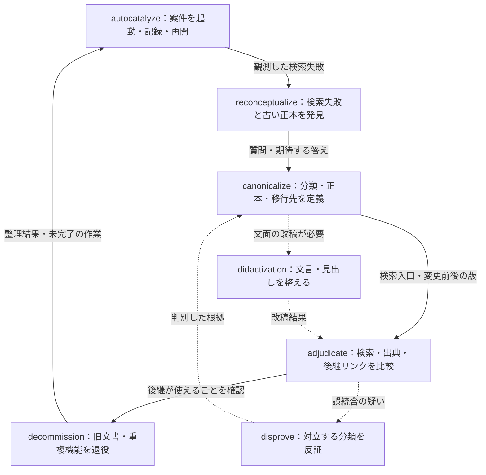
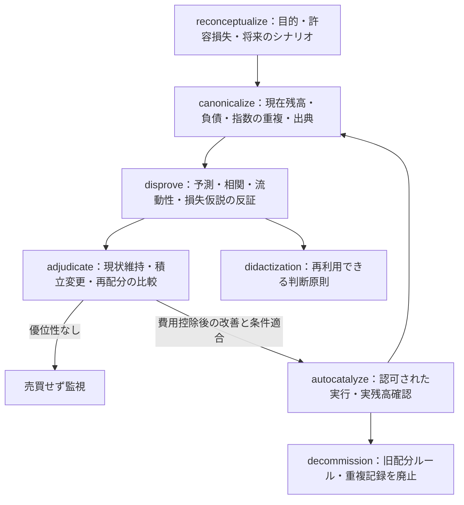
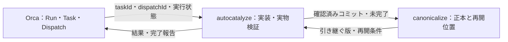
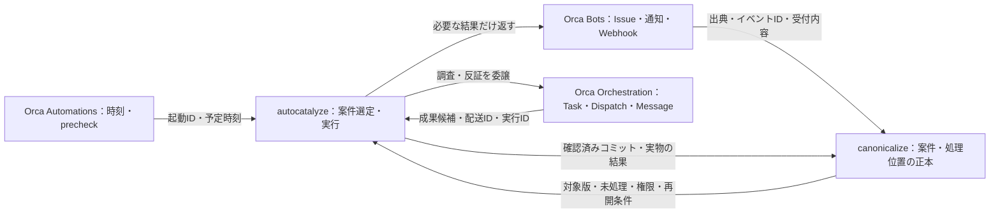

# 聖典台帳

何を判断・検証するかから資料を探す。各項目には一次URL、使う場面、対応するスキルをまとめる。

## 分野から探す

- **設計・評価** [かふかのデザインパターン](#かふかのデザインパターン) · [目標・文章・評価](#目標文章評価)
- **文書・データ** [ノートの管理](#ノートの管理) · [技術白書の執筆](#技術白書の執筆) · [Obsidian](#obsidian) · [データ・オントロジー・命名](#データオントロジー命名)
- **開発・運用** [エージェントとハーネス](#エージェントとハーネス) · [Orca](#orcaでエージェントを監督する) · [常駐エージェント](#常駐エージェント) · [CLI・開発・インフラ](#cli開発インフラ)
- **制作** [UIとComfyUI](#uiとcomfyui) · [ユニティとVRChatの制作ツール](#ユニティとvrchatの制作ツール) · [Tripoと3D生成](#tripoと3d生成)
- **金融・資産運用** [ファンドマネージャーの聖典](#ファンドマネージャーの聖典)
- **書籍・実践例** [AIエンジニアリングの書籍](#aiエンジニアリングの書籍) · [かふかのZenn](#かふかのzenn) · [ISUCONのハーネス](#isuconのハーネス)

[資料の見直し](#資料の見直し) · [台帳の更新手順](MISSION.md) · [評価指標](MISSION.md) · [外部手法への置き換え](MISSION.md)

## 資料の見直し

1. 日次の保守タスクで、資料を掲載している分野を掲載順に一日一つずつ見直す。現行スキルで判断、操作、検証に使う資料を確かめ、公式資料の改訂や直近の作業で足りなかった根拠から候補を探す。
2. 候補の一次資料を開き、同じ作業で現行資料と比べる。判断や手順が具体的に改善するなら入れ替え、既存資料で扱えない用途があれば追加する。用途が重複する資料、公式の後継がある旧資料、現行の用途を示せない個別事例は整理する。公開日や参照回数だけで採否を決めない。改善を確かめられない日は現状を維持する。
3. 変更する場合は、一次URL、用途、対応スキルを台帳に記し、参照元と参照先を同じコミットで更新する。必須の仕様や手順を引き続き確認でき、リンク切れがないことを確かめる。採否の理由は作業記録に残し、台帳には現在使う資料を載せる。

## かふかのデザインパターン

[KAFKA2306/design](https://github.com/KAFKA2306/design) は、KAFKA2306のプロジェクトが共有するWeb UIの設計正本。共通部品、見た目、操作状態の定義は上流を読み、業務ルール、データ、公開環境は各プロジェクトの正本を使う。共有デザインを導入するときは、利用側の `design.config.json` で採用する版をコミットSHAに固定する。

### 利用者の操作の順番

確認して行動する、比較して決める、調査してから行動する、実行して結果を確認する、の中から実際の操作に合う順番を選ぶ。[操作パターンの実装](https://github.com/KAFKA2306/design/blob/main/registry/ui/product/journey.ts)

使うスキルは[目標設定](skills/reconceptualize/SKILL.md)と[自律開発](skills/autocatalyze/SKILL.md)。

### 判断に必要な情報と文言

利用者が結論、理由、根拠、次の操作を見つけられるようにする。実績、予測、仮説、未確認を表示まで区別する。[共通の判断パネル](https://github.com/KAFKA2306/design/blob/main/registry/ui/product/decision.tsx) · [コンテンツのスキーマ](https://github.com/KAFKA2306/design/blob/main/artifacts/content.schema.json)

使うスキルは[データ設計](skills/canonicalize/SKILL.md)と[知見の教材化と推敲](skills/didactization/SKILL.md)。

### 部品と見た目の正本

共通の部品とトークンを使い、同期後の状態を検証する。利用側で同じ値や部品を独立して維持する箇所は、置き換え後に整理する。[設計・同期の手順](https://github.com/KAFKA2306/design/blob/main/skills/frontend-design/SKILL.md#workflow) · [共通トークン](https://github.com/KAFKA2306/design/blob/main/tokens/foundation.tokens.json)

使うスキルは[自律開発](skills/autocatalyze/SKILL.md)と[不要なファイル・コード・文章の削除](skills/decommission/SKILL.md)。

### 画面の評価

[画面評価ガイド](https://github.com/KAFKA2306/design/blob/main/docs/frontend-review.md)（共有デザインの手順）で見た目と操作を確かめる。状態と入力方法の要件は[設計と検証の基準](https://github.com/KAFKA2306/design#current-design-contract)を使う。

使うスキルは[画面の評価](skills/adjudicate/SKILL.md#画面の評価)、[反証レビュー](skills/disprove/SKILL.md)、[目標設定](skills/reconceptualize/SKILL.md)。

## ノートの管理

Obsidianでは、このリポジトリのルートを保管庫として開く。文書と見出しは相対Markdownリンクで結ぶ。ファイル名や見出しを変更したら参照元も更新し、GitHubとObsidianで開けるかを確かめる。GitHub用に空白をハイフンにした見出しリンクがObsidianで開けない場合は、対象の文書を開いてアウトラインから見出しを選ぶ。

管理するMarkdownにはYAML frontmatterを置く。README、記事、スキル、規約、メモに共通して、`type` に文書の種別、`description` に用途を示す日本語の説明、`tags` に空でない検索用リストを書く。OKFの目次と変更ログには下の予約ファイル規則を使う。`aliases` は別名で探す文書に使う。同じキーの型は保管庫内でそろえる。設定ファイルの用途とタグは[作業規約](AGENTS.md)に記録する。

タグは小文字とハイフンを使い、階層は `/` で区切る。YAMLでは `kafstyler/canon` と書く。Obsidianでは `[type:reference] tag:#kafstyler/canon` で種別とタグを組み合わせて検索する。

[保管庫](#obsidianの保管庫)・[内部リンク](#obsidianの内部リンク)・[プロパティ](#obsidianのプロパティ)・[タグ](#obsidianのタグ)・[検索](#obsidianの検索)・[データ設計](skills/canonicalize/SKILL.md)・[文書監査と移行](#文書監査と移行)

### Open Knowledge Format (OKF) v0.3

[Google Cloud・OKF v0.3の発表](https://cloud.google.com/blog/products/data-analytics/introducing-okf-v0-3)（2026年11月18日公開）。2026年11月19日に[公式リポジトリ](https://github.com/open-knowledge-format/open-knowledge-format)の[仕様](https://github.com/open-knowledge-format/open-knowledge-format/blob/main/SPEC.md)、[プラグインの導入手順](https://github.com/open-knowledge-format/open-knowledge-format#agent-skills)、[生成スキル](https://github.com/open-knowledge-format/open-knowledge-format/blob/main/skills/okf-generate/SKILL.md)と[バリデータ](https://github.com/open-knowledge-format/open-knowledge-format/blob/main/skills/okf-generate/scripts/validate.py)、[読み取りスキル](https://github.com/open-knowledge-format/open-knowledge-format/blob/main/skills/okf-consume/SKILL.md)と[検索スクリプト](https://github.com/open-knowledge-format/open-knowledge-format/blob/main/skills/okf-consume/scripts/scan.py)を確認した。

- OKFで知識として扱う文書には、frontmatterに空でない文字列の `type` を付ける。frontmatterや `type` を持たないMarkdownは読み取り時に対象外になる。Kafstylerの検索に必要な追加項目は[ノートの管理](#ノートの管理)を参照する。既存の項目と型を保ち、独自の項目を新設するときは `x-kafstyler-` で始める。[^okf-v03-spec]
- まとまりとして交換する文書群は、ルートの `index.md` に `okf_version: "0.3"` を置く。サブディレクトリの `index.md` と、各階層の `log.md` にはfrontmatterを置かない。文書やファイルは標準のMarkdownリンクで結ぶ。相対パスは参照元のディレクトリ、先頭が `/` のパスは文書群のルートを基準にする。空白は `%20` と書く。[^okf-v03-spec]

[^okf-v03-spec]: OKF v0.3公式仕様、第3〜6節と第8〜9節。

[文書のメタデータを整える](skills/canonicalize/SKILL.md)・[公式OKFスキルを使う](skills/canonicalize/SKILL.md#公式okfスキルを使う)

### 文書監査と移行

文書の分類・検索・統廃合は、読者や後続のAIが**必要な問いに正しい正本と出典から答え、古い版を誤って採用しない**ことを目的とする。最初に実際の検索質問と参照元を選び、既存のMarkdown・frontmatter・索引で解決できるか調べる。ノート数・分類数・プラグイン数を成果とせず、同じ質問で変更前後を比較する。役割の異なる文書を同じ分類へ強制せず、同じ役割の重複は整理する。

| 一次資料 | 文書管理での判断 |
| --- | --- |
| [Diátaxis・Diátaxis as a guide to work](https://diataxis.fr/how-to-use-diataxis/)（設計原典） | 読者が学習・作業・参照・理解のどれを求めているかを確認し、既存文書を少しずつ改善する。分類先の空フォルダを先に量産しない。 |
| [Stanford・Noy / McGuinness「Ontology Development 101」](https://protege.stanford.edu/publications/ontology_development/ontology101-noy-mcguinness.html)（オントロジー設計原著） | 型・階層・関係を増やす前に、知識から答えるべき質問（competency questions）を決める。分類と識別子が実データの問いに答えられるか検証する。 |
| [W3C・SKOS Reference](https://www.w3.org/TR/skos-reference/)（語彙の標準仕様） | 正規名、別名、上位・下位概念を区別する。異なる対象を表記だけで統合せず、同じ対象の表記ゆれを検索可能にする。RDFへの全面移行は目的としない。 |
| [Obsidian・Bases](https://obsidian.md/help/bases)（標準機能の仕様） | Markdownのプロパティの一覧・絞り込み・編集は標準機能から試し、Dataviewや別の表示用台帳と役割を比較する。 |
| [GOV.UK・Transition content to GOV.UK](https://www.gov.uk/guidance/govuk-transition-guidance-for-agencies#audit-your-content)（移行ガイド） | 利用状況・参照元・古さ・重複と旧URLを棚卸しし、移行先と保存先を定める。 |
| [GOV.UK・Retire outdated content](https://guidance.publishing.service.gov.uk/writing-to-gov-uk-standards/plan-manage-content/retire-content/)（公開文書の運用基準） | 旧版を更新・統合・退役するとき、元URLから後継を見つけられるか、検索に旧版が混ざらないかを確かめる。 |
| [Zenn・Zenn CLIで記事・本を管理する方法](https://zenn.dev/zenn/articles/zenn-cli-guide)（公開先の仕様） | Zennへ出す場合だけ、記事種別・ファイル名・公開用メタデータとリポジトリの正本を照合する。 |

各判断・実行手順は [reconceptualize](skills/reconceptualize/SKILL.md)、[canonicalize](skills/canonicalize/SKILL.md)、[adjudicate](skills/adjudicate/SKILL.md)、[decommission](skills/decommission/SKILL.md)、[autocatalyze](skills/autocatalyze/SKILL.md) に置く。改稿時は [didactization](skills/didactization/SKILL.md)、重大な誤統合の検証には [disprove](skills/disprove/SKILL.md) を使う。

### 互換を残さない移行

新しい正本へ切り替える移行では、廃止する旧契約を明示し、旧形式の読み書き・別名・二重ジョブを無期限に維持しない。必要なデータと出典を移してから、通常の入口を確認して旧経路を削除する。公開URLの退役判断は[文書監査と移行](#文書監査と移行)に統合する。

| 一次資料 | 移行での判断 |
| --- | --- |
| [Semantic Versioning 2.0.0](https://semver.org/spec/v2.0.0.html)（公開APIの版規則） | 公開APIを宣言しSemVerで版管理している場合、非互換の変更をMAJOR更新として伝える。単なる内部文書の変更を機械的にMAJORとしない。 |
| [Git・git-rm](https://git-scm.com/docs/git-rm)（公式操作） | 廃止すると確定した追跡ファイルをリポジトリと作業ツリーから外し、過去の変更はGit履歴で確認する。 |

[破壊的移行の共通規約](AGENTS.md#破壊的移行と旧方式の廃止) · [正本の移行](skills/canonicalize/SKILL.md#正本の移行と旧版の整理) · [旧経路の廃止](skills/decommission/SKILL.md) · [移行の実行](skills/autocatalyze/SKILL.md#破壊的移行の実行)

## 目標・文章・評価

### MISSIONとIssueによる案件選定

使命から実行と検証をつなぐときは、**目的と成果の基準**、**個別作業の追跡**、**完成・不採用の判定**を分ける。

| 一次資料 | Kafstylerでの採用判断 |
| --- | --- |
| [Google Cloud・AI/ML Operational excellence](https://docs.cloud.google.com/architecture/framework/perspectives/ai-ml/operational-excellence)（2026年10月29日レビュー） | 解く問題と必要な成果を最初に定め、目的を測定可能な結果へ結び付ける。`reconceptualize` がMISSIONへの寄与を判断し、`adjudicate` が成果を測る。 |
| [GitHub・About issues](https://docs.github.com/en/issues/tracking-your-work-with-issues/learning-about-issues/about-issues)（公式仕様） | Issueを問題・意見・作業の単位として使う。MISSIONや実物の成果をIssueに置き換えず、`canonicalize` が相互参照を保つ。 |
| [GitHub・Planning and tracking work](https://docs.github.com/en/issues/tracking-your-work-with-issues/learning-about-issues/planning-and-tracking-work-for-your-team-or-project)（公式ガイド） | 大きな仕事だけ必要な粒度に分割し、Issue間の依存関係をたどる。`autocatalyze` が実行順を決め、Issue数を成果としない。 |
| [GitHub・Closing an issue](https://docs.github.com/en/issues/tracking-your-work-with-issues/administering-issues/closing-an-issue)（公式仕様） | 解決済みと実行予定なしを区別する。`autocatalyze` は確認した成果を紐付けて閉じ、`decommission` は重複・不要な仕事を整理する。 |

[共通運用](AGENTS.md#missionとissueの運用) · [自律開発](skills/autocatalyze/SKILL.md#missionに沿ったissue駆動) · [正本の統一](skills/canonicalize/SKILL.md#missionとissueの正本関係)

### 問題の再定義と利用者の目的

[Design Council・Double Diamond](https://www.designcouncil.org.uk/resources/the-double-diamond/)（設計原典）。解決策の前に問題を探索・定義する。[GOV.UK・Solve a whole problem for users](https://www.gov.uk/service-manual/service-standard/point-2-solve-a-whole-problem)（公式基準）。利用者が一連の用事を完了できるか確かめる。

[Anthropic・Trustworthy agents in practice](https://www.anthropic.com/research/trustworthy-agents)（エージェントの自律性と監督に関する研究）。個々の可逆的な操作では自律性を生かし、利用者の目的が不明な判断や重大な変更では上位の方針と権限を確認する。質問を増やすことと、必要な判断を得ることを区別する。

[目標設定](skills/reconceptualize/SKILL.md) · [自律開発](skills/autocatalyze/SKILL.md)

### 自律的な問題発見と概念再構築

`reconceptualize` は要求された解決策を順位付けする前に、実績、再発、利用のつまずき、維持費、既存の機能が生む負担から**取り組む価値がある問題**を見つける。発見した事実と原因の仮説を分け、現状維持・削除・再利用・根本的な再設計を比較する。採用した案は `autocatalyze` に渡し、実測の変化から問題設定自体の妥当性を評価する。

| 一次資料 | Kafstylerで使う判断 |
| --- | --- |
| [Donald A. Schön・The Reflective Practitioner](https://books.google.com/books?id=oYNHAAAAMAAJ)（1983年、原著の書誌） | 与えられた課題の解決以前に、何を問題として設定したのかを問い直す。 |
| [Kees Dorst・Frame Innovation](https://mitpress.mit.edu/9780262328852/frame-innovation/)（MIT Press、2015年） | 既存解決策の改良と、問題の捉え方を変更する案を明確に分ける。 |
| [Ackoff、Magidson、Addison・Idealized Design](https://www.oreilly.com/library/view/idealized-design-creating/0131963635/ch01.html)（2006年、原著第1章） | 現行機能から積み上げるだけでなく、望ましい完成状態から必要な構造を考える。 |
| [Chris Argyris・Double Loop Learning in Organizations](https://hbr.org/1977/09/double-loop-learning-in-organizations)（Harvard Business Review、1977年） | 期待した成果が出ないとき、実装の修正だけでなく目標・前提・判断基準まで戻る。 |
| [Richard Hamming・You and Your Research](https://www.cs.virginia.edu/~robins/YouAndYourResearch)（1986年講演の記録） | 簡単に片付く仕事ではなく、影響が大きく進展可能な問題を選ぶ。 |
| [Teresa Torres・Prioritize Opportunities, Not Solutions](https://www.producttalk.org/prioritize-opportunities/)（2019年、著者の記事） | Issueや機能案の前に、利用者の未充足の用事・障害を選定する。 |
| [Jeongほか・TIDE: Proactive Multi-Problem Discovery via Template-Guided Iteration](https://arxiv.org/abs/2606.04743)（2026年、研究論文） | 明示されていない問題を証拠付きで探索する。発見済みの証拠を次の探索に引き継ぎ、重複した問題の列挙を避ける。 |
| [Gloaguenほか・Coding Agents Don't Know When to Act](https://www.sri.inf.ethz.ch/publications/gloaguen2026coding)（2026年、FixedBench） | 既に解決した問題や修正不要な状態を見分け、何もしない判断を成功に含める。 |
| [SWE-sweep](https://swesweep.com/)（2026年、研究・評価基盤） | 具体的な修正箇所を与えない状況で、実際に問題を発見・修復できるかを評価する。 |

これらは同じ証拠水準ではない。書籍・講演・設計記事は問題設定の方法論、TIDE・FixedBench・SWE-sweepはAIエージェントの観測・評価に使う。研究結果をKafstylerでの改善実績と取り違えず、実際の利用結果で採否を確かめる。

[概念再構築](skills/reconceptualize/SKILL.md#自律的に問題を発見して再構築する) · [継続実行と案件選定](skills/autocatalyze/SKILL.md#常時稼働エージェントの中核)

### 評価指標のすり替えと独立した検証

- [Google DeepMind・Specification gaming](https://deepmind.google/blog/specification-gaming-the-flip-side-of-ai-ingenuity/)（開発元の事例）。指標を満たしても本来の目的を達成しない問題を扱う。
- [OpenAI・Evaluation best practices](https://developers.openai.com/api/docs/guides/evaluation-best-practices)（公式ガイド）。評価入力と実装を分離する。
- [OpenAI・How we monitor internal coding agents for misalignment](https://openai.com/index/how-we-monitor-internal-coding-agents-misalignment/)（開発元の事例）。テスト操作や監視の限界を踏まえる。
- [Center for Open Science・Preregistration](https://www.cos.io/initiatives/prereg)（研究手法の原典）。探索と確証の判定条件を区別する。

[評価と比較](skills/adjudicate/SKILL.md) · [反証レビュー](skills/disprove/SKILL.md)

### 合成回答と人間の判断を区別する

- [Maierほか・LLMs Reproduce Human Purchase Intent via Semantic Similarity Elicitation of Likert Ratings](https://arxiv.org/abs/2510.08338)（PyMC Labs・Colgate-Palmolive共同研究、arXiv v3、2025年）。LLMの自由記述を意味類似性で5段階の回答分布に変換するSSRを、57件の商品コンセプト調査・実回答者9,300人で比較した。商品間の購買意向平均の相関は、人間の回答者を二分した場合の相関の約90%に達したが、実際の購買の予測精度ではない。回答の変換に使う基準文は同じ57調査に合わせて調整されており、別の商品群で同じ精度になるかは確かめられていない。
- [Bisbeeほか・Synthetic Replacements for Human Survey Data? The Perils of Large Language Models](https://www.cambridge.org/core/journals/political-analysis/article/synthetic-replacements-for-human-survey-data-the-perils-of-large-language-models/B92267DC26195C7F36E63EA04A47D2FE)（Political Analysis、2024年）。政治意識調査では合成回答の平均が実調査に近くても、回答のばらつきや属性との関係が食い違い、実際の回答者の代理として推論すると結論が変わった。SSRそのものの追試ではない。回答分布の一致だけでなく、意思決定に必要な関係を実測で照合する。
- [AAPOR・Making Good Choices—and Explaining Them](https://aapor.org/announcements/making-good-choices/)（米国世論調査研究協会、2026年）。AIが生成した回答を人間から回収した回答と区別し、生成・検証の方法を明示する。ペルソナ別の模擬回答は仮説の発見に使い、利用者の需要や行動を確定する根拠には実際の人間による観測を用いる。

[評価と比較](skills/adjudicate/SKILL.md) · [反証レビュー](skills/disprove/SKILL.md) · [利用者の目的](skills/reconceptualize/SKILL.md)

### 減算による解決

- [Adamsほか・People systematically overlook subtractive changes](https://www.nature.com/articles/s41586-021-03380-y)（Nature誌の人間行動研究）。削除案を明示的に探す。AIの性質を直接実証した研究ではない。
- [Martin Fowler・Yagni](https://martinfowler.com/bliki/Yagni.html)（設計原典）。不要な機能を先回りして足さない。
- [Google SRE・Eliminating Toil](https://sre.google/workbook/eliminating-toil/)（公式手引き）。作業の自動化だけでなく発生源を取り除く。

[不要なファイル・コード・文章の削除](skills/decommission/SKILL.md) · [自律開発](skills/autocatalyze/SKILL.md)

### 登大遊の論理的思考

[登大遊・論理的思考の放棄](https://softether.hatenadiary.org/entry/20070324/p1)（原典）。完成時の利用場面を先に思い描く。整理では、完成像と現状の差から候補を見つけ、普段の入口で変更の結果を確かめる。

[目標設定](skills/reconceptualize/SKILL.md)・[不要なファイル・コード・文章の削除](skills/decommission/SKILL.md)

### Claude Codeの実践

[Anthropic・Claude Codeの実践ガイド](https://code.claude.com/docs/en/best-practices)（公式ガイド）。依頼の範囲、検証、作業の進め方

[目標設定](skills/reconceptualize/SKILL.md) · [自律開発](skills/autocatalyze/SKILL.md)

### Claude Codeの検証

[Addy Osmani・How the Claude Code team thinks about verification](https://claude.dev/blog/how-the-claude-code-team-thinks-about-verification/)（Claude Codeチームの公式技術記事、2026年11月16日公開、11月19日確認）。

- 利用者の入口から実物を最後まで動かす。入力にかかわらず守る条件は性質ベースのテストで試し、挙動を保つ移行は旧版と新版に同じ入力を与えて比べる。
- 実装前に、依頼と変更前の信頼できる版から、期待する結果と合格条件を決める。検証では対象の版を固定し、手間の少ない確認から始める。過去の障害に基づく検査は、変更内容に関係するものを選ぶ。観測した結果は次のレビューに引き継ぐ。
- 必須にするチェックの候補は、合否の判定に使う前に実行結果を記録し、誤検知を調べる。実際の障害と安定していた変更で検証手順を試し、見逃しを再現できたら手順を直す。重複や不安定な判定も定期的に見直す。

| スキル | 適用する工程 |
| --- | --- |
| [reconceptualize](skills/reconceptualize/SKILL.md) | 作業前に入口、入力、最後に観測する結果を決める |
| [didactization](skills/didactization/SKILL.md#本文の推敲と提出前の確認) | 原意と出典を守り、読者の入口で推敲稿と教材の再現性を確かめる |
| [canonicalize](skills/canonicalize/SKILL.md#完了条件) | 読み書きの契約、旧データとの互換、再処理を確かめる |
| [disprove](skills/disprove/SKILL.md) | 対象版と判定基準を固定し、差分から過去の失敗を選ぶ |
| [decommission](skills/decommission/SKILL.md) | 削除前後に利用経路と、残した検査が拾う失敗を確かめる |
| [adjudicate](skills/adjudicate/SKILL.md#検証手順の評価) | 不変条件と旧版との比較を設計し、評価手順自体の精度も測る |
| [autocatalyze](skills/autocatalyze/SKILL.md#実装と検証) | 既存の検査を先に実行し、普段の入口から結果を読み戻す |

### 成功基準と評価

[Anthropic・成功基準と評価の設計](https://platform.claude.com/docs/en/test-and-evaluate/develop-tests)（公式ガイド）。成功条件、テストケース、採点方法

[GOV.UK・利用者テスト](https://www.gov.uk/service-manual/user-research/using-moderated-usability-testing)（公式手引き）。文書、ツール、画面の用途が分かりづらいときは、普段の入口で初見の理解と作業の完了をそれぞれ確かめる。利用者には目標を伝え、手順は伏せる。評価では、対象の版、止まった箇所、観察した事実、利用者への影響、修正後の合格条件を返す。用途を確認できない場合は未確定とし、試せた範囲を伝える。

[評価と比較](skills/adjudicate/SKILL.md) · [反証レビュー](skills/disprove/SKILL.md)

### imozの日本語編集

[imoz・日本語の文章編集ガイド](https://imoz.jp/humanizer.ja.txt)（編集ガイド）。人が読む文章の執筆と推敲

[評価と比較](skills/adjudicate/SKILL.md) · [自律開発](skills/autocatalyze/SKILL.md) · [データ設計](skills/canonicalize/SKILL.md) · [反証レビュー](skills/disprove/SKILL.md) · [知見の教材化と推敲](skills/didactization/SKILL.md) · [目標設定](skills/reconceptualize/SKILL.md) · [不要なファイル・コード・文章の削除](skills/decommission/SKILL.md)

### 読者から記事を設計する

- [英国国家統計局・Designing content to meet user needs](https://service-manual.ons.gov.uk/content/writing-for-users/user-needs)（公式編集ガイド）。読者が何をしたいかを根拠から把握し、何ができれば記事がその用事に応えたといえるかを執筆前に決める。
- [Nielsen Norman Group・The Layer-Cake Pattern of Scanning Content on the Web](https://www.nngroup.com/articles/layer-cake-pattern-scanning/)（視線計測の研究報告）。見出しを拾い読みして必要な本文を探す行動を踏まえ、見出しだけでも答えの場所を見つけられるかを確かめる。

[知見の教材化と推敲](skills/didactization/SKILL.md#記事を読者から設計する)

### 知見を残す記事の基準

- [GOV.UK・Understand content design](https://guidance.publishing.service.gov.uk/writing-to-gov-uk-standards/plan-manage-content/understand-content-design/)（英国政府の公式編集ガイド）。執筆前に読者の用事を確かめ、新規記事を作るか既存記事を更新・統合するか判断する。
- [Meinckeほか・ChatGPT decreases idea diversity in brainstorming](https://www.nature.com/articles/s41562-025-02173-x)（Nature Human Behaviour、2025年）。ブレーンストーミングで案の質が高まっても、集合としての多様性が下がる場合がある。文章一般への証明とは扱わず、独自の観測のない記事が既存記事と重複しないか確認する際に参照する。
- [Huangほか・Large Language Models Cannot Self-Correct Reasoning Yet](https://proceedings.iclr.cc/paper_files/paper/2024/hash/8b4add8b0aa8749d80a34ca5d941c355-Abstract-Conference.html)（ICLR 2024）。外部フィードバックなしの推論の自己訂正には限界がある。記事の正確さは原資料・実行結果・独立した判定で確かめる。ただし、すべてのモデル・課題で自己訂正が不可能という主張ではない。

[教材化と改稿](skills/didactization/SKILL.md#発見を汎用原則に変える) · [規則の費用対効果](AGENTS.md)

### 技術白書の執筆

- [George Mason University Writing Center・White Papers](https://writingcenter.gmu.edu/writing-resources/different-genres/white-papers)（大学の執筆ガイド）。白書を問題と解決策の検討として構成し、判断基準、代替案、根拠、推奨を必要に応じて示す。販売促進を目的とする白書とは区別する。
- [NIST・Technical Series Publications Author Instructions](https://www.nist.gov/nist-research-library/nist-technical-series-publications-author-instructions)（米国国立標準技術研究所の技術報告作成指針）。要旨、本文、参考文献、図表、単位、版の扱いを参考に、主張を一次資料・測定条件・結果へたどれるようにする。NIST固有の出版手続きは一般の白書に適用しない。

[技術白書を書く](skills/didactization/SKILL.md#技術白書を構成する) · [評価と比較](skills/adjudicate/SKILL.md) · [反証レビュー](skills/disprove/SKILL.md)

### 成果物の根拠と読みやすさ

- [MaryCache・imozuru](https://github.com/MaryCache/imozuru)（公式リポジトリ）。分野の用語、文献、引用をたどり、判断を支える原文の場所を調べる。
- [nanaism・yomiyasu](https://github.com/nanaism/yomiyasu)（公式リポジトリ）。主張と条件を保ち、人が読む日本語を推敲する。

[成果物の確認手順](AGENTS.md) · [導入手順](README.md) · [反証レビュー](skills/disprove/SKILL.md#成果物の理由を確かめる)

## ファンドマネージャーの聖典

**投資戦略の正本は相場予測ではなく、目的・許容損失・全資産の実質リスク・行動規則である。** AI需要の成長、企業収益、株価、信用市場の安定を別の変数として扱う。2027年のAIバブル崩壊を前提に資産を動かすことも、好況が永続する前提で集中することもしない。予測が外れた場合にも資金需要を満たし、長期運用を続けられるかを優先する。

この運用方針では**個別株は調査対象、新規投資は指数商品**とする。個別企業のPER・成長率・ニュースを指数全体の売買根拠へ直結させない。投資行動の変更は、投資方針書（IPS）で決めた条件、現在の保有残高、投資可能資金、税・費用、代替案との比較によって決める。

### 投資戦略を組み立てる原典

| 役割 | 一次資料 | 適用する判断 |
| --- | --- | --- |
| 目的と制約 | [CFA Institute・Basics of Portfolio Planning and Construction（2026）](https://www.cfainstitute.org/insights/professional-learning/refresher-readings/2026/basics-of-portfolio-planning-and-construction) | 目的、期間、最大許容損失、流動性、税・法的制約、資金需要をIPSにまとめる。 |
| 全体最適 | [CFA Institute・Total Portfolio Approach（2026）](https://rpc.cfainstitute.org/research/reports/2026/total-portfolio-approach) | 商品や資産区分ごとの局所最適ではなく、全資産の収益・リスク・流動性への寄与で判断する。 |
| 配分の根拠 | [CFA Institute・Principles of Asset Allocation（2026）](https://www.cfainstitute.org/insights/professional-learning/refresher-readings/2026/principles-asset-allocation) | 負債・支出予定に対する配分を複数シナリオで比べ、戦略配分と実装の点検頻度を分ける。 |
| 商品を超えたリスク | [MSCI・Total-Portfolio Approach: Framework in Practice（2026-11-12）](https://www.msci.com/research-and-insights/paper/total-portfolio-approach-framework-in-practice) | 銘柄数・商品名ではなく、共通株式要因、金利、信用、為替、流動性、レバレッジで重複を可視化する。 |
| 期待収益の推定 | [AQR・Ilmanen『Expected Returns』（2011）](https://www.aqr.com/insights/research/book/expected-returns-an-investors-guide-to-harvesting-market-rewards) | 過去の高収益を将来の期待値とせず、評価水準・利回り・リスク要因・推定誤差を分ける。 |
| 継続可能な運用 | [Vanguard・Four Principles for Investment Success](https://corporate.vanguard.com/content/corporatesite/us/en/corp/about-our-funds/how-we-invest/principles-for-investing-success.html) | 目的、分散、低コスト、規律を優先する。新規資金と許容乖離に基づく再配分を基本とし、相場の気分で頻繁に売買しない。 |
| 実績の評価 | [CFA Institute・Portfolio Performance Evaluation（2026）](https://www.cfainstitute.org/insights/professional-learning/refresher-readings/2026/portfolio-performance-evaluation) | 実口座の損益、ベンチマーク、配分寄与、売買・税・信託報酬を分け、バックテストを実績と呼ばない。 |

### 信用膨張・AI設備投資を読む原典

| 役割 | 一次資料 | 適用する判断 |
| --- | --- | --- |
| 金融不安定性 | [Hyman Minsky・The Financial Instability Hypothesis（1992）](https://www.levyinstitute.org/pubs/wp74.pdf) | 好況期に金融構造が脆弱化し得る。支払能力、借換え依存、資産売却が連鎖する条件を検証する。 |
| 循環取引 | [BIS Bulletin 137・Circular relationships among AI firms（2026）](https://www.bis.org/publications/bulletin-137-circular-relationships-among-ai-firms) | AI関連企業間の投資・供給・売上の重なりを調べ、資金移転と最終需要を区別する。 |
| 信用の構造 | [BIS Bulletin 140・Building AI on credit（2026）](https://www.bis.org/publications/bulletin-140-building-ai-credit--structures-and-spillovers) | 長期借入、証券化、簿外の約束、信用補完、銀行・債券市場への波及を追う。 |
| 金融安定性 | [ECB・The debt financing of AI and its implications for financial stability（2026-11）](https://www.ecb.europa.eu/press/financial-stability-publications/fsr/focus/2026/html/ecb.fsrbox202611_03~4fd1449eaa.en.html) | 設備投資と営業キャッシュフローの差、契約債務、信用格付け、循環的な収益見込みを確認する。 |

### 正本にするデータと、正本にしない数字

`canonicalize` は証券会社の最新残高、現預金・借入、取得単価、口座区分、NISA枠、生活資金、保有指数の組入れと実質エクスポージャーを、評価日・通貨・取得元付きで統一する。指数の中身は [MSCI Index Methodology](https://www.msci.com/indexes/index-resources/index-methodology) と [S&P U.S. Indices Methodology](https://www.spglobal.com/spdji/en/methodology/article/sp-us-indices-methodology/) を原則として原典で確認する。

同じ企業がS&P500、全世界株、NASDAQ100、Top10集中指数に含まれていても、別の分散先と数えない。株式100%相当＋金100%相当の複合商品は、口数や純資産比率だけでなく、株式と金の**各100%相当の感応度**を別々に計上する。為替、先物の費用、取引条件、相関の変化も考慮する。

過去の保有状況、再構成ポートフォリオ、将来の崩壊確率、PER、政策金利予測は、取得日時と出典を持つ**観測値・推定値・シナリオ**として保存する。過去の比率やバックキャストの高いリターンを将来の目標配分として固定しない。予測市場の価格やSNSの発言を、現実の破綻確率や売買指示へ昇格させない。

### 予測から行動規則へ移す

1. **目的を決める。** 生活防衛資金、円建て支出予定、運用期間、強制売却なく耐えられる損失を先に確定する。未確定の許容損失を、一般論の「最適配分」で埋めない。
2. **現状を測る。** 全商品の重複、株式・金・債券・信用・為替の感応度、レバレッジ、流動性、税区分を全資産で計算する。資産割合と損失への寄与を別に表示する。
3. **代替案を比較する。** 現状維持、今後の積立先だけを変更、必要な一部再配分の順で、長期期待収益、悲観時の円建て損失、資金不足、税・費用を同じ条件で比べる。予測への依存が強い「最適解」より、前提が変わっても機能する案を選ぶ。
4. **シナリオを先に決める。** AI投資の成功、AI需要成長下での株価下落、設備投資縮小、信用収縮を区別する。各シナリオで「何を観測し、配分・許容損失・生活資金のどれを再評価するか」を定め、結果が出る前の値動きだけで断定しない。
5. **実行と検証を分ける。** 新規資金による乖離縮小を優先し、売却が必要な場合だけ税・NISA・費用を試算する。事前に定めた許容乖離と定期レビューで見直す。売買後に同じ全資産指標と実残高を再計算する。

### AI信用リスクの監視と判断の境界

営業キャッシュフローと設備投資の差、借入の満期と借換え費用、債券・プライベートクレジットのスプレッド、簿外契約、設備稼働率、顧客の最終需要を監視する。これらは危機の**伝播経路**を調べる指標であり、一つの指標悪化だけで「2027年に崩壊する」と判断する規則ではない。市場の暴落時にも、生活資金の不足と資産配分の乖離を別々に判断する。

`reconceptualize` は「何が上がるか」から「どうすれば全資産と生活計画が破綻しないか」へ問題を再設定する。`disprove` はAI需要、収益化、金融逼迫、価格への織込みを独立に反証する。`adjudicate` は現状維持を含む候補の改善が税・費用控除後にも残るか比較する。`autocatalyze` は認可された実行と結果の読み戻しを担う。`didactization` は将来も使える原則だけを残し、`decommission` は旧戦略の重複・相反する売買規則を退役させる。

[正本の統一](skills/canonicalize/SKILL.md) · [反証](skills/disprove/SKILL.md) · [採否](skills/adjudicate/SKILL.md) · [自律実行](skills/autocatalyze/SKILL.md)

## エージェントとハーネス

### Claude Agent SDK

[Anthropic・Agent SDK overview](https://code.claude.com/docs/en/agent-sdk)（公式ガイド）。実行場所と必要な機能に応じて方式を選ぶ。

| やりたいこと | 選ぶ方式 |
| --- | --- |
| 自分で運用するPython・TypeScriptアプリにClaude Codeのツール、エージェントループ、セッションを組み込む | Claude Agent SDK |
| 端末で対話して開発する、または単発の処理を実行する | Claude Code CLI |
| Claude APIを直接呼び、ツール処理をアプリ側で組み立てる | Client SDK |
| Anthropicが運用するエージェントの実行基盤をAPIから使う | Claude Managed Agents |

[プラグインの読み込み](https://code.claude.com/docs/en/agent-sdk/plugins)・[ツールの権限設定](https://code.claude.com/docs/en/agent-sdk/permissions)（公式仕様）。[導入と確認](skills/autocatalyze/SKILL.md#claude-agent-sdkでの実装)

### スキルの執筆

[Anthropic・Agent Skills執筆ガイド](https://platform.claude.com/docs/en/agents-and-tools/agent-skills/best-practices)（公式ガイド）。スキルの記述、検証、手直し

[自律開発](skills/autocatalyze/SKILL.md) · [不要なファイル・コード・文章の削除](skills/decommission/SKILL.md)

### Claude Codeのスキル

[Anthropic・Claude Code Skills](https://code.claude.com/docs/en/skills)（公式仕様）。スキルの配置と呼び出し

[自律開発](skills/autocatalyze/SKILL.md)

### Claude Codeのコマンド一覧

[Anthropic・Claude Codeのコマンド一覧](https://code.claude.com/docs/en/commands#all-commands)（公式リファレンス）。組み込みコマンド、同梱スキル、ワークフロー、別名との名前の重複を確かめる。

[作業規約](AGENTS.md)

### Claude Codeのloop

[Anthropic・Run prompts on a schedule](https://code.claude.com/docs/en/scheduled-tasks#run-a-prompt-repeatedly-with-loop)（公式リファレンス）。`/loop` からのスキルの定期実行、実行条件、ジョブの解除を確認する。

[自律開発の連携手順](skills/autocatalyze/SKILL.md)

### Claude Codeのフック

Anthropic・Hooks reference（公式リファレンス、2026年11月19日確認。一次資料URLは冒頭の `sources.anthropic-hooks` に記録）。[設定場所](https://code.claude.com/docs/en/hooks#hook-locations)、[matcher](https://code.claude.com/docs/en/hooks#matcher-patterns)、[イベント別の発火条件・入出力・判定制御](https://code.claude.com/docs/en/hooks#hook-events)を確認する。[^anthropic-hooks]

- Kafstylerで使うイベントは [SessionStart](https://code.claude.com/docs/en/hooks#sessionstart) と [UserPromptSubmit](https://code.claude.com/docs/en/hooks#userpromptsubmit)。[作業規約](AGENTS.md)
- ツール実行前の遮断は [PreToolUse](https://code.claude.com/docs/en/hooks#pretooluse-decision-control)。起動失敗やタイムアウト時も遮断する場合は [onFailureの適用条件](https://code.claude.com/docs/en/hooks#block-the-action-when-a-hook-fails) を参照する。
- 応答終了時の自動チェックは [Stop](https://code.claude.com/docs/en/hooks#stop)。作業を続ける条件と、再実行を打ち切る条件を決める。

[作業中の版で試す](README.md)・[発火の確認](https://code.claude.com/docs/en/hooks#debug-hooks)

[^anthropic-hooks]: Hooks referenceの「Configuration」「Hook events」「Debug hooks」。

### プラグインの作成

[Anthropic・Claude Codeプラグインの作成](https://code.claude.com/docs/en/plugins/create)（公式ガイド）。プラグインの作成と検証

[自律開発](skills/autocatalyze/SKILL.md)

### Codexのプラグインとフック

- [OpenAI・プラグインの構成](https://developers.openai.com/plugins/build/plugins)（公式仕様）。Codexのマニフェスト、同梱スキル、フックを定義する。
- [OpenAI・Codexのフック](https://learn.chatgpt.com/docs/hooks)（公式仕様）。フックの承認、各イベントの入力と出力、続行条件を確認する。
- [OpenAI・Codexのプラグインコマンド](https://learn.chatgpt.com/docs/developer-commands#codex-plugin)（公式リファレンス）。配布元の登録、インストール、更新に使う。
- [OpenAI・スキルの作成と実行](https://learn.chatgpt.com/docs/build-skills)（公式ガイド）。同梱したスキルの検出と利用方法を確認する。

[作業規約](AGENTS.md)・[導入手順](README.md)

### Antigravity CLIの配布と実行

- [Google・Antigravity CLIの導入](https://antigravity.google/docs/getting-started?tab=cli)、[更新履歴](https://antigravity.google/docs/changelog?tab=cli)、[更新のトラブルシューティング](https://antigravity.google/docs/cli/troubleshooting#resolve-self-updater-locks-and-failures)（公式手順・更新履歴）。OSごとの既定パス、稼働版、更新先の所有者と書き込み権限を確かめる。
- [Google・プラグインの作成](https://antigravity.google/docs/build-plugins/)、[マニフェストのJSON Schema](https://antigravity.google/schemas/v1/plugin.json)、[CLIでのプラグイン管理](https://antigravity.google/docs/plugins?tab=cli)（公式仕様・リファレンス）。マニフェスト、同梱スキル、常時有効なルールの配置とGitHubからの導入を確かめる。
- [Google・認証](https://antigravity.google/docs/install?tab=cli)、[モデルの選び方](https://antigravity.google/docs/models#gemini-4-neon)、[ヘッドレス実行](https://antigravity.google/docs/cli/headless/)（公式リファレンス）。実行ユーザーの認証、利用可能なモデルID、待ち時間、JSONと標準エラーでの結果判定を確かめる。
- [Microsoft・PowerShellのGet-Command](https://learn.microsoft.com/en-us/powershell/module/microsoft.powershell.core/get-command)、[WSLの相互運用設定](https://learn.microsoft.com/en-us/windows/wsl/wsl-config#interop-settings)（公式リファレンス）。PATHから解決したCLIを特定し、WSLでもWindows側のPATHが追加される設定を確認する。

[配布版の導入](README.md)・[ヘッドレスでレビューする](skills/autocatalyze/SKILL.md#antigravity-cliでレビューする)

### Orcaでエージェントを監督する

[Stably AI・Orca公式ドキュメント](https://orca.dev/docs)・[公式リポジトリ](https://github.com/stablyai/orca)。OrcaはClaude Code・Codex・Antigravityなどを動かし、端末・作業場所・ワーカーを監督する実行環境。Kafstylerの7 Skillsと正本を置き換えず、`autocatalyze`の委譲と引き継ぎを補助する。

| Orca公式一次資料 | Kafstylerへの適用 |
| --- | --- |
| [CLI overview](https://orca.dev/docs/cli/overview) | `orca status --json`で接続を確認し、端末・作業場所をCLIで観測する。 |
| [Skills registry & MCP](https://orca.dev/docs/cli/skills) | OrcaはClaude/Codex等のSkill配置を発見する。`skills/<name>/SKILL.md`を持つリポジトリからSkillsを導入できる。Orca固有の操作は実行版に合う`orca skills get <topic>`を参照し、Kafstylerの7 Skillsを複製しない。 |
| [Orchestration](https://orca.dev/docs/cli/orchestration) | Run・Task・Dispatchとワーカーを使い、`taskId`・`dispatchId`を含む完了通知を照合する。ワーカーの終了だけでは公開成果の合格としない。 |
| [Worktree checkpoints](https://orca.dev/docs/cli/worktree-checkpoints) | 作業コメントの更新前に`orca worktree current --json`を読む。長期の作業ID・確認済みコミット・再開位置は`canonicalize`が既存のIssueや実行履歴に置く。 |
| [Agent hooks & memory](https://orca.dev/docs/agents/hooks-memory) | `orca agent hooks status --json`でOrca管理の状態通知フックを調べ、必要なら`on`/`off`で切り替える。状態通知と実行許可を混同しない。承認エラーの解決に別の強制フックを足さない。 |
| [Scheduled automations](https://orca.dev/docs/cli/automations) | 既存スケジューラーと実行元を照合し、同じ案件を二重起動しない。既存の作業場所を使う場合は`--workspace`を選ぶ。 |

**規約の優先順位。** [Kafstylerの共通規約](AGENTS.md#orcaなど外部実行環境との優先順位)をOrcaの既定動作・Botテンプレートより優先する。Orcaの新規worktree作成は、[公式Worktrees仕様](https://orca.dev/docs/model/worktrees)にある標準の運用であり、[Botのコード変更](https://orca.dev/docs/bots)も通常は新たなworktreeに委譲する。Kafstylerの対象では既存の`main`チェックアウトを使い、`worker-start --worktree current`や`agent launch --worktree path:<既存パス>`のように対象を明示する。共有checkoutへの書き込みを直列化し、別リポジトリや読み取り専用の作業だけを並列実行する。UI表示・実行受付・Gitコミット・利用者の入口での動作は別々に照合する。Orcaの`orca.yaml`で作業ブランチ禁止を強制する公式キーは確認できないため、存在しない設定を作らない。

[Orcaの実行手順](skills/autocatalyze/SKILL.md#orcaで監督して実行する) · [Orcaから使う](README.md#orca)

### Orcaを横断運用の実行基盤にする

Orcaが持つ画面・CLI・遠隔実行を`autocatalyze`の仕事に沿って使う。新しいKafstyler Skill、独自のOrca Bot台帳、各リポジトリの重複ジョブは増やさない。

| 公式一次資料 | 大規模運用での使い方 |
| --- | --- |
| [Orca CLI reference](https://orca.dev/docs/cli/reference)・[セッション検索](https://orca.dev/docs/cli/reference#session-search) | `orca search`で複数AIの失敗を探し、`orca terminal list/show/read/wait/send`で既存端末を観測・操作する。再起動後は端末ハンドルを取り直し、端末が見つからない場合も`hostScope`が対象ホストを含まなければ終了と断定しない。結果は`canonicalize`の既存履歴と結ぶ。 |
| [Orchestration](https://orca.dev/docs/cli/orchestration) | Runは名前空間であって起動装置ではない。`run-create`・`task-create`後に`worker-start`で明示的に担当を起動する。`worker_done`の`taskId`・`dispatchId`を照合し、Deliveryは全メッセージを処理してからack、検証後は`worker-release`する。質問には`ask`、依存判断には必要時のみgateを使う。別リポジトリや読み取り専用調査を並列化し、同じ`main`への書き込みは直列化する。旧`orchestration run`は使わない。 |
| [Bots](https://orca.dev/docs/bots)・[ユースケース](https://orca.dev/docs/bots/use-cases) | GitHub等のイベントから障害・Issue・レビューの候補を拾い、まず読み取り専用のトリアージに使う。Botの標準コード変更は新規worktreeなので、Kafstyler管轄リポジトリの書き込みにはそのまま使わない。 |
| [Scheduled automations](https://orca.dev/docs/cli/automations) | `--workspace`で既存作業場所を使い、`--precheck`で差分なしの起動を省く。既存の定期処理が同じ役割なら新規登録せず、移行時は旧経路を止めて読み戻す。 |
| [CLI browser automation](https://orca.dev/docs/cli/overview#browser-automation)・[Browser profiles](https://orca.dev/docs/cli/overview#browser-profiles)・[Computer use](https://orca.dev/docs/cli/computer-use) | 公開Webは`orca goto`→`orca snapshot`→操作→再snapshot/スクリーンショットで検証し、認証状態が異なる検証はBrowser profileを使い分ける。デスクトップアプリは`computer-use`、Android端末・AVDは必要時に`orca-emulator-android`を選ぶ。APIや直接取得できる結果があれば優先する。 |
| [Remote Orca Servers](https://orca.dev/docs/ways-to-run)・[モバイル](https://orca.dev/docs/mobile) | 複数PCの実行状態と利用者の確認依頼を遠隔から見届ける。ホストの稼働、接続、認可を確認し、端末上で未実行の仕事を完了扱いしない。 |
| [Usage & rate-limit tracking](https://orca.dev/docs/agents/usage-tracking)・[CLI agent launch](https://orca.dev/docs/cli/reference) | 各CLIの利用枠と実際に指定できるモデルを確認し、Kafstylerのモデル選定方針を利用可能な実行担当へ割り当てる。公開評価の候補とそのホストで使えるIDを分ける。 |

[Orcaの実行手順](skills/autocatalyze/SKILL.md#orcaで監督して実行する) · [成果までの運用設計](skills/autocatalyze/SKILL.md#orcaの横断運用)

### Orcaを常駐・通信基盤として使う

**Kafstylerの7 Skillsは各Agent共通のままにする。** Orcaが担うのは常駐ホスト・起動・外部通信・作業中の連絡であり、判断と完成判定は`autocatalyze`、案件・成果の正本は`canonicalize`が担う。OrcaネイティブPluginの[`contributes.skills`](https://github.com/stablyai/orca/blob/main/docs/reference/plugin-manifest.md)は公式マニフェストで予約済みのため、既存Skillsの置き換えに使わない。

| 公式一次資料 | 運用で使う仕組み |
| --- | --- |
| [Scheduled automations](https://orca.dev/docs/cli/automations) | CLIから定時・cron・RRULEで起動。既存`main`には`--workspace`で対象を固定し、最初は`--disabled`で登録。`--precheck`は終了コード0なら実行し、非0ならスキップする。スケジュールのホスト・タイムゾーン・最終結果は`list`・`show`・`runs`で読み戻す。 |
| [Automationの再開と実行引数](https://orca.dev/docs/cli/automations#reuse-an-existing-automation-session) | `--reuse-session`は既存Workspaceの生きたセッションを再利用する場合だけ。通常は新しいセッションと既存作業履歴の引き継ぎを使う。`--extra-agent-args`のモデル・effort指定は新規セッション用で、再利用と併用しない。欠席回の再実行猶予は`--missed-run-grace-minutes`で指定できる。 |
| [Bots quickstart](https://orca.dev/docs/bots)・[Bot connectors](https://orca.dev/docs/bots/connectors) | Botは会話・定時実行・GitHub／Slack／Linearのメンションやイベント・Webhookを受け付ける。Botによるコード変更は標準で新しいworktreeとPRを生成するため、Kafstylerの書き込みは既存`main`の単一担当に案件として引き継ぐ。 |
| [Bot security](https://orca.dev/docs/bots/security) | Botの既定会話権限はFull accessになり得る。`Who can ask`はメンションを制限するが、イベントによる自動起動は別。外部入力の受付用Botは権限・Connector・発火対象を絞り、書き込みは独立したKafstylerの認可済み経路で行う。承認依頼は依頼者が承認できる点にも注意する。 |
| [Orchestration](https://orca.dev/docs/cli/orchestration) | Run・Task・Dispatchで別リポジトリの実行や読み取り専用調査を管理。`check`で取得したDeliveryのメッセージを処理・記録してから`--ack`する。`worker_done`は`taskId`と`dispatchId`を照合し、Gitと成果を検証するまで完了にしない。 |
| [Remote Orca Servers](https://orca.dev/docs/remote-servers)・[Mobile](https://orca.dev/docs/mobile) | ホストが作業状態・CLI認証・Agentを保持し、PC・スマホは接続先となる。ホストは起動・通信できる状態を維持する。macOS/Linuxの`orca serve service`は利用可能だがWindowsには未対応。クライアント切断とホスト停止を区別する。 |
| [Orca skills registry & MCP](https://orca.dev/docs/cli/skills) | KafstylerのSkillsを複製しない。`orca skills installed --json`でエージェントごとの検出状況を調べ、必要な公式Skillだけ導入する。Orca操作時は`orca skills get orca-cli --full`、監督付き委譲時は`orca skills get orchestration --full`から実行版と一致する手順を取得する。 |

**通信断と再送の境界。** GitHub・Slack・Linear・Webhookの外部イベントはOrca Cloudを通り、ホスト停止中の依頼保持は最大1日。WebhookのURLは起動権限を持つため秘密として扱い、必要なら署名を追加する。[Bot connectors](https://orca.dev/docs/bots/connectors#webhooks)。Orcaによる配送、Botの会話、Automationの実行、Orchestrationのメッセージ受信を、外部正本への変更の確定と混同しない。接続復旧後は元サービスで更新を再取得し、同じ作業ID・イベントID・書き込み操作IDに照合する。[再開情報の契約](skills/canonicalize/SKILL.md#定期実行と再開の記録)

[実行手順](skills/autocatalyze/SKILL.md#orcaのautomationsとbotsを使う) · [共通規約](AGENTS.md#orcaなど外部実行環境との優先順位)

### Orcaの拡張を選ぶ

Orcaの拡張は**Plugins（画面・コマンド）**、**Skills（AIに操作を教える）**、**MCP（外部サービスと連携）**、**Bots（イベントから実行）**を区別する。まず[設定と標準機能](https://orca.dev/docs/settings)にあるAgent Dashboard・Skillsページ・利用枠・通知を使い、重複するプラグインは入れない。

| 種類・公式入口 | 選定と使い方 |
| --- | --- |
| [Orca公式Pluginディレクトリ](https://orca.dev/plugins)・[公式カタログ](https://github.com/stablyai/orca-plugins) | `Settings → Plugins`（Windows: `Ctrl+Shift+X`）から検索し、発行元、ソース、実行権限、対応版を確認する。見た目だけならテーマやアイコン、成果物の編集ならExcalidrawなどの公式Pluginを優先する。 |
| [Orca公式Skills](https://orca.dev/docs/cli/skills) | `orca-cli`は端末・作業場所・ブラウザー操作、`orchestration`はRun・Task・Dispatch、`computer-use`はデスクトップ操作。既存のインストールを先に確認し、必要なSkillだけ追加する。使う前に`orca skills get <topic> --full`で実行版の仕様を読む。 |
| [Orca MCP設定](https://orca.dev/docs/cli/skills#mcp-servers) | `Settings → Integrations → MCP`で外部ツールを接続する。GitHubなど既存の認可済みツールがあれば二重登録しない。 |
| [Orca Bots](https://orca.dev/docs/bots) | GitHub等のイベントとAI担当を結び付けるが、Kafstylerの`main`一本規約に従い、標準の新規worktree付き書き込みフローはそのまま有効化しない。 |

**公式Pluginカタログを基準に選ぶ。** 2026年11月22日、[公式カタログv2](https://github.com/stablyai/orca-plugins/blob/main/orca-catalog.json)の43件を版・実行権限まで照合した。`data`36件、`declarative`1件、`sandboxed-ui`6件、`trusted-worker`0件。マーケットの全掲載数は日々変わり、この43件とコミュニティ製を混同しない。[公式レビュー規約](https://github.com/stablyai/orca-plugins/blob/main/REVIEW_POLICY.md)は最低限の権限、公開ソース、版固定の検証を要求する。[Orca本体のプラグイン執筆ガイド](https://github.com/stablyai/orca/blob/main/docs/reference/plugin-authoring.md)は実行形式を説明する。掲載・インストール可能なことと安全性の保証を区別する。

公式の実用候補は、[Excalidraw](https://orca.dev/plugins/stablyai/orca-plugins/orca-excalidraw)（構造図編集）、[Spreadsheet](https://orca.dev/plugins/stablyai/orca-plugins/orca-spreadsheet)（表計算編集）、[SQLite Browser](https://orca.dev/plugins/stablyai/orca-plugins/orca-sqlite-browser)（データベースの読み取り）、[Word Document Viewer](https://orca.dev/plugins/stablyai/orca-plugins/orca-docx)（Word文書の確認）、[Image Markup](https://orca.dev/plugins/stablyai/orca-plugins/orca-image-markup)（スクリーンショットへの注記）。このうち実際に扱うファイルがある機能だけ採用する。外部の読み書き、DB接続、GPU監視、Skill追跡などを理由に第三者プラグインを導入する前に、Orca本体のビューア、Resource Manager、Agent Dashboard、セッション履歴、CLIで同じ問いに答えられるか確かめる。

**Skillsは公式の7種類から用途別に選ぶ。** [`orca-cli`、`orchestration`、`computer-use`、`orca-linear`、`orca-emulator`、`orca-emulator-android`、`orca-per-workspace-env`](https://orca.dev/docs/cli/skills)。先に`orca skills installed --json`と`orca skills install --all --dry-run`でインストール範囲を確認する。標準の3種類を使う際も`orca skills get <topic> --full`で実行ホストの版に合わせる。`orchestration`は[試験機能](https://orca.dev/docs/cli/orchestration)であり、CLIを有効化して使う。`Skills → Share skills`は版固定されたSkillを別ホストに配布できるが、非公開URLを知る人は取得でき、リンクを失効させてもインストール済みのコピーは消えない。Kafstylerの通常配布はGitHubの正本を優先し、共有リンクの用途と公開範囲が明確な場合だけ使う。

**Chrome拡張とOrca Pluginは別。** [組み込みブラウザーのChrome拡張](https://orca.dev/docs/browser/overview#chrome-extensions)は試験機能で、ローカルプロファイルにだけ適用する。一部の拡張は正しく動作しない。Orca Pluginと二重導入せず、必要なWeb操作は既存ブラウザーとOrca CLIから先に検証する。

**Botの権限とイベント起動。** [公式Bot security](https://orca.dev/docs/bots/security)の権限はKafstylerの正本管理を代替しない。外部イベントは発見・分類に使い、書き込み担当と分ける。[常駐・通信の原則](#orcaを常駐通信基盤として使う)
**Kafstyler向け拡張候補。**

- [No Worktrees](https://orca.dev/plugins/rolottr/orca-no-worktrees)（コミュニティ製、未レビュー、Full access）：`workspace.create.before`を使いOrcaによる新規worktreeを拒否する。実装の[`main.mjs`](https://github.com/rolottr/orca-no-worktrees/blob/main/main.mjs)と[`orca-plugin.json`](https://github.com/rolottr/orca-no-worktrees/blob/main/orca-plugin.json)を確認済み。前者は`event.kind === 'worktree'`を拒否し、後者はフックの`onError: pass`を指定。フックの`onError: pass`によってフック失敗時は通過し得るため、このプラグインをGit運用の強制境界とは扱わない。既存checkoutを選び、Git状態を実際に読み戻す。別経路の`git worktree add`や同時書き込みも防げない。
- [Skill Tracker](https://orca.dev/plugins/robshox/skill-tracker)：セッションで実際に読み込まれたKafstyler Skillsを確認する候補。ただし`agent.tool.after`フックを使用するため、既存のフック障害との整合と性能を確認するまで導入しない。
- [Regia](https://orca.dev/plugins/cryptosecco/orca-regia-plugin)・[Projects & Sessions](https://orca.dev/plugins/simplycreatecode/projects-sessions-sidebar)：Botの判断待ちと過去のセッションを見渡す候補。標準Agent Dashboard・セッション履歴と比べ、運用上の改善が実測できるときだけ採用する。

**権限と採否。** 上記コミュニティプラグインは公式掲載でもコードレビュー済みとは限らず、Full accessではユーザー権限でファイル・ネットワーク・プロセスにアクセスできる。自動インストールやフルアクセスを既定で有効にしない。採用する場合はソース、権限、変更履歴を確認し、既存`main`での起動・不要な作業場所の不作成・アンインストール後の復旧を実機で確かめる。競合を解決できない場合は、プラグインを増やさずOrcaの既存checkout選択で運用する。

[Kafstylerの優先規約](AGENTS.md#orcaなど外部実行環境との優先順位) · [Orca運用の手順](skills/autocatalyze/SKILL.md#orcaで監督して実行する)

### プラグインの構成

[Anthropic・プラグインの構成要素](https://code.claude.com/docs/en/plugins/components)（公式仕様）。コマンドやスキルの構成

[自律開発](skills/autocatalyze/SKILL.md)

### プラグインのマニフェスト

[Anthropic・プラグインマニフェスト仕様](https://code.claude.com/docs/en/plugins/manifest-reference)（公式仕様）。マニフェストの項目と形式

[自律開発](skills/autocatalyze/SKILL.md)

### DeepSeek Harnessの使い方

[DeepSeek Harness・公式開発者ドキュメント](https://deepseek-harness.github.io/deepseek-harness/)（公式開発者ドキュメント）。DeepSeek Harnessの利用と拡張

[自律開発](skills/autocatalyze/SKILL.md)

### DeepSeek Harnessの構成

[DeepSeek Harness・アーキテクチャ](https://github.com/deepseek-ai/deepseek-harness/blob/master/docs/architecture.md)（公式設計文書）。Cordis、プロファイル、バンドルの構成

[自律開発](skills/autocatalyze/SKILL.md)

### エージェントスキルの仕様

[Agent Skills・仕様](https://agentskills.io/specification)（標準仕様）。SKILL.mdの形式、名前と説明、補助資料の配置

[自律開発](skills/autocatalyze/SKILL.md)

### MCPのツール仕様

[Model Context Protocol・Tools](https://modelcontextprotocol.io/specification/latest/server/tools)（標準仕様）。MCPツールの発見、入力スキーマ、呼び出しと結果

[自律開発](skills/autocatalyze/SKILL.md)

### OpenAIのハーネス設計

[OpenAI・Harness engineering](https://openai.com/index/harness-engineering/)（公式技術記事）。作業規約からリポジトリ内の設計・手順と検証方法をたどれるようにする。

[自律開発](skills/autocatalyze/SKILL.md) · [評価と比較](skills/adjudicate/SKILL.md)

### 長時間稼働するエージェント

[Anthropic・Effective harnesses for long-running agents](https://www.anthropic.com/research/effective-harnesses-for-long-running-agents)（公式技術記事）。Gitの履歴と進捗メモを残す。次のセッションでは両方を読み、[普段の操作で動作を確かめて](#claude-codeの検証)から作業を続ける。

[自律開発](skills/autocatalyze/SKILL.md) · [評価と比較](skills/adjudicate/SKILL.md)

### OpenAIの現場開発

[OpenAI・現場で成果を届けるエンジニアリング（What FDE means at OpenAI）](https://openai.com/index/forward-deployed-engineering-means/)（開発元の実践記事）。[利用者の完成場面から考える設計](#登大遊の論理的思考)の実践例。顧客と一緒に、現場の条件で使えるかを確かめ、見つけた課題を製品開発に伝える。

[目標設定](skills/reconceptualize/SKILL.md) · [自律開発](skills/autocatalyze/SKILL.md)

## 常駐エージェント

**中核の設計資料。** [Anthropic・Effective harnesses for long-running agents](https://www.anthropic.com/research/effective-harnesses-for-long-running-agents) はセッションを越える復元、[Anthropic・Scaling Managed Agents with stable interfaces](https://www.anthropic.com/research/managed-agents) は状態と環境の分離、[Google SRE・Eliminating Toil](https://sre.google/workbook/eliminating-toil/) は不要な起動の削減に使う。[autocatalyze](skills/autocatalyze/SKILL.md#常時稼働エージェントの中核) が専門工程を統括する。

2026年11月18日に、常駐、定期・イベント起動、長時間実行、再開、記憶、権限、成果の検証に具体的な設計判断がある公式英語資料を確認した。[Anthropic Engineering](https://www.anthropic.com/engineering)・[Claude Resources](https://claude.com/resources/articles)・[claude.dev](https://claude.dev/)・[OpenAI Engineering](https://openai.com/news/engineering/)・[OpenAI Developers](https://developers.openai.com/blog)の索引と、記事から参照された公式仕様を対象にした。翻訳版、重複URL、本文を確認できなかった資料は集計から外した。

[Google SRE・Monitoring Distributed Systems](https://sre.google/sre-book/monitoring-distributed-systems/) は処理件数やプロセス稼働だけでなく利用時の症状を見て原因へ進む監視に使う。[Chenほか・Knowing When to Stop: The Evidence-Action Gap in Coding Agents](https://arxiv.org/abs/2610.31895)（2026年）は、十分な証拠がある障害では無益な再試行をやめ、障害内容・進捗・必要な外部支援・再開条件を渡す設計の根拠とする。回復可能な障害では早すぎる引き継ぎを避け、独立して進められる案件は続ける。

[自律開発の実行手順](skills/autocatalyze/SKILL.md#常駐エージェントと定期実行)・[再開の記録](skills/canonicalize/SKILL.md#定期実行と再開の記録)・[運用での評価](skills/adjudicate/SKILL.md#定期実行と再開の評価)・[長時間作業の引き継ぎ](#長時間稼働するエージェント)

### 外部主導の差分取り込みとVault保守

**ゼロトークンの常駐保守は、AIを小型化する前にAIを呼ばないことから始める。** 上流が実装・保守する機能を使い、Kafstylerは接続条件、正本、完成の判断だけを定める。

| 一次資料・実装 | Kafstylerへの適用 |
| --- | --- |
| [OKF v0.3仕様](https://github.com/open-knowledge-format/open-knowledge-format/blob/main/SPEC.md)・[公式Validator](https://github.com/open-knowledge-format/open-knowledge-format/blob/main/skills/okf-generate/scripts/validate.py) | 知識の構造とfrontmatter、予約ファイルの検証。意味の正しさとは分ける。 |
| [Google Cloud Knowledge Compiler](https://github.com/GoogleCloudPlatform/knowledge-compiler)・[CLI安定性](https://github.com/GoogleCloudPlatform/knowledge-compiler/blob/main/STABILITY.md) | `vault-extract`のSHA-256キャッシュで既処理の入力を省き、`vault-lint --fix`で決定的な形式修復、`vault-lint --json`で検証する。`vault-correct`は事実訂正用なので無審査の一括処理に使わない。 |
| [rclone copy](https://rclone.org/commands/rclone_copy/) | 登録済みの読取元からキャッシュへ更新分をコピー。`--dry-run`で事前確認し、`sync`による削除を日次取り込みへ混ぜない。 |
| [rclone combine backend](https://rclone.org/combine/) | 複数の読み取り元を別名付きのサブフォルダとして一つの仮想remoteにまとめる。`KAFSTYLER_INGEST_SOURCE`にはそのremoteを渡し、実ファイルやVaultの正本を追加複製しない。抽出後の同名衝突は処理前に検出して停止する。 |
| [XDG Base Directory Specification](https://specifications.freedesktop.org/basedir-spec/latest/) | 一時入力は`XDG_CACHE_HOME`、正本は`OBSIDIAN_VAULT_PATH`。WindowsとWSLは同じ実体へ別の表記で到達する。 |
| [Windows Task Scheduler](https://learn.microsoft.com/en-us/windows/win32/TaskSchd/about-the-task-scheduler)・[Orca Scheduled Automations](https://orca.dev/docs/cli/automations) | OSが非AI保守を起動し、Orcaの`--precheck`は0ならAI起動、非0ならスキップ。旧ジョブを照合して二重起動を防ぐ。 |
| [LiquidAI d1-2B](https://huggingface.co/LiquidAI/d1-2B) | 文書生成ではなく分類・選択肢の判断モデル。APIトークンを使わなくてもGPU資源は必要。固定規則より良いことを実測できる場合だけ導入する。 |
| [Erlang/OTP Supervisor Principles](https://www.erlang.org/doc/system/sup_princ.html)・[AWSの安全な再試行](https://aws.amazon.com/builders-library/making-retries-safe-with-idempotent-APIs/) | 監督の独立、再試行の上限、同一入力の重複反映防止。新しい監督用台帳を作らず既存の実行履歴につなぐ。 |

[vault-maintenance.sh](scripts/vault-maintenance.sh)は上流CLIを呼ぶ薄い入口で、同期DB・モデル判断を内蔵しない。`vault-extract`は抽出であって知識の採否を決めない。Knowledge Compilerの任意Git同期フックは、Kafstylerの単一書き手・`main`運用と競合しない場合だけ使う。Agent Skillsの`SKILL.md`はAgent Skills仕様を優先し、OKFの概念文書と同一のfrontmatterを強制しない。

[実行手順](skills/autocatalyze/SKILL.md#外部ツールによるゼロトークン保守) · [正本管理](skills/canonicalize/SKILL.md#vaultとパスの単一正本) · [旧経路の廃止](skills/decommission/SKILL.md#外部実装への移管)

### Anthropicの技術記事と事例

| 英語一次資料 | 設計で使う判断 |
| --- | --- |
| [Building always-on agents](https://claude.com/resources/articles/building-always-on-agents) | 受信、時刻、記憶、権限、通知を設計する。処理はイベントで起動し、回答待ちは記録して実行枠を空ける。 |
| [Building effective agent automations](https://claude.dev/blog/building-effective-agent-automations/) | 通知結果を確認してから次回の読み取り位置を進める。取得失敗と変更なしを区別する。 |
| [Loop engineering: Getting started with loops](https://claude.com/resources/articles/getting-started-with-loops) | 目標を達成するまでの反復、日時での定期実行、エージェントが次の確認を決める方式を選ぶ。 |
| [Claude Code on the web](https://claude.com/resources/articles/claude-code-on-the-web)・[Claude Code in the cloud](https://claude.dev/blog/claude-code-in-the-cloud/) | クラウド実行に必要なリポジトリ、接続、再開時に使える作業環境を確かめる。 |
| [Agent view in Claude Code](https://claude.com/resources/articles/agent-view-in-claude-code)・[Put Claude to work on your computer](https://claude.com/resources/articles/dispatch-and-computer-use)・[Claude Cowork and chat are now one Claude](https://claude.com/resources/articles/cowork-is-now-claude) | バックグラウンド作業の進捗を確認する入口と、端末やアプリの稼働が必要な処理を見分ける。 |
| [Introducing Claude Duet](https://claude.com/resources/articles/claude-duet)・[Claude Duet Safety, Privacy, and Security](https://claude.com/resources/articles/claude-duet-safety-privacy-and-security) | 利用者が継続作業の状態と委任した範囲を確認し、必要な判断だけを返せるようにする。 |
| [Effective context engineering for AI agents](https://www.anthropic.com/research/effective-context-engineering-for-ai-agents)・[The components of agent memory](https://www.anthropic.com/research/components-of-agent-memory) | 会話の外に進捗と参照先を置く。長く使う記憶は後続の作業で役立つかを評価する。 |
| [Scaling Managed Agents with stable interfaces](https://www.anthropic.com/research/managed-agents) | セッションの履歴と成果を実行環境の外で保持し、環境交換後も復元する。 |
| [Claude Managed Agents](https://claude.com/resources/articles/claude-managed-agents)・[The evolution of agentic surfaces](https://claude.com/resources/articles/building-with-claude-managed-agents) | 管理サービスに任せる実行環境と、自分で提供する指示・ツール・成果の入口を決める。 |
| [Scheduled deployments and vaults](https://claude.com/resources/articles/whats-new-in-claude-managed-agents)・[Self-hosted sandboxes and MCP tunnels](https://claude.com/resources/articles/claude-managed-agents-updates) | 定期実行と資格情報を設定し、閉域環境が必要なら実行環境をどこに置くか決める。 |
| [Operate Claude Managed Agents inside your security perimeter](https://claude.com/resources/articles/self-hosted-claude-managed-agents) | 実行環境に加え、セッション履歴や制御を含むサービス自体を自社で運用する必要があるか判断する。 |
| [Dreaming, outcomes, and multiagent orchestration](https://claude.com/resources/articles/new-in-claude-managed-agents) | 記憶の見直し、成果の採点の自動化、委譲の要否を決める。 |
| [Building effective AI agents](https://www.anthropic.com/research/building-effective-agents)・[Building agents with the Claude Agent SDK](https://claude.com/resources/articles/building-agents-with-the-claude-agent-sdk) | 作業を観測して次の操作を選ぶ最小のループから始め、停止条件を決める。 |
| [Harness design for long-running apps](https://www.anthropic.com/research/harness-design-long-running-apps)・[A harness for every task](https://claude.dev/blog/a-harness-for-every-task-dynamic-workflows-in-claude-code/)・[Agent harness design: 3 patterns](https://claude.com/resources/articles/harnessing-claudes-intelligence) | 成果の条件を揃え、自己判定で失敗を見落とすときに独立した検証を使う。 |
| [Long-running Claude for scientific computing](https://www.anthropic.com/research/long-running-claude)・[Formalizing Fermat's Last Theorem](https://www.anthropic.com/research/formalizing-fermats-last-theorem) | 長期案件を検証できる工程に分け、進捗と外部の判定結果を次の作業へ引き継ぐ。 |
| [Building verification loops in Claude Code with skills](https://claude.com/resources/articles/building-verification-loops-in-claude-code-with-skills)・[Demystifying evals for AI agents](https://www.anthropic.com/research/demystifying-evals-for-ai-agents) | 手作業で行っている[確認](#claude-codeの検証)をスキルにする。成果は操作後に環境へ反映された結果で判定する。 |
| [Using a chaos loop to harden the Claude Docs launch](https://claude.dev/blog/chaos-loop-claude-docs-launch/) | 負荷をかけた環境で失敗を再現し、観測、変更、再実行を繰り返す。 |
| [How we built our multi-agent research system](https://www.anthropic.com/research/multi-agent-research-system)・[Building a C compiler with parallel Claudes](https://www.anthropic.com/research/building-c-compiler)・[Safely scaling multi-agent teams with Claude Fable 5.2](https://claude.dev/blog/safely-scaling-multi-agent-teams-with-fable-5-2/) | 独立した仕事を並行に調べ、成果の統合と同一対象への書き込みを管理する。 |
| [Measuring AI agent autonomy in practice](https://www.anthropic.com/research/measuring-agent-autonomy) | 稼働時間に加え、途中介入や自発停止が必要だった条件を評価する。 |
| [How we contain Claude across products](https://www.anthropic.com/research/how-we-contain-claude)・[Agent identity](https://claude.com/resources/articles/agent-identity-access-model) | 実行環境と資格情報を分け、エージェントに必要な対象と操作だけを許可する。 |
| [Introducing Claude Tag](https://www.anthropic.com/news/introducing-claude-tag)・[Claude Tag now reads even more of the room](https://claude.com/resources/articles/claude-tag-now-reads-even-more-of-the-room)・[Claude Tag as first responder for CI/CD failures](https://claude.com/resources/articles/ai-ci-cd-on-call) | チームのイベントで調査を起動し、介入が必要なときに根拠とともに伝える。 |
| [Project Vend](https://www.anthropic.com/research/project-vend-1)・[Project Vend: Phase two](https://www.anthropic.com/research/project-vend-2) | 長期に委ねた作業では、取引や成果を外部の正本から照合し、書き込み可能な範囲を決める。 |

### OpenAIの技術記事と事例

| 英語一次資料 | 設計で使う判断 |
| --- | --- |
| [Securing persistent agents like OpenClaw at OpenAI](https://developers.openai.com/blog/securing-persistent-agents-like-openclaw-at-openai)・[Running Codex safely at OpenAI](https://openai.com/index/running-codex-safely/) | 起動と権限を管理する仕組みを実行環境から分け、操作主体と結果を追跡する。 |
| [An open-source spec for Codex orchestration: Symphony](https://openai.com/index/open-source-codex-orchestration-symphony/) | 案件の状態を起点に、同じ案件の重複起動を抑え、再試行前に正本と照合する。 |
| [Introducing dots](https://openai.com/index/introducing-dots/)・[How we build safety, security, and privacy into dots](https://openai.com/index/how-we-build-safety-security-and-privacy-into-dots/) | 継続作業を利用者が確認・修正・停止できるようにし、自発的な情報収集と外部への書き込みの権限を分ける。 |
| [Introducing workspace agents in ChatGPT](https://openai.com/index/introducing-workspace-agents-in-chatgpt/)・[Introducing the Admin plugin for ChatGPT Work and Codex](https://openai.com/index/introducing-admin-plugin/) | 共有の定期作業で、起動条件、担当者、接続権限、停止と引き継ぎの入口を定める。 |
| [Trigger a Workspace Agent from the API](https://developers.openai.com/cookbook/examples/chatgpt/workspace_agents/workspace-agents-api-trigger)・[ChatGPT is now a partner for your most ambitious work](https://openai.com/index/chatgpt-for-your-most-ambitious-work/) | 再送されても同じイベントを識別し、長時間の作業中も利用者が指示と成果を確認できるようにする。 |
| [Introducing Codex](https://openai.com/index/introducing-codex/)・[Introducing the Codex app](https://openai.com/index/introducing-the-codex-app/)・[Codex for (almost) everything](https://openai.com/index/codex-for-almost-everything/) | クラウドへの単発委譲、定期実行、既存スレッドへの再開を使い分ける。 |
| [Introducing the Agents API](https://openai.com/index/introducing-the-agents-api/)・[The next evolution of the Agents SDK](https://openai.com/index/the-next-evolution-of-the-agents-sdk/) | 運用を任せるAPIと自分で制御するSDKを選び、セッションや実行環境を誰が管理するか決める。 |
| [Codex as a platform](https://developers.openai.com/blog/codex-as-a-platform)・[Unlocking the Codex harness](https://openai.com/index/unlocking-the-codex-harness/)・[Unrolling the Codex agent loop](https://openai.com/index/unrolling-the-codex-agent-loop/) | `exec`、SDK、App Serverを目的に合わせて選び、実行単位、イベント、途中の指示、結果の取り出し方を押さえる。 |
| [Codex-maxxing for long-running work](https://openai.com/index/codex-maxxing-long-running-work/) | 作業ごとにスレッドを決め、判断と成果物を残して次の実行で参照する。[関連するリポジトリ設計](#openaiのハーネス設計) |
| [Run long horizon tasks with Codex](https://developers.openai.com/blog/run-long-horizon-tasks-with-codex)・[Using PLANS.md for multi-hour problem solving](https://developers.openai.com/cookbook/articles/codex_exec_plans)・[Using Goals in Codex](https://developers.openai.com/cookbook/examples/codex/using_goals_in_codex) | 目標、進捗、判断、合格条件を残し、実装と検証を繰り返して再開後も同じ目標を追う。 |
| [Shell + Skills + Compaction](https://developers.openai.com/blog/skills-shell-tips)・[From model to agent](https://openai.com/index/equip-responses-api-computer-environment/) | 実行環境、スキル、会話の圧縮を組み合わせ、成果物を後続工程から取り出せるようにする。 |
| [Session Memory](https://developers.openai.com/cookbook/examples/agents_sdk/session_memory)・[Building Reliable Agents with Memory and Compaction](https://developers.openai.com/cookbook/examples/agents_sdk/building_reliable_agents_memory_compaction) | セッション履歴の保持範囲を決め、要約から落ちると困る証拠は参照先を残す。 |
| [Automating repetitive work at OpenAI with Codex](https://developers.openai.com/blog/automating-repetitive-work-at-openai-with-codex)・[Build an Agent Improvement Loop](https://developers.openai.com/cookbook/examples/agents_sdk/agent_improvement_loop)・[Build iterative repair loops with Codex](https://developers.openai.com/cookbook/examples/codex/build_iterative_repair_loops_with_codex) | 実行の証拠から再現ケースを作り、手順を直して次回の実行で効果を測る。 |
| [Testing Agent Skills Systematically with Evals](https://developers.openai.com/blog/eval-skills)・[Harness-aware evaluation of plugins](https://developers.openai.com/cookbook/examples/partners/harness_aware_plugin_evals/harness_aware_plugin_evals) | 実際の起動経路と成果を評価し、プラグインの読込みと作業の完了を別々に確かめる。 |

### 起動と再開の公式仕様

| 対象 | 仕様と確認すること |
| --- | --- |
| Claude Code | `/goal` は一件の合格条件を各ターン後に評価する。セッション再開で未完了の条件は復元され、時間・ターン数・消費の計測はリセットされる。[^claude-code-goal] `/bg` はターミナルを閉じても同じ端末で進み、端末の再起動で処理が止まる。[^claude-code-agent-view] [セッション内の `/loop`](#claude-codeのloop)を実行するには、そのセッションを開いておく。[クラウド定期タスク](https://code.claude.com/docs/en/routines)は定時・API・GitHubイベントで起動する（[発表記事](https://claude.com/resources/articles/introducing-routines-in-claude-code)）。[Desktop定期実行](https://code.claude.com/docs/en/desktop-scheduled-tasks)は端末上のファイルとアプリを使う。 |
| Claude Managed Agents | [概要](https://platform.claude.com/docs/en/managed-agents/overview)と[定期デプロイ](https://platform.claude.com/docs/en/managed-agents/scheduled-deployments)で、新規セッションの起動、保存、停止方法を確かめる。[Memory](https://platform.claude.com/docs/en/managed-agents/memory)でセッションをまたぐ記憶の共有範囲を決める（[活用例](https://claude.com/resources/articles/claude-managed-agents-memory)）。[Outcomes](https://platform.claude.com/docs/en/managed-agents/define-outcomes)で成果の判定を決める。 |
| ChatGPT Work・Codex | [長時間作業](https://learn.chatgpt.com/docs/long-running-work)で、Codexの `/goal` が使える環境と目標の再開・停止を確認する。[Scheduled tasks](https://learn.chatgpt.com/docs/automations)で定時・対応イベントと接続を確かめる。ローカルファイルを使うデスクトップのタスクは端末とアプリの起動が必要。[Codex Cloud](https://learn.chatgpt.com/docs/cloud)と[クラウド環境](https://learn.chatgpt.com/docs/environments/cloud-environments)で一件の委譲に使うリポジトリ、依存関係、再開時のファイルを確かめる。[Dotsのタスクと記憶](https://learn.chatgpt.com/docs/dots/tasks-and-memory)で状態や履歴を確認する。 |
| OpenAI Agents API | [概要](https://developers.openai.com/api/docs/guides/agents-api/overview)・[定期実行](https://developers.openai.com/api/docs/guides/agents-api/sessions/automations)・[セッションの継続](https://developers.openai.com/api/docs/guides/agents-api/sessions)で、新規と既存のセッションを選ぶ。[Session webhooks](https://developers.openai.com/api/docs/guides/agents-api/sessions/webhooks)で通知後に成果を確認し、[エラー時の回復](https://developers.openai.com/api/docs/guides/agents-api/errors)で失敗後の再試行を決める。 |
| OpenAI Responses API | [Background mode](https://developers.openai.com/api/docs/guides/background)で非同期のリクエスト状態を取得する。[Webhooks](https://developers.openai.com/api/docs/guides/webhooks)で重複配信を識別する。 |

[^claude-code-goal]: Keep Claude working toward a goal（公式リファレンス、2026年11月19日確認）。目標の評価、上限と再開時の計測を確認した。
[^claude-code-agent-view]: Manage multiple agents with agent view（公式リファレンス、2026年11月19日確認）。ローカルでの継続と、端末の再起動後に復元される範囲を確認した。

## AIエンジニアリングの書籍

### AI Engineering（Chip Huyen）

[Chip Huyen・AI Engineering](https://www.oreilly.com/library/view/ai-engineering/9781098166298/)（書籍）。基盤モデルを使うアプリケーションの設計と評価

[自律開発](skills/autocatalyze/SKILL.md) · [評価と比較](skills/adjudicate/SKILL.md)

### エージェント設計の書籍

[Manning・Agent Engineering](https://www.manning.com/books/agent-engineering)（書籍）。自律性の設計、ツール連携、評価とフィードバック

[自律開発](skills/autocatalyze/SKILL.md) · [評価と比較](skills/adjudicate/SKILL.md)

## データ・オントロジー・命名

### 産業オントロジー

[Industrial Ontologies Foundry・IOF Ontology Portal](https://spec.industrialontologies.org/portal/)（公式ポータル）。産業分野の共通概念と関係

[データ設計](skills/canonicalize/SKILL.md)

### Foundryのオントロジー

[Palantir Foundry・Ontology](https://www.palantir.com/docs/foundry/ontology/overview/)（公式ドキュメント）。業務で扱うオブジェクト、関係、操作

[データ設計](skills/canonicalize/SKILL.md)

### Foundryのデータ来歴

[Palantir Foundry・Data Lineage](https://www.palantir.com/docs/foundry/data-lineage/overview/)（公式ドキュメント）。データの出所と派生先の追跡

[データ設計](skills/canonicalize/SKILL.md)

### スタースキーマ

[Microsoft Learn・スター・スキーマ](https://learn.microsoft.com/en-us/power-bi/guidance/star-schema)（公式ガイド）。ファクトとディメンションの設計

[データ設計](skills/canonicalize/SKILL.md)

### ファクトの粒度

[Kimball Group・ファクトの粒度](https://www.kimballgroup.com/data-warehouse-business-intelligence-resources/kimball-techniques/dimensional-modeling-techniques/grain/)（設計原典）。ファクトの1行が何を表すかの定義

[データ設計](skills/canonicalize/SKILL.md)

### 来歴の標準

[W3C・PROV-O 来歴の標準](https://www.w3.org/TR/prov-o/)（標準仕様）。根拠となる実体、活動、主体の関係

[データ設計](skills/canonicalize/SKILL.md)

### データカタログの標準

[W3C・DCAT 3 データカタログの標準](https://www.w3.org/TR/vocab-dcat-3/)（標準仕様）。データセットと配布物の記述

[データ設計](skills/canonicalize/SKILL.md)

### dbtの概要

[dbt Developer Hub・dbtの概要](https://docs.getdbt.com/docs/introduction)（公式ドキュメント）。変換モデルの構成

[データ設計](skills/canonicalize/SKILL.md)

### dbtのソース

[dbt・ソースと来歴](https://docs.getdbt.com/docs/build/sources)と[`ref()`](https://docs.getdbt.com/reference/dbt-jinja-functions/ref)（公式ドキュメント）。入力データを宣言し、モデル間の依存を記述する。

[データ設計](skills/canonicalize/SKILL.md)

### dbtのデータテスト

[dbt・データ品質テスト](https://docs.getdbt.com/docs/build/data-tests)と[`dbt build`](https://docs.getdbt.com/reference/commands/build)（公式ドキュメント）。モデルの生成と品質条件の検証を依存順に行う。

[データ設計](skills/canonicalize/SKILL.md) · [評価と比較](skills/adjudicate/SKILL.md)

### 命名規則

[Microsoft・General Naming Conventions](https://learn.microsoft.com/en-us/dotnet/standard/design-guidelines/general-naming-conventions)（公式ガイド）。.NETの指針から、意味が伝わる語を選び、よく知られた略語だけを使う原則を採用する。

[データ設計](skills/canonicalize/SKILL.md) · [自律開発](skills/autocatalyze/SKILL.md)

## Obsidian

### Obsidianのプロパティ

[Obsidian・Properties](https://obsidian.md/help/properties)（公式ドキュメント）。ファイル先頭のYAML、プロパティの名前と型

[データ設計](skills/canonicalize/SKILL.md)

### Obsidianのタグ

[Obsidian・Tags](https://obsidian.md/help/tags)（公式ドキュメント）。タグのリスト、階層、検索

[データ設計](skills/canonicalize/SKILL.md)

### Obsidianの保管庫

[Obsidian・保管庫の作成](https://obsidian.md/help/vault)（公式文書）。新しい保管庫を作るか、既存のフォルダを保管庫として開く手順。

[データ設計](skills/canonicalize/SKILL.md)

### Obsidianの内部リンク

[Obsidian・内部リンク](https://obsidian.md/help/links)（公式文書）。リンク先にファイルや見出しを指定するときの書式。

[データ設計](skills/canonicalize/SKILL.md)

### Obsidianの検索

[Obsidian・Search](https://obsidian.md/help/Plugins/Search#Search%20properties)（公式文書）。プロパティの値とタグで検索し、想定した文書が結果に出ることを確かめる。

[台帳とObsidian Vaultで文書を整理する](skills/canonicalize/SKILL.md#台帳とobsidian-vaultで文書を整理する)

### Obsidianコミュニティプラグインの選定と検証

[Obsidian公式のコミュニティプラグイン台帳](https://github.com/obsidianmd/obsidian-releases/blob/master/community-plugins.json)でプラグインIDと開発元を特定し、[登録・配布の仕様](https://github.com/obsidianmd/obsidian-releases#community-plugins)と[対応版の判定](https://docs.obsidian.md/Reference/Versions)に沿ってGitHub Releasesの配布物を選ぶ。[Obsidianのプラグインセキュリティ](https://obsidian.md/help/plugin-security)によれば、コミュニティプラグインはObsidianの権限を継承し、ファイルやネットワークへアクセスできる。公式ディレクトリへの登録は、個々の導入環境での動作・安全の保証ではない。

2026年11月22日に各開発元のリリースとソースの `manifest.json` を照合した8候補。以下の版は調査時点の候補であり、将来の固定バージョンではない。

| プラグイン（ID） | 調査時点の通常版候補 | 用途と採用判断の根拠 |
| --- | --- | --- |
| [Dataview](https://github.com/blacksmithgu/obsidian-dataview)（`dataview`） | [0.5.70](https://github.com/blacksmithgu/obsidian-dataview/releases/tag/0.5.70) | frontmatterやノートから一覧を生成する。まずObsidian標準のBasesで足りるか比べ、必要なクエリだけ導入する。DataviewJSの実行は通常のDQL検索と区別する。 |
| [Omnisearch](https://github.com/scambier/obsidian-omnisearch)（`omnisearch`） | [1.32.0](https://github.com/scambier/obsidian-omnisearch/releases/tag/1.32.0) | 順位付けした検索・関連する文書の発見。[標準検索](https://obsidian.md/help/plugins/search)で見つからない実例がある場合に追加する。 |
| [Calendar](https://github.com/liamcain/obsidian-calendar-plugin)（`calendar`） | [1.5.10](https://github.com/liamcain/obsidian-calendar-plugin/releases/tag/1.5.10) | デイリーノートへの日付別移動。2021年公開の通常版。日次ノート作成の正本設定を他プラグインと競合させない。 |
| [Periodic Notes](https://github.com/liamcain/obsidian-periodic-notes)（`periodic-notes`） | [0.0.17](https://github.com/liamcain/obsidian-periodic-notes/releases/tag/0.0.17) | 週次・月次などの定期ノートを作成する。Calendarとの連携設定をそろえる。2021年の通常版で、保守状況と現行Obsidianでの動作を確かめる。 |
| [Homepage](https://github.com/mirnovov/obsidian-homepage)（`homepage`） | [4.6.0](https://github.com/mirnovov/obsidian-homepage/releases/tag/4.6.0) | 起動時に正本の目次・ダッシュボードを開く。ノートの正本は通常のMarkdownに保持する。 |
| [Recent Files](https://github.com/tgrosinger/recent-files-obsidian)（`recent-files-obsidian`） | [1.7.10](https://github.com/tgrosinger/recent-files-obsidian/releases/tag/1.7.10) | 最近開いたファイルへ再移動する。閲覧履歴は正本や変更履歴の代わりにならない。 |
| [Templater](https://github.com/SilentVoid13/Templater)（`templater-obsidian`） | [2.27.0](https://github.com/SilentVoid13/Templater/releases/tag/2.27.0) | ノート作成時にプロパティや本文を生成する。[標準テンプレート](https://obsidian.md/help/plugins/templates)と比較し、任意のJavaScriptやシステムコマンドを実行するテンプレートは内容を確認してから使う。 |
| [Linter](https://github.com/platers/obsidian-linter)（`obsidian-linter`） | [1.35.0](https://github.com/platers/obsidian-linter/releases/tag/1.35.0) | YAMLやMarkdownを整形する。保存時の自動実行や全件整形は、意図しない差分が出ないことを小さな対象で確かめてから有効にする。 |

GitHubの `releases/latest` をそのまま安定版とみなさない。Calendarの最新表示 `2.0.0-beta.2` は `calendar-beta` という別IDであり、通常版 `calendar` ではない。Periodic Notesの最新表示 `1.0.0-beta.3` はベータ版で、`1.0.0` タグのソース側manifestも `0.0.17` のまま。Dataviewの `0.5.70` タグのソース側manifestは `0.5.68` のままなので、配布アセットの `manifest.json` とバージョンが一致するかは別途確認する。リリース名、`prerelease` フラグ、配布manifest、プラグインID、`minAppVersion`、利用中のObsidian本体の版を突き合わせる。

導入・更新では、公式台帳から開発元のGitHub Releaseへたどり、該当タグの `main.js`・`manifest.json`・提供されている `styles.css` を同じ版から `.obsidian/plugins/<plugin-id>/` に揃える。GitHubの配布アセットにSHA-256があればダウンロード物と照合し、値がなければ取得元・タグ・ローカルハッシュを記録して照合未完了と区別する。読み込まれたIDと版、起動、代表操作、生成ノート、既存ファイルへの差分を実際のVaultで確かめる。ダウンロード完了は動作確認完了ではない。

Kafstylerの正本はMarkdown、YAML frontmatter、Git履歴とする。DataviewやHomepageの表示、CalendarやPeriodic Notesの生成入口、TemplaterやLinterの自動変更は正本を補助する機能であり、8プラグイン一式をKafstylerの必須依存関係にはしない。必要な候補は[canonicalizeのVault移行手順](skills/canonicalize/SKILL.md#台帳とobsidian-vaultで文書を整理する)で採否を決め、再現できない表示や重複する機能は[decommission](skills/decommission/SKILL.md)で整理する。

## CLI・開発・インフラ

### Gitの作業状態と完了

[DORA・Trunk-based development](https://dora.dev/capabilities/trunk-based-development/)（DORAの開発指針）。小さな変更を共通の主ブランチへ頻繁に統合し、長期間の分岐で差分を滞留させない。DORAはブランチ1本を必須としていない。Kafstylerの1ブランチ運用は、未回収の作業を増やさないための運用上の選択。

[Git・git-worktree](https://git-scm.com/docs/git-worktree)（公式リファレンス）。`git worktree list --porcelain` で作業場所を特定し、不要な追加worktreeは内容を確認後に `git worktree remove` で整理する。

[Git・git-branch](https://git-scm.com/docs/git-branch)（公式リファレンス）。`git branch --list` でローカルのブランチを確かめ、採用すべき差分が残っていないことを確認して整理する。

[Git・git-status](https://git-scm.com/docs/git-status)（公式リファレンス）。`git status --porcelain=v1 -uall` でステージ済み・未ステージ・未追跡の変更を確認する。出力が空ならGitが追跡する作業状態はクリーン。無視されたファイルは別途管理対象を判断する。

[Git・git-commit](https://git-scm.com/docs/git-commit)（公式リファレンス）。検証済みの変更を説明可能な単位で履歴に記録する。[Anthropic・長時間稼働するエージェント](#長時間稼働するエージェント) は、セッション終了時にコミットと進捗情報を残す運用の実験的根拠。

[共通規約](AGENTS.md#gitの作業状態) · [自律開発](skills/autocatalyze/SKILL.md#実装と検証) · [作業状態の引き継ぎ](skills/canonicalize/SKILL.md)

### UNIX哲学

[McIlroy・Pinson・Tague「UNIX Time-Sharing System: Foreword」（1978）](https://doi.org/10.1002/j.1538-7305.1978.tb02135.x)（原典）。一つのプログラムに一つの仕事を任せ、入出力でつなぐ

[自律開発](skills/autocatalyze/SKILL.md) · [不要なファイル・コード・文章の削除](skills/decommission/SKILL.md)

### Pydanticのデータ検証

[Pydantic・検証の公式ドキュメント](https://pydantic.dev/docs/validation/latest/get-started/)（公式ドキュメント）。データの型と入力値の検証

[データ設計](skills/canonicalize/SKILL.md) · [自律開発](skills/autocatalyze/SKILL.md)

### uvの環境管理

[Astral・uv](https://docs.astral.sh/uv/)（公式ドキュメント）。Pythonの環境と依存関係

[自律開発](skills/autocatalyze/SKILL.md)

### Ruffの静的解析

[Astral・Ruff](https://docs.astral.sh/ruff/)（公式ドキュメント）。Pythonのlintと整形

[自律開発](skills/autocatalyze/SKILL.md)

### tyの型検査

[Astral・ty](https://docs.astral.sh/ty/)（公式ドキュメント）。Pythonの型検査

[自律開発](skills/autocatalyze/SKILL.md)

### Pulumiの構成管理

[Pulumi・Infrastructure as Code](https://www.pulumi.com/docs/iac/)（公式ドキュメント）。インフラ構成の実装

[自律開発](skills/autocatalyze/SKILL.md)

### Pulumiの差分確認

[Pulumi・変更の事前確認（pulumi preview）](https://www.pulumi.com/docs/iac/cli/commands/pulumi_preview/)（公式手順）。インフラ変更の適用前確認

[自律開発](skills/autocatalyze/SKILL.md)

## UIとComfyUI

### Googleの画面設計

[Google Gemini・DemoLabのフロントエンド設計スキル](https://github.com/google-gemini/demolab#installation)（公式スキル）。フロントエンド設計

[自律開発](skills/autocatalyze/SKILL.md)

### ComfyUIの公式文書

[ComfyUI・公式ドキュメント](https://docs.comfy.org/)（公式ドキュメント）。ComfyUIの基本操作

[自律開発](skills/autocatalyze/SKILL.md)

### ComfyUIのワークフロー選定

[ComfyUI Workflow選定と採用の基準](https://github.com/KAFKA2306/comfyui-workflows-factory/blob/main/docs/knowledge/best-workflows.md)（制作の選定基準）。8領域の第一候補、代替、原典、採用前に確かめる条件

[自律開発](skills/autocatalyze/SKILL.md)

### ComfyUIのテンプレート

[ComfyUI・Workflow Templatesの使い方](https://docs.comfy.org/interface/features/template)（公式手順）。テンプレートの選び方と実行

[自律開発](skills/autocatalyze/SKILL.md)

### ComfyUIのテンプレート正本

[ComfyUI・公式テンプレートの正本](https://github.com/Comfy-Org/workflow_templates)（公式実装）。テンプレートの取得元

[自律開発](skills/autocatalyze/SKILL.md)

### ComfyUIのワークフロー形式

[ComfyUI・Workflow JSON仕様原本](https://github.com/Comfy-Org/docs/blob/main/specs/workflow_json.mdx)（公式仕様）。ワークフローのJSON形式

[自律開発](skills/autocatalyze/SKILL.md)

## ユニティとVRChatの制作ツール

用途ごとに1本を選定。Starsは2026-11-17にGitHubで取得した値。

### ユニティの汎用MCP

[汎用Unity・CoplayDev/unity-mcp](https://github.com/CoplayDev/unity-mcp)（開発元実装）。シーン、アセット、テスト、ビルドを扱う50のMCPツール。MIT。GitHub Stars 16,030。

[自律開発](skills/autocatalyze/SKILL.md)

### VRChatのワールド制作

[VRChat Worlds・swax/UnityMCP-VRC](https://github.com/swax/UnityMCP-VRC)（開発元実装）。UdonSharpの補助とエディター画面の確認。GitHub Stars 73。CC BY-NC 4.0のため、BOOTH向けなどの商用制作では利用条件を事前に確認する。[ライセンス原文](https://github.com/swax/UnityMCP-VRC/blob/main/LICENSE)

[自律開発](skills/autocatalyze/SKILL.md)

### VRChatのアバター制作

[VRChat Avatars・lighfu/unity-agent](https://github.com/lighfu/unity-agent)（開発元実装）。READMEに400以上の操作ツールとComfyUI連携を記載。Avatar Descriptorの検査、PhysBoneの設定、Modular Avatarによる衣装導入、SDKビルドとアップロードを扱う。MIT。GitHub Stars 45。[衣装導入手順](https://github.com/lighfu/unity-agent/blob/master/Editor/Skills/modular-avatar.md)・[SDKビルド手順](https://github.com/lighfu/unity-agent/blob/master/Editor/Skills/avatar-build.md)

[自律開発](skills/autocatalyze/SKILL.md)

## Tripoと3D生成

### Tripo Studio

[Tripo Studio・公式ドキュメント](https://www.tripo3d.ai/product-doc)（公式ドキュメント）。Studioでの制作

[自律開発](skills/autocatalyze/SKILL.md)

### TripoのAPI

[Tripo API・公式ドキュメント](https://developers.tripo3d.ai/en/docs/introduction)（公式ドキュメント）。APIを使った生成処理

[自律開発](skills/autocatalyze/SKILL.md)

### TripoのComfyUI連携

[Tripo・ComfyUIノードの公式ドキュメント](https://developers.tripo3d.ai/en/docs/comfyui-nodes)（公式ドキュメント）。ComfyUIでのノード設定

[自律開発](skills/autocatalyze/SKILL.md)

### Tripoの研究一覧

[Tripo / VAST AI・論文一覧](https://www.tripo3d.ai/research/publications)（論文一覧）。関連する手法の検索

[自律開発](skills/autocatalyze/SKILL.md) · [評価と比較](skills/adjudicate/SKILL.md)

### 画像からの三次元復元

[TripoSR・単一画像からの3D復元](https://arxiv.org/abs/2403.02151)（技術報告）。単一画像からの3D復元

[評価と比較](skills/adjudicate/SKILL.md)

### 細部を保つ三次元形状生成

[TripoSG・高精細な3D形状生成](https://arxiv.org/abs/2502.06608)（論文）。3D形状の生成と品質評価

[評価と比較](skills/adjudicate/SKILL.md)

### 任意のトポロジーを持つ形状

[SparseFlex（TripoSF）・任意のトポロジーを持つ3D形状](https://arxiv.org/abs/2503.21732)（論文）。任意のトポロジーを持つ形状の表現

[評価と比較](skills/adjudicate/SKILL.md)

### 密度を制御する三次元生成

[TripoSplat・密度を制御する3Dガウシアン生成](https://arxiv.org/abs/2605.16355)（論文）。密度を制御する3Dガウシアン生成

[評価と比較](skills/adjudicate/SKILL.md)

### 動かせる三次元アセット

[AniGen・アニメーション可能な3Dアセット生成](https://arxiv.org/abs/2604.08746)（論文）。アニメーション可能な3Dアセット生成

[評価と比較](skills/adjudicate/SKILL.md)

### 頂点とトポロジーを扱うメッシュ生成

[Nexus・頂点とトポロジーを扱うメッシュ生成](https://doi.org/10.1145/3811344)（論文）。頂点とトポロジーを扱うメッシュ生成

[評価と比較](skills/adjudicate/SKILL.md)

## かふかのZenn

### かふかのZenn記事一覧

[かふかのZenn記事一覧](https://zenn.dev/kafka2306?tab=articles)（記事一覧）。対象の作業に近い記事を探す。

[評価と比較](skills/adjudicate/SKILL.md) · [自律開発](skills/autocatalyze/SKILL.md) · [データ設計](skills/canonicalize/SKILL.md) · [反証レビュー](skills/disprove/SKILL.md) · [知見の教材化と推敲](skills/didactization/SKILL.md) · [目標設定](skills/reconceptualize/SKILL.md) · [不要なファイル・コード・文章の削除](skills/decommission/SKILL.md)

### AIが増やす判断箇所

[かふか「なぜAIに任せるほど、あなたのコードは複雑になるのか」](https://zenn.dev/kafka2306/articles/2026-08-16-ai-added-decision-cost-audit)（記事）。分岐や状態の重複を見つけ、統合や削除の優先順位を決める。

[不要なファイル・コード・文章の削除](skills/decommission/SKILL.md)

### Issue駆動開発

[AIに同じ指示を繰り返すのをやめた。Issue駆動開発という最小運用](https://zenn.dev/kafka2306/articles/issue-driven-development)（記事）。終わった変更の経緯をIssueに残し、現在の仕様として必要な記述を正本に集約する。

[不要なファイル・コード・文章の削除](skills/decommission/SKILL.md) · [自律開発](skills/autocatalyze/SKILL.md)

### 失敗原因が見える実装

[AIを「過保護」にするな。スタックトレースを聖典とする開発規律 "Crash-Driven Development"](https://zenn.dev/kafka2306/articles/11cd731eebded1)（記事）。障害の原因を隠す広すぎる例外捕捉やフォールバックを見直し、根本原因を観測できる形にする。

[不要なファイル・コード・文章の削除](skills/decommission/SKILL.md)

### 個人開発の次の一件

[個人開発が123個になって分かった。ChatGPTに任せるべきはコードより「次の1件」だった](https://zenn.dev/kafka2306/articles/chatgpt-multiproject-autonomy)（記事）。複数プロジェクトから次の変更を選び、利用者に届いたかを確認する。

[目標設定](skills/reconceptualize/SKILL.md) · [自律開発](skills/autocatalyze/SKILL.md)

### 自動テストの合格条件

[Claude Codeにテストを全部任せるなら、先に「合格条件」を固定する](https://zenn.dev/kafka2306/articles/2026-08-15-hook-runner-is-not-policy)（記事）。[合格条件](#claude-codeの検証)を固定し、ローカル・Claude Code・CIで同じ検証コマンドを使う例。

[評価と比較](skills/adjudicate/SKILL.md) · [自律開発](skills/autocatalyze/SKILL.md)

### 外部実装の互換性と判定根拠

[OSSが動いた。でもその判定はまだ使えない。「動く」と「使ってよい」を4状態に分ける](https://zenn.dev/kafka2306/articles/2026-08-14-05-compatibility-is-not-validation)（記事）。動作・入力条件・証拠を別々に確かめ、判定に使える範囲を定める。

[評価と比較](skills/adjudicate/SKILL.md) · [反証レビュー](skills/disprove/SKILL.md)

### 成果物を仕事の証拠にする

[人は他人を『何を任せられるか』で圧縮する——成果物が仕事の証拠になるまで](https://zenn.dev/kafka2306/articles/2026-08-13-02-how-people-compress-a-person)（記事）。担当できる課題と得られる結果を成果物で示す。

[目標設定](skills/reconceptualize/SKILL.md) · [知見の教材化と推敲](skills/didactization/SKILL.md)

### 透かしの検証可能性

[AIの文章に「透かし」があると言われたら、誰がそれを証明できるのか](https://zenn.dev/kafka2306/articles/claude-watermark-secret-key-detection)（記事）。検証主体と公開根拠を確かめ、一次資料で前提を見直す。

[反証レビュー](skills/disprove/SKILL.md)

### AI検索向けの一次情報

[AI検索最適化（GEO/AEO）運用指針](https://zenn.dev/kafka2306/articles/6dd453d941b99f)（記事）。公開物の一次情報、機械可読性、施策の検証条件を確認する。

[知見の教材化と推敲](skills/didactization/SKILL.md) · [反証レビュー](skills/disprove/SKILL.md)

### 目的別の情報収集サイト

[AI活用してそうな情報サイトのクオリティがすごい](https://zenn.dev/kafka2306/articles/1436dad81ab3ac)（記事）。調べたい項目から企業史、財務、IRなどの候補を探し、原典へたどる。

[反証レビュー](skills/disprove/SKILL.md)

### 継続検証による技術監査

[Adaptive Survivable Verification System (ASVS) に基づく技術監査フレームワーク](https://zenn.dev/kafka2306/articles/5c3c93f798da3f)（記事）。実行時の変化を観測し、検証で用いる証拠を定める。

[評価と比較](skills/adjudicate/SKILL.md) · [反証レビュー](skills/disprove/SKILL.md)

### 完了を裏づける証拠

[AIの“やったふり”とハルシネーションを暴くゼロトラスト・コントラクト](https://zenn.dev/kafka2306/articles/77e6af7be1d527)（記事）。完了報告を実行結果や再現できる証拠と照らす。

[評価と比較](skills/adjudicate/SKILL.md) · [反証レビュー](skills/disprove/SKILL.md)

### エージェント向けのフォルダ整理

[AIエージェントのためのディレクトリ管理指針 — モデルを邪魔しない構造設計](https://zenn.dev/kafka2306/articles/5c21f4d010baeb)（記事）。指示や過去の生成物を仕分け、作業に使う情報へ短く到達できる配置にする。

[不要なファイル・コード・文章の削除](skills/decommission/SKILL.md)

### WindowsでのGemini CLI導入

[WindowsでDocker×Gemini CLI×everything-claude-code Skillsを一気に動かす](https://zenn.dev/kafka2306/articles/cd6f21d4a26bdd)（記事）。WindowsでDocker、Gemini CLI、スキルを組み合わせる手順を参照する。

[自律開発](skills/autocatalyze/SKILL.md)

### エージェント向け運用基盤

[AIエージェントのためのインフラ：agent-resources (agr) の設計思想](https://zenn.dev/kafka2306/articles/9f9997babac335)（記事）。機能を個別プロジェクトに持たせるか、共通ツールを使うかの判断材料にする。

[自律開発](skills/autocatalyze/SKILL.md)

### AstralのPython開発基盤

[Astral ツールチェーンで作る 2026 年の Python 開発基盤：uv から次世代型チェッカー ty まで](https://zenn.dev/kafka2306/articles/2005501fe91754)（記事）。Pythonの依存管理、型検査、静的解析を既存ツールに委ねる方法を参照する。

[不要なファイル・コード・文章の削除](skills/decommission/SKILL.md) · [自律開発](skills/autocatalyze/SKILL.md)

### SteamVRの起動障害

[【SteamVR】PicoConnect削除後に起動しない・HMD未検出になる時の修復手順](https://zenn.dev/kafka2306/articles/a25478878eeaab)（記事）。起動と機器認識が止まった操作を切り分け、復旧後に同じ経路を試す。

[自律開発](skills/autocatalyze/SKILL.md) · [評価と比較](skills/adjudicate/SKILL.md)

### WSL2でのAntigravity導入

[WSL2でLinuxネイティブ版Antigravityを正しく動かす](https://zenn.dev/kafka2306/articles/09834f9c98002d)（記事）。Windows版とLinux版の実行ファイルを区別し、起動元を確かめる。

[自律開発](skills/autocatalyze/SKILL.md)

### Taskで共通の実行手順を作る

[開発者とAIのための「共通の作法」をつくる Task](https://zenn.dev/kafka2306/articles/215f0d6521e498)（記事）。手順を書き写す箇所を減らし、Taskfileで人とAIが同じ入口を使う。

[不要なファイル・コード・文章の削除](skills/decommission/SKILL.md) · [自律開発](skills/autocatalyze/SKILL.md)

### WindowsとWSLの自動化

[Windows × WSL 自動化の正解](https://zenn.dev/kafka2306/articles/18fe96f422c920)（記事）。実行ユーザー、パス、起動元が変わる境界で自動化を確認する。

[自律開発](skills/autocatalyze/SKILL.md) · [評価と比較](skills/adjudicate/SKILL.md)

### WSL2でのUnity Hub導入

[WSL2でUnity Hubをインストールする方法](https://zenn.dev/kafka2306/articles/5ef689985e9aee)（記事）。WSL2でUnity Hubとエディターを用意する際の手順を参照する。

[自律開発](skills/autocatalyze/SKILL.md)

## ISUCONのハーネス

### ISUCONの準備

[ISUCON2026 で優勝しました（準備編）](https://zenn.dev/luvtechno/articles/isucon2026-preparation)（当事者の実践記録）。素の構成を先に測り、追加した知識や道具の効果を同じ課題で比較する。

[評価と比較](skills/adjudicate/SKILL.md) · [自律開発](skills/autocatalyze/SKILL.md)

### ISUCONの優勝ハーネス

[fukabori.fm 第142回「ISUCON2026で優勝する方法 w/ kawasy」](https://fukabori.fm/episode/142)（当事者インタビュー）。長時間の自律実行、競技用ハーネスを小さくした経緯、計測と停止の判断を参照する。

[自律開発](skills/autocatalyze/SKILL.md) · [評価と比較](skills/adjudicate/SKILL.md)
