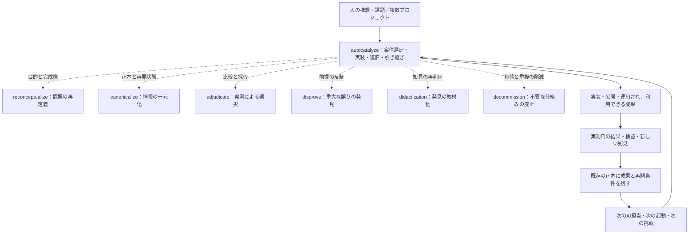

# ミッション

**一人の構想を、複数のAIエージェントが引き継ぎながら実現し、社会で使われ続ける大きな成果へ育てる。**

Kafstylerは、研究・開発・制作・公開・運用をまたぐ多数のプロジェクトで、構想から実利用までを継続して進めるための7 Skills。担当AI、セッション、モデル、実行環境が変わっても、目的と実績を引き継ぎ、次の成果につなぐ。

## 7 Skillsが実現すること

- **[autocatalyze](skills/autocatalyze/SKILL.md)｜常時稼働する成果創出の中核。** 定時・イベント・中断後の再開から案件を選び、状態を復元し、必要な作業を委譲・実装・公開・検証する。障害を復旧し、別のAI担当や次回の実行へ引き継ぐ。単発の修正を、大規模な継続運用の一部として完了させる。
- **[reconceptualize](skills/reconceptualize/SKILL.md)｜構想を、本当に解くべき問題と完成像へ変える。** 既存の手段に縛られず目的を再定義し、利用者が実際に達成できる結果と合格条件を決める。多数の案件が局所的な作業に埋もれず、より大きな目的へ向かうようにする。
- **[canonicalize](skills/canonicalize/SKILL.md)｜成果と判断を失わない正本をつくる。** データの意味・所在・更新方法を統一し、重複と矛盾を解消する。作業ID、対象の版、決定、検証結果、未完了の工程、再開条件を既存の正本で引き継ぎ、別のAIが会話の再説明なしに続きを進められるようにする。
- **[adjudicate](skills/adjudicate/SKILL.md)｜成果を測定し、最善の選択を残す。** 候補を同じ条件で比較し、精度、品質、操作成功、費用、運用負荷など実際の目的に関わる結果で採否を決める。見かけの進捗ではなく、改善を確認できる選択を積み上げる。
- **[disprove](skills/disprove/SKILL.md)｜重大な思い込みを反証する。** 設計、仮説、完成判定の弱点を具体的な反例や実物の確認で探し、致命的な誤りが大規模に広がる前に修正する。証拠のない断定や、テストだけ通って利用できない成果を見逃さない。
- **[didactization](skills/didactization/SKILL.md)｜実績を、再利用できる知識へ変える。** 一次資料、実験、失敗、例外から汎用的な原則と再現方法を抽出し、他の人やAIが理解・検証・応用できる文章にする。文章を増やすのではなく、次の研究・開発・判断を改善する知見を蓄積する。
- **[decommission](skills/decommission/SKILL.md)｜不要な仕組みをなくし、実行力を取り戻す。** 役割を終えたコード、規則、CI、フック、文書、台帳、運用手順を統合・廃止する。案件が増えても管理負荷が膨張しないようにし、必要な機能と検証は維持する。

各Skillが受け取る入力と次へ渡す具体的な成果は、[READMEの継続運用例](README.md#7つのskillが連関して成果を出す)を参照する。

## 成果が次の成果を生む構造

`autocatalyze` が継続実行を担い、他の6 Skillsは案件に必要な判断だけを提供する。全Skillsの一律実行や独自スケジューラーの新設は目的ではない。常時稼働とは、LLMを止めずに動かすことではなく、必要なときに状態を復元し、成果の創出と改善を続けられることである。

## 成果の基準

成果の大きさは、生成した文章・コード・Issueの数では測らない。**利用者が解決できた問題、実際に使われる成果、再利用できる知見、削減できた負担、長期にわたって改善できる範囲**で判断する。完成の宣言ではなく、利用者の入口から成果を確認する。

## 改善と更新

`autocatalyze` が継続運用で得た失敗と実測を次の案件に反映する。`reconceptualize` で目的を見直し、`adjudicate` と `disprove` で選択を確かめ、`canonicalize` と `didactization` で成果を継承し、`decommission` で不要になった仕組みをなくす。

変更は利用者の明示指示、再現した問題、実物の利用結果に基づく。必要な公式仕様を参照し、影響する経路を検証する。判断の経緯はGit履歴で追えるようにする。
