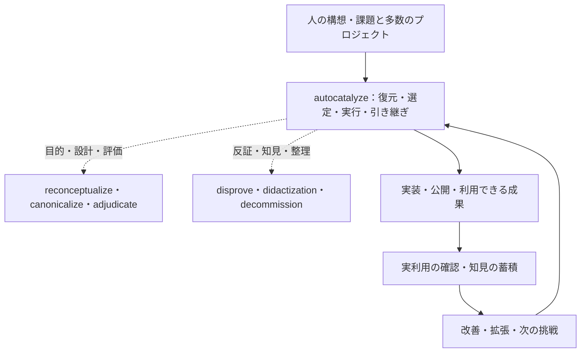

# ミッション

**一人の構想を、時間・分野・担当者の壁を越えて、社会で使われ続ける大きな成果へ変える。**

Kafstylerは、個人や小さなチームが複数のAIエージェントと協働し、長期間にわたる多数のプロジェクトを進めるための7 Skills。研究、開発、制作、公開、運用を一件ずつ終わらせるだけでなく、実際に役立つ成果と知見を積み上げ、次の挑戦をさらに大きくできる状態を目指す。

## 目指す世界

一人でも複数の領域で大規模な仕事を進められる。担当AIが交代し、セッションが切れ、数か月後に再開しても、目的・判断・実装・検証の蓄積を失わない。成果物は公開・配布・運用され、利用者の課題を解決し、実際の反応を受けて改良され続ける。

**成果の大きさは、生成した文章・コード・Issueの数ではなく、実際に使われている成果、解決した問題、再利用できる知見、減らせた手間、継続して改善できる範囲で判断する。** 規模を広げても人による説明のやり直しと管理負荷を増やさず、人の創造と判断をより価値の高い仕事へ向ける。

## 自律成果創出

[autocatalyze](skills/autocatalyze/SKILL.md) が常時稼働エージェントの中核を担う。多数の案件について、定時・イベント・再開を起点に状態を復元し、重要な仕事を選び、委譲・実装・検証・公開・復旧・引き継ぎを続ける。他の6 Skillsは必要な判断だけを支える。常時稼働はLLMの連続起動ではなく、仕事が中断しても成果創出を再開できることを指す。

## 自律文書整備

発見と失敗を、一次資料・再現方法・反例を備えた再利用可能な知見へ変える。知識の蓄積を次の研究・開発・制作で活用し、同じ調査や失敗を繰り返さない。独自の知見がなければ新規記事より既存記事の改善・統合を優先する。手順は [didactization](skills/didactization/SKILL.md) を正本とする。

## 自律改善

成果を生まない規則、検査、コード、文章、運用作業を減らす。既存の道具と外部実装を先に検討し、独自機構を増やさない。比較できるものは同条件で評価し、改善が確認できない仕組みは撤去する。案件が増えるほど管理が重くなるのではなく、再利用と引き継ぎによって実行力が高まる構造を保つ。

## 更新

利用者の明示指示、再現できた失敗、実物の利用結果に基づいて修正する。必要な公式仕様を参照し、変更した経路だけ検証する。経緯はGit履歴で残す。
