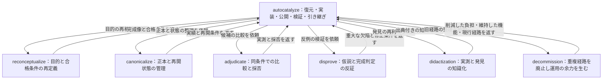

# ミッション

**一人の構想を、複数のAIエージェントが引き継ぎながら実現し、社会で使われ続ける大きな成果へ育てる。**

Kafstylerは、研究・開発・制作・公開・運用をまたぐ多数のプロジェクトで、構想から実利用までを継続して進めるための7 Skills。担当AI、セッション、モデル、実行環境が変わっても、目的と実績を引き継ぎ、次の成果につなぐ。

## 7 Skillsが実現すること

- **[autocatalyze](skills/autocatalyze/SKILL.md)｜常時稼働する成果創出の中核。** 定時・イベント・中断後の再開から案件を選び、状態を復元し、必要な作業を委譲・実装・公開・検証する。障害を復旧し、別のAI担当や次回の実行へ引き継ぐ。単発の修正を、大規模な継続運用の一部として完了させる。
- **[reconceptualize](skills/reconceptualize/SKILL.md)｜構想を、本当に解くべき問題と完成像へ変える。** 既存の手段に縛られず目的を再定義し、利用者が実際に達成できる結果と合格条件を決める。多数の案件が局所的な作業に埋もれず、より大きな目的へ向かうようにする。
- **[canonicalize](skills/canonicalize/SKILL.md)｜成果と判断を失わない正本をつくる。** データの意味・所在・更新方法を統一し、重複と矛盾を解消する。作業ID、対象の版、決定、検証結果、未完了の工程、再開条件を既存の正本で引き継ぎ、別のAIが会話の再説明なしに続きを進められるようにする。
- **[adjudicate](skills/adjudicate/SKILL.md)｜成果を測定し、最善の選択を残す。** 候補を同じ条件で比較し、精度、品質、操作成功、費用、運用負荷など実際の目的に関わる結果で採否を決める。見かけの進捗ではなく、改善を確認できる選択を積み上げる。
- **[disprove](skills/disprove/SKILL.md)｜重大な思い込みを反証する。** 設計、仮説、完成判定の弱点を具体的な反例や実物の確認で探し、致命的な誤りが大規模に広がる前に修正する。証拠のない断定や、テストだけ通って利用できない成果を見逃さない。
- **[didactization](skills/didactization/SKILL.md)｜実績を、再利用できる知識へ変える。** 一次資料、実験、失敗、例外から汎用的な原則と再現方法を抽出し、他の人やAIが理解・検証・応用できる文章にする。文章を増やすのではなく、次の研究・開発・判断を改善する知見を蓄積する。
- **[decommission](skills/decommission/SKILL.md)｜常時稼働の余力を生み、規模を拡大できる状態を守る。** `canonicalize` が統一した正本と `adjudicate` が確かめた後継経路を受け取り、旧処理・重複ジョブ・過剰な検査や通知を廃止する。必要な機能を保ちながら実行回数・費用・障害要因・管理対象を減らし、`autocatalyze` が新しい成果に使う余力を取り戻す。

各Skillを分けた理由と、統合したときの失敗は [READMEの設計思想](README.md#なぜこの7-skillsなのか) に示す。具体的な受け渡しは [READMEの継続運用例](README.md#7つのskillが連関して成果を出す) を参照する。

## autocatalyzeと6 Skillsの成果循環

`autocatalyze` は定時・イベント・担当交代を起点に案件の状態を復元し、判断が必要なSkillを呼び出して実装・公開・利用者の入口での検証まで進める。`reconceptualize`、`canonicalize`、`adjudicate`、`disprove`、`didactization`、`decommission` はそれぞれの判断と結果を `autocatalyze` に返す。`autocatalyze` は検証済みの成果と未完了工程を記録し、既存の実行基盤による次の起動と、交代したAI担当へ引き継ぐ。

## adjudicateとautocatalyzeの成果判定

`reconceptualize` は利用者が完了できる行動を合格条件にする。`adjudicate` は文章・コード・Issueの生成数ではなく、利用者が解決できた問題、成果の利用状況、品質、削減できた負荷を評価する。`disprove` は検証結果と実利用が食い違う反例を調べる。`autocatalyze` は利用者の入口で成果を確認し、未確認の工程を完了扱いしない。`canonicalize` は確認済みの結果と対象の版を正本に残す。`didactization` は再利用できる知見を残す。`decommission` は不要な仕組みを廃止した効果を確認する。

## autocatalyzeと6 Skillsの改善・更新

`autocatalyze` は利用者の明示指示、再現した失敗、実物の利用結果から改善案件を選ぶ。`reconceptualize` は目的と完成条件を必要に応じて見直す。`adjudicate` は改善前後を比較し、`disprove` は変更の重大な反例を検証する。`canonicalize` は更新後の正本と引き継ぎ情報を整え、`didactization` は再利用可能な知見として整理する。`decommission` は役割を終えた仕組みを撤去する。`autocatalyze` は必要な公式仕様と影響範囲を確認し、結果を検証してGit履歴に反映する。
