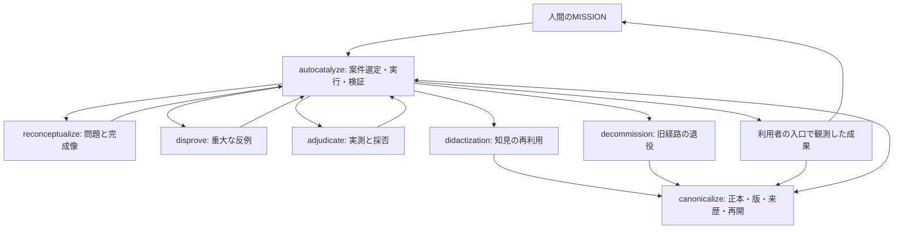

# ミッション

**一人の構想、美学、探究心を、交換可能なAIエージェントと外部基盤が引き継ぎ、社会で使われ続ける成果と再利用可能な知識へ変える。**

Kafstylerは単なる作業手順やプロジェクト管理ではない。AI、端末、サービス、モデル世代が交代しても目的・根拠・実績が失われず、活動の規模が増すほど意思決定が遅くならず、過去の蓄積が次の成果を助ける**永続的な知能機関（Autonomous Cognitive Institution）の憲法**である。

## 永続する三つの基盤

1. **使命（MISSION）**：人間が何を実現し、どの価値を守るかを決める。各リポジトリの目的はそのプロジェクトの既存の正本から読む。
2. **来歴を持つ正本（Canonical Provenance）**：対象、識別子、版、出典、判断、最後の確認結果と再開条件を、会話の外にあるGit履歴・Issue・適切なデータ正本へ結ぶ。競合する第二の正本を作らない。
3. **観測された成果（Observable Outcomes）**：完了はAIの自己申告でなく、利用者の通常の入口で観測した結果と、事前に決めた合格条件で確定する。

モデル、セッション、実行基盤、スケジューラーは交換可能な計算資源である。これらに使命や記憶の唯一の実体を依存させない。

## 組織エントロピーを反転する五原則

1. **判断時間を増やさない**：分野別の一次資料索引から関係する正本だけを読み、事前に固定した外部判定を使う。差分がなければ何もせず終了する。
2. **知見を散逸させない**：確認済みの版、証拠、再開条件を外部に残し、反例と成功条件を別案件でも使える形へ還流する。
3. **追加より減算を先に考える**：不要な仕事を削り、移行後に旧経路・二重ジョブ・重複ルールを退役させる。価値を維持したまま減らした負荷を成果として測る。
4. **計算を必要な層へ配分する**：確定処理は上流CLIとOS、合否が閉じた定型変更は低コスト実行主体、目的の再定義・重大反証・昇格案件は高知能実行主体へ委ねる。全層が同じ正本と停止条件に従う。
5. **自分自身を反証する**：素の構成・現行版・改訂版を固定課題で比較し、不要な変更を行わない判断と、証拠付き停止も正解に含める。規約の増加自体を成果としない。

具体的な実行契約は[共通作業規約](AGENTS.md)に集約し、一次資料は[聖典台帳](BIBLES.md)から必要な分野だけ参照する。

## MISSION起点のIssue駆動

**MISSIONは成果の方向、Issueは解く問題、コミットは変更の版、利用結果は完成の証拠。** Issueを閉じた数ではなく、解決できた利用者の問題で判断する。

`reconceptualize`は目的と実測からIssueにない問題も発見し、`autocatalyze`は価値・緊急性・費用・実現可能性で案件を選び実装と検証を進める。`canonicalize`はMISSION、Issue、コミット、成果、再開条件をつなぐ。結果が届かなければ`disprove`と`adjudicate`の観測を使って問題設定まで見直す。複数回にまたがる案件だけ既存Issueを使い、軽微な一回限りの仕事に台帳を新設しない。[Issue運用](AGENTS.md#missionとissueの運用)

## 日常保守をAIなしで完了し、判断を成果へ集中する

差分検出、同期、形式検証、キャッシュ判定、定時起動はOSと既存の上流ツールに任せる。変化がない実行はLLMを起動せず終了する。重大な例外だけを`autocatalyze`へ引き上げ、必要なSkillを選ぶ。失敗や権限の不足を推測で埋めず、証拠・停止理由・再開条件を渡す。[外部保守](AGENTS.md#外部実装を利用する常駐差分保守)・[実行層](AGENTS.md#計算資源の3層配分と停止契約)

## 7 Skillsが実現すること

| Skill | 知能機関の機能 | 引き継ぐもの |
| --- | --- | --- |
| [canonicalize](skills/canonicalize/SKILL.md) | 座標系と記憶 | 対象ID・正本・版・出典・再開状態 |
| [autocatalyze](skills/autocatalyze/SKILL.md) | 推進力 | 優先案件・実装・公開・検証・次回起動 |
| [reconceptualize](skills/reconceptualize/SKILL.md) | 枠組みの再構築 | 新たな問題・完成像・成果条件 |
| [disprove](skills/disprove/SKILL.md) | 反証 | 重大な反例・再現条件・修正条件 |
| [adjudicate](skills/adjudicate/SKILL.md) | 実測と採否 | 固定条件・観測結果・比較と判断 |
| [didactization](skills/didactization/SKILL.md) | 知識の複利 | 根拠付きの汎用原理・適用条件 |
| [decommission](skills/decommission/SKILL.md) | 新陳代謝 | 維持した価値・退役した経路・削減した負荷 |

7つの常駐プロセスを立てるのではない。`autocatalyze`が案件選定と引き継ぎを統括し、他の6 Skillsは必要な判断だけを行う。正本を共有するから、開発、研究、金融、制作、生活の知見がプロジェクトを越えて再利用できる。

## autocatalyzeと6 Skillsの成果循環

## adjudicateとautocatalyzeの成果判定

完了は資料、Issue、コミット、スキル実行数で代用しない。利用者の入口で動作と成果を測り、重大な反例を検査し、未検証の公開や未到達の成果は完了に含めない。無介入が正しいときは`noop`、権限や証拠が不足するときは`stopped`で正常に引き継ぐ。

## 人間が決定すること

人間は創設者として使命、美学、優先する価値、不可逆な判断を担う。許可済みで可逆的な保守と改善は実行主体が完遂する。使命の転換、権限の拡大、重大な不可逆操作では観測事実、対立案、反証、必要な決定だけを人間に返す。
