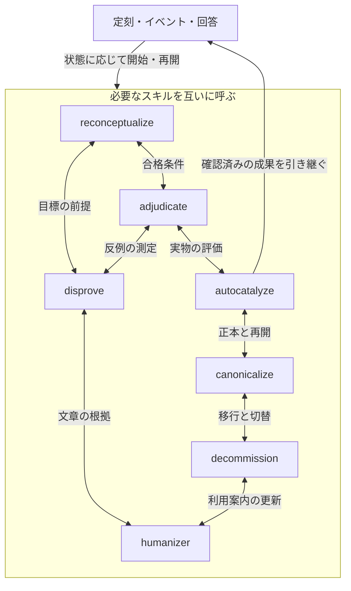

# Kafstyler

**担当者やAIモデルが替わっても、成果を再現し、根拠をたどり、更新を続けられる。**

開発・調査・制作・運用に共通の作業規約と7スキルを備えたAIエージェント用プラグインです。

**[まず一件試す](#まず一件試す)** · [導入する](#プラグインの使い方) · [仕組みを見る](#大規模な開発を支える仕組み) · [用途を探す](#成果から使い方を選ぶ)

対応環境 Claude Code · Codex · Antigravity CLI

## まず一件試す


## 常時稼働エージェントの中核

[`autocatalyze`](skills/autocatalyze/SKILL.md#常時稼働エージェントの中核) が起動・状態復元・案件選定・他の6スキルへの委譲・実行・公開先検証・復旧・次回への引き継ぎを統括します。**常時稼働とはLLMの連続実行ではなく、必要なときに前回の成果から再開できることです。** Issueや台帳の更新だけでは完了しません。[一次資料](BIBLES.md#常駐エージェント)

対象のURLか資料を添え、GitHubを読めるAIに次の依頼文を送ります。導入前でも読み取り専用で試せます。

```text
https://github.com/KAFKA2306/kafstyler の main の完全なコミットSHAを取得してください。
そのSHAの AGENTS.md と、この依頼に該当する skills/*/SKILL.md を読んで適用してください。
添えた対象を読み取り専用で確認してください。編集・公開・設定変更はせず、優先して対応したい点を一つ選んでください。
何を観測したか、次に何をして、どんな結果を確かめるかを先に教えてください。
使ったSHA、スキル名、確認手順、結果を次の担当が追える形で残してください。
```

修正まで試す場合は「添えた対象を読み取り専用で確認してください」で始まる一行を「対象のこの箇所を直し、同じ入力で前後を確かめて」に替え、変更してよい範囲を指定します。

## 大規模な開発を支える仕組み

[`canonicalize`](skills/canonicalize/SKILL.md) で一件の単位、正本、更新先を決めます。知識文書はOKFとObsidian Vault、分析データの変換・集計はdbtを使います。

公表統計の検索画面とCSVを毎週更新するなら、収集と画面開発の担当で次の手順を共有します。

1. **正本を決める。** 発行元・系列ID・対象期間で値を識別し、単位を統一。地域・季節調整は系列IDで区別し、改定の公表日と出典を記録します。
2. **同じ正本から公開する。** 画面とCSVを作り、公開先の値と出典を照合します。再取り込みで行が増えないことも確かめます。
3. **訂正を反映する。** 半年前の値が訂正されたら、台帳の入力・版・コマンドから対象集計を再実行します。仕様変更は版を固定し、同じ入力で前後を比較します。

[画面の設計基準](BIBLES.md#かふかのデザインパターン) · [定期実行と再開](skills/autocatalyze/SKILL.md#常駐エージェントと定期実行) · [一次資料の見直し](BIBLES.md#資料の見直し) · [更新手順](MISSION.md#更新手順)

### 7つのスキルと、残す成果物

定刻・イベント・回答を機に、7スキルのどれからでも始められます。必要な相手を呼び、結果は同じ作業IDに戻します。両矢印は相互呼び出しの例です。



動画を日次公開するなら、定刻に制作を始め、公開先で指定した状態を読み戻します。停止した回は同じ記録から再開し、次回は確認済みの条件と新しい入力を使います。成果の評価は `adjudicate`、方式の見直しは `disprove` や `decommission` からも始められます。

| スキル | 責任範囲と次に渡すもの |
| --- | --- |
| [`reconceptualize`](skills/reconceptualize/SKILL.md) | 目的・利用経路・制約・完了場面を定め、合格条件と検証の道具を渡す。 |
| [`canonicalize`](skills/canonicalize/SKILL.md) | 文書・データ・入出力の意味、識別子、正本、来歴、状態を設計し、更新・移行・再開の契約を渡す。 |
| [`autocatalyze`](skills/autocatalyze/SKILL.md) | 常時稼働エージェントの中核。起動・選定・委譲・実装・公開検証・復旧・継続を統括する。 |
| [`humanizer`](skills/humanizer/SKILL.md) | 読み手と用途に沿って見出し・用語・本文を整え、条件と根拠を追える文章を渡す。 |
| [`disprove`](skills/disprove/SKILL.md) | 一次資料と実物で現行方式・代替案の前提に反例を探し、結論・範囲・証拠・未確認事項を返す。 |
| [`adjudicate`](skills/adjudicate/SKILL.md) | 判定を設計前に固定し、成果・手法を同条件で測る。測定値、採否、証拠、再実行手順を渡す。 |
| [`decommission`](skills/decommission/SKILL.md) | 重複するコード・文書・定期処理を統合し、旧方式を廃止。切替結果と残した利用経路を渡す。 |

[連携手順](AGENTS.md#コマンドの連携)

## プラグインの使い方

[Claude Code](#claude-code) · [Codex](#codex) · [Antigravity CLI](#antigravity-cli)

### Claude Code

Claude Code 2.1.292以降が必要です。WindowsではWSLかGit Bashを使います。[配布元](https://github.com/KAFKA2306/agent-resources/blob/main/.claude-plugin/marketplace.json)

```sh
claude plugin install kafstyler --marketplace KAFKA2306/agent-resources --scope user
```

対象プロジェクトで `claude` を起動します。

### Codex

WindowsではWSLで実行します。

```sh
codex plugin marketplace add KAFKA2306/kafstyler
codex plugin add kafstyler@kafstyler
```

対象プロジェクトで `codex` を起動し、`/hooks` でフックを承認します。更新後に再確認が出た場合も同じです。承認前はスキルを手動で選べます。[Codexのフック承認](https://learn.chatgpt.com/docs/hooks#review-and-trust-hooks)

### Antigravity CLI

[Googleの公式手順](https://antigravity.google/docs/getting-started?tab=cli)で `agy` を導入します。

<details>
<summary>Windows・WSLで導入先を確認する</summary>

PowerShellでは `Get-Command agy -All`、WSLでは `type -a agy` で特定し、各シェルで `agy --version` を実行します。既定の場所はWindowsが `%LOCALAPPDATA%\agy\bin` 配下、Linuxが `~/.local/bin/agy` です。WSLでユーザー単位に導入する前に、所有者と親ディレクトリへの書き込み権限を確認します。

```bash
id -un
agy_bin=$(type -P agy) && agy_bin=$(realpath -- "$agy_bin") &&
  stat -Lc '%U %A %n' -- "$agy_bin" "$(dirname -- "$agy_bin")" &&
  test -w "$(dirname -- "$agy_bin")" && echo '導入先に書き込み可能'
```

</details>

導入後、一覧で `kafstyler` が有効で、7スキルが登録されていることを確かめます。

```sh
agy plugin install https://github.com/KAFKA2306/kafstyler
agy plugin list --json
```

対象プロジェクトで `agy` を起動し、`/reconceptualize` などを使います。[ヘッドレスでの実行](skills/autocatalyze/SKILL.md#antigravity-cliでレビューする) · [公式仕様](BIBLES.md#antigravity-cliの配布と実行)

### 依頼を送って使う

対象プロジェクトで、資料と普段の入口での完了条件を添えて[最初の依頼文](#まず一件試す)を送ります。

「台帳の列を統一し、移行後に旧ファイルを整理して」なら、設計前に `canonicalize`、削除前に `decommission` を使います。合格条件を委譲先とも共有し、同じ入力で前後を比べます。[作業規約](AGENTS.md#コマンドの連携)

判断が変わったら発見と次の確認を伝え、成果の直後に試せるリンクかコマンドを添えます。[報告の手順](AGENTS.md#出力と成果物)

### プラグインの更新と検証

<details>
<summary>Claude CodeとCodexの更新コマンド</summary>

- Claude Codeは `claude plugin update kafstyler@kafka-agent-tools` の後、新しいセッションを開始するか `/reload-plugins` を実行します。自動更新は `/plugin` の Marketplaces で `kafka-agent-tools` を選びます。[公式の更新手順](https://code.claude.com/docs/en/discover-plugins#keep-plugins-updated)
- Codexは `codex plugin marketplace upgrade kafstyler`、`codex plugin add kafstyler@kafstyler` の順に実行し、新しいセッションを開始します。検証前に `codex plugin list` の版を対象コミットのマニフェストと照合します。`marketplace add` の再登録で旧版が残った場合も `marketplace upgrade` を使います。[公式のコマンド一覧](https://learn.chatgpt.com/docs/developer-commands#codex-plugin)

</details>

### 作業中の版で試す

候補版を着手前と候補版の両方の検査にかけ、起動時に規約、依頼受付時に7スキルの発動条件が渡ることを確かめます。

<details>
<summary>リポジトリと各クライアントの検証手順</summary>

着手前にリポジトリのルートで `base=$(git rev-parse main)` を実行します。変更後は次の検査を実行します。

```bash
(set -o pipefail; git show "${base}:.agents/check.py" | python3 -)
python3 .agents/check.py
```

全Markdownへのスキル適用を[適用記録](.agents/markdown-reviews.json)に残し、ステージ後に `python3 .agents/check.py --staged` を実行します。配布設定・フックも確認するなら `--all-files`、版の一覧は `--markdown-inventory`、ステージ済み全ファイルの照合は `--staged --all-files` を使います。[適用と記録の手順](AGENTS.md#全markdownに全スキルを使う)

- **Claude Code**では `claude plugin validate .` と `claude --plugin-dir "$PWD"` を実行します。別プロジェクトから試すときは `--plugin-dir` にチェックアウトの絶対パスを渡します。
- **Codex**では検証用の `CODEX_HOME` を設定し、`codex plugin marketplace add "$PWD"` と `codex plugin add kafstyler@kafstyler` を実行します。変更後は `codex plugin remove kafstyler@kafstyler` で検証用のコピーを削除し、再導入します。新しいセッションで `/hooks` を確認・承認します。[ローカル配布元の仕様](https://developers.openai.com/plugins/build/plugins#how-local-marketplaces-work)
- **Antigravity CLI**では `agy plugin validate --json .` の後、検証環境で `agy plugin install .` と `agy plugin list --json` を実行し、版・7スキル・常時有効なルールを確かめます。[公式の警告判定](https://antigravity.google/docs/build-plugins/#warnings-in-multi-tool-repositories)

影響するクライアントにスキル名なしの依頼を送り、呼び出し履歴か `SKILL.md` の読み込みと、成果物の合否を確かめます。漏れを直したら影響する工程を同じ入力でやり直します。[本体の変更手順](AGENTS.md#kafstyler本体の変更)

</details>

## 成果から使い方を選ぶ

「イベント収集を直して」なら、[公開カレンダー](https://github.com/KAFKA2306/cast_event_cal)のURLと「開催回が公開WebとICSに一度ずつ載り、主催者の告知を開ける」という合格条件を渡します。目的と結果は[作業台帳](AGENTS.md#作業台帳)に残ります。

### 開発・運用

停止した処理を最終成功時刻と失敗ログから直し、次の結果を利用者のURLで確認する。画面は初見で情報と出典を探し、迷った操作と合格条件を一件にまとめる。[定期運用](https://github.com/KAFKA2306/agent-resources) · [画面の評価例](https://github.com/KAFKA2306/design/blob/main/docs/frontend-review.md)

### 記事・動画・音声

記事は数値を一次資料と照合し、読者のつもりで手順を再現する。動画は音声・字幕を通しで確認し、公開先でチャンネル・公開状態を確かめる。音声は同じ台詞で比較し、採用WAV・モデル・シード・参照音声を残す。[記事](https://github.com/KAFKA2306/articles/blob/main/articles/kafstyler-agent-quality-loop.md) · [動画](https://github.com/KAFKA2306/yt3) · [音声](https://github.com/KAFKA2306/yt4)

### VRChat・3D・画像制作

ワールドでは初期位置から展示へ歩き、案内を読んで操作する。衣装はUnityで取り込み・装着し、指定ポーズで貫通とウェイト崩れを確認する。画像は素材・シード・サイズをそろえ、画質と処理時間を比べる。[VRMine](https://github.com/KAFKA2306/vrmine) · [衣装](https://github.com/KAFKA2306/image2outfit) · [ComfyUIの制作台帳](https://github.com/KAFKA2306/comfyui-workflows-factory)

### ボードゲーム・ゲーム

スマホで作品と版を選び、プレイ中に裁定と公式説明書の該当ページを開く。MODはSteam版に導入し、プレイ中に効果を確かめる。[ボドゲのミカタ](https://bodoge-no-mikata.vercel.app/) · [Slay the Spire 2のMOD](https://github.com/KAFKA2306/sts2)

### 企業・市場の調査

半導体の価格と出荷は決算期・単位をそろえ、実績・会社予想・シナリオを分けて、公開画面で式と一次開示を開く。統計は初報・改定値を対象月・公表日で区別し、公開CSVを原資料と照合する。[半導体決算モデル](https://github.com/KAFKA2306/semiconductor-earnings-model) · [米雇用統計](https://github.com/KAFKA2306/nonfarmpayroll)

### 科学・製造の調査

同じ材料・加工目的の候補を一次資料から探し、温度・圧力・速度などの条件と歩留まり・欠陥率を表にする。論文は対象・比較条件・測定値と引用箇所を記録し、案件で試せる条件を選ぶ。[製造工程の調査](https://github.com/KAFKA2306/factory) · [arXiv調査](https://github.com/KAFKA2306/daily-arXiv-ai-enhanced)

### Kaggle

データ版・時系列分割・公式指標・ベースラインをそろえ、手元の検証と公式提出の結果を分けて記録する。[商品価格予測コンペ](https://github.com/KAFKA2306/mitsuikaggle)

### 暮らしと学習

家計は明細の再取り込みで件数・合計が変わらず、差額から元の取引を開けるか試す。蔵書は同じ作品の別版を区別し、目的のノートに戻る。旅行は公式時刻・総額・取消条件を比べ、現地時刻で乗り換えを確かめる。[家計](https://github.com/KAFKA2306/kakeibo) · [蔵書](https://github.com/KAFKA2306/books) · [旅行計画](https://github.com/KAFKA2306/travel)

## スキル

Claude Codeは `/kafstyler:<名前>`、Codexは `$` から選択、Antigravity CLIは `/<名前>`。各スキルは `disprove` で目標や成果物の前提を確かめ、重大な欠陥があれば修正に戻ります。[7スキルと成果物](#7つのスキルと残す成果物)

端末を閉じても定時に動かすには[常駐エージェントと定期実行](skills/autocatalyze/SKILL.md#常駐エージェントと定期実行)へ。プラグインを使えない環境では[作業規約](AGENTS.md#全作業への適用と自己改善)に従い、正本の版を固定して必要な `SKILL.md` の手順を使います。

## Unity・VRChatで制作する

汎用Unityは `CoplayDev/unity-mcp`、VRChat Worldsは `swax/UnityMCP-VRC`、VRChat Avatarsは `lighfu/unity-agent` を使い、Unity EditorやVRChat SDKで成果を確かめます。[公式の接続手順](BIBLES.md#ユニティとvrchatの制作ツール)

## 外部スキルとテンプレート

### 成果物の根拠調査と推敲

imozuruで根拠を原文までたどり、yomiyasuで説明を整え、反証レビューで利用場面に照らします。Claude CodeかCodexの新しいセッションで両方を選べることを確かめます。[成果物の確認手順](AGENTS.md#成果物の各要素を根拠と照合する)

```sh
npx skills add MaryCache/imozuru
npx skills add nanaism/yomiyasu
```

### Googleのフロントエンド設計スキル

KAFKA2306のWeb UIを設計するときは[かふかのデザインパターン](BIBLES.md#かふかのデザインパターン)を先に確認します。Claude Codeで `/plugin marketplace add google-gemini/demolab`、`/plugin install demolab@demolab` の順に実行し、`/demolab:gemini-frontend-design` で設計案を検討します。[Google Gemini DemoLabの導入手順](https://github.com/google-gemini/demolab#claude-code)

### ComfyUIのワークフローテンプレート

[採用基準](BIBLES.md#comfyuiのワークフロー選定)に合わせ、`Workflow → Browse Workflow Templates` で候補を開き、必要なモデルと出力を確認します。[ComfyUI公式手順](https://docs.comfy.org/interface/features/template) · [テンプレートの正本](https://github.com/Comfy-Org/workflow_templates)

## ミッション・聖典・作業規約

[OKF目次](index.md)から[ミッション](MISSION.md)、[一次資料の聖典台帳](BIBLES.md)、[作業規約](AGENTS.md)を開けます。手順書は現行版を一か所にまとめ、旧版と統合先を記録し、Obsidianでタグ検索できるようにします。[文書整理の手順](skills/canonicalize/SKILL.md#台帳とobsidian-vaultで文書を整理する)
