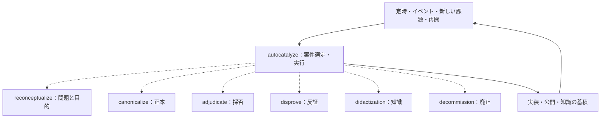

# Kafstyler

**一度の指示を、継続する成果へ。**

Kafstylerは、Claude Code・Codex・Antigravity CLIなどのAIエージェントに、問題の発見から案件選定、実装、公開、知識の蓄積までを任せる7 Skillsです。

一人の構想を、AIや端末が変わっても継続する知能機関へ変えることを目指します。既存の起動基盤と組み合わせ、認可された使命の範囲で次の仕事を見つけ、成果を積み上げます。

[できること](#kafstylerが変えること) · [7 Skills](#7-skillsが連関して成果を出す) · [利用例](#成果から使い方を選ぶ) · [まず一件試す](#まず一件試す) · [導入する](#プラグインの使い方)

## Kafstylerが変えること

| よくある課題 | 導入後の仕事の進め方 |
| --- | --- |
| AIを交代するたびに説明し直す | MISSION・Issue・Git・公開先を参照して仕事を再開する |
| 指示された変更ばかり繰り返す | 本質的な問題を捉え直し、価値の高い改善を選ぶ |
| 複数のAIが同じ仕事を進めてしまう | 正本を統一し、書き込みを直列化する |
| 案件が増えるほど運用費用が増える | OS・CLIが差分を扱い、AIは判断に集中する |
| 機能追加のたびに運用が複雑になる | 旧方式・重複処理・不要な仕組みを廃止する |

個々のAIの能力を高めるだけでなく、担当を交代できること、知見を再利用できること、規模が拡大しても運用負荷を抑えられることを重視します。[MISSION](MISSION.md)に目指す成果を示しています。

## 7 Skillsが連関して成果を出す

autocatalyzeが仕事を統括し、必要な専門判断だけを他のSkillへ渡します。全Skillを一律に起動する必要はありません。



| Skill | どんなときに使うか |
| --- | --- |
| [autocatalyze](skills/autocatalyze/SKILL.md) | 次の仕事を選び、実装・制作・公開まで進める |
| [reconceptualize](skills/reconceptualize/SKILL.md) | 本当に解くべき問題や目的を見直す |
| [canonicalize](skills/canonicalize/SKILL.md) | 複数担当が共有する正本・意味・識別子・出典を統一する |
| [adjudicate](skills/adjudicate/SKILL.md) | 方式やモデルを費用・品質・制約から比較し、採否を決める |
| [disprove](skills/disprove/SKILL.md) | 仮説や設計が成立しない条件を探す |
| [didactization](skills/didactization/SKILL.md) | 調査や失敗から再利用できる知見を抽出し、教材や文章にする |
| [decommission](skills/decommission/SKILL.md) | 必要な能力と情報を守り、不要な仕組みを廃止する |

## 常時稼働と大規模運用

### MISSION駆動・Issue駆動

[MISSION](MISSION.md)は目的、Issueは仕事、Gitは実装の変更、公開先は成果の正本です。別の担当やセッションでも既存の正本を使い、会話を最初から説明し直さずに続けられる運用を目指します。

### 外部ツールで回す日常保守

定時起動・差分取得・整形などの定型処理はOSや外部標準ツールに任せます。変化のない日常保守では不要なLLM起動を避け、定型判断と難しい判断は必要な計算資源に分けます。探索や制作は日常保守と区別します。

Kafstyler自体は常駐サービスではありません。既存のスケジューラーや[Orca](integrations/orca/README.md)などの起動基盤と組み合わせます。権限・費用・書き込み担当・停止条件は[共通規約](AGENTS.md)に従います。

### 知識と仕組みを育てる

canonicalizeが正本と引き継ぎを整え、didactizationが発見を別案件でも使える知識に変え、decommissionが役割を終えた仕組みを減らします。新しいモデルや外部ツールも、既存の役割に合わせて置換できます。

## 成果から使い方を選ぶ

以下は導入先での利用例です。

| 分野 | 具体的な使い方 |
| --- | --- |
| ソフトウェア開発 | 既存Issueから価値の高い改善を選び、利用者に届く形で公開する |
| データ・市場調査 | 系列ID・単位・公表日・出典をそろえ、改定を同じ正本へ反映する |
| 科学・製造 | 論文から材料・温度・圧力・加工条件と適用限界を整理し、再利用できる知識にする |
| 文章・教材制作 | 読者の問いから構成を決め、一次資料や失敗から得た知見を説明する |
| 画像・3D制作 | 用途・寸法・形式を定め、外部標準ツールで制作・公開する |
| 長期保守 | 変更のある対象だけを処理し、古い経路や重複ジョブを廃止する |

## まず一件試す

対象プロジェクトを開き、autocatalyzeを呼び出して次の依頼を送ります。

```text
このプロジェクトの目的と既存Issueを読み、
最も価値のある改善を一件選び、認可された範囲で実装・公開してください。
必要なSkillを使い、残った仕事は既存の正本に引き継いでください。
```

特定の判断だけを任せるなら、データの統合にはcanonicalize、方式の比較にはadjudicate、不要な仕組みの整理にはdecommissionを直接選べます。

## プラグインの使い方

### Claude Code

```sh
claude plugin install kafstyler --marketplace KAFKA2306/agent-resources --scope user
```

[配布元](https://github.com/KAFKA2306/agent-resources/blob/main/.claude-plugin/marketplace.json)

### Codex

```sh
codex plugin marketplace add KAFKA2306/kafstyler
codex plugin add kafstyler@kafstyler
```

### Antigravity CLI

```sh
agy plugin install https://github.com/KAFKA2306/kafstyler
```

### Orca

[接続手順](integrations/orca/README.md)から既存のAgents・Skills・Automations・Botsを利用する。main一本・単一書き手を守る。

### 依頼を送って使う

Claude Codeでは `/kafstyler:autocatalyze`、Codexでは `$autocatalyze`、Antigravity CLIでは `/autocatalyze` を使う。

### プラグインの更新

Claude Codeは `claude plugin update kafstyler@kafka-agent-tools`、Codexは `codex plugin marketplace upgrade kafstyler` を使う。

## 実行基盤と外部資源

共通タスクの入口はmiseです。Kafstylerの配置先で既知の操作は `mise run TASK ARGS`、未知なら `mise tasks` を使います。Pythonの実行・環境・依存管理にはuvを使います。

既存の公式Skill・CLI・テンプレートを優先し、複製しません。操作契約が必要なときは[実行索引](COMMANDS.md)、判断原理が必要なときは[BIBLES](BIBLES.md)を参照します。個別設定は案件の正本に置きます。

## ミッション・聖典・作業規約

[MISSION](MISSION.md) · [BIBLES](BIBLES.md) · [AGENTS](AGENTS.md) · [実行索引](COMMANDS.md) · [目次](index.md)
