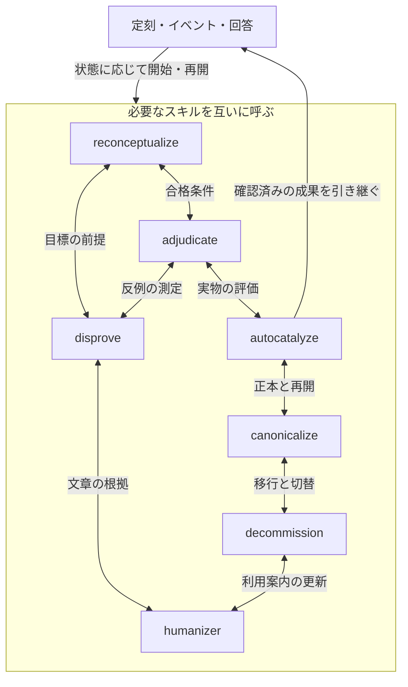

# Kafstyler

**担当者やAIモデルが替わっても、成果を再現し、根拠をたどり、更新を続けられる。**

Kafstylerは、開発・調査・制作・運用に共通の作業規約と7つのスキルを備えたAIエージェント向けプラグインです。

**[まず一件試す](#まず一件試す)** · [導入する](#プラグインの使い方) · [仕組みを見る](#大規模な開発を支える仕組み) · [用途を探す](#成果から使い方を選ぶ)

対応環境 Claude Code · Codex · Antigravity CLI

## まず一件試す

進行中のプロジェクトのURLや共有できる資料を添え、ふだん使うAIに次の依頼文を送ります。導入前でも試せます。

```text
利用者が困る箇所を一つ調べ、
完了条件を決めてから直して。
変更前後を同じ入力で試して。
使った版、検証手順、結果は
次の担当が追える形で残して。
```

## 大規模な開発を支える仕組み

設計の中心は [`canonicalize`](skills/canonicalize/SKILL.md) です。何を一件と数え、どの文書やデータを正本とし、どこで更新するかを決めます。知識文書はOKFで記述してObsidian Vaultで管理し、分析データはdbtで変換・集計します。

たとえば、公表統計の検索画面とCSVを毎週更新するサービスでは、データ収集と画面開発を別のチームが担当しても、次の定義と手順を共有できます。

1. **正本を決める。** 発行元・系列ID・対象期間で値を識別し、単位をそろえます。地域や季節調整の違いは系列IDで区別し、改定ごとの公表日と出典を残します。
2. **同じ正本から公開する。** 検索画面とCSVを生成し、公開先で値と出典を照合します。同じ資料を取り込み直しても行が重複しないことを確かめます。
3. **訂正を反映する。** 半年前の数値が訂正されたら、次の担当が台帳に残った入力、版、再実行コマンドを使って影響する集計を更新します。仕様変更時は版を固定し、同じ入力で切り替え前後を比べます。

[画面の設計基準](BIBLES.md#かふかのデザインパターン) · [定期実行と再開](skills/autocatalyze/SKILL.md#常駐エージェントと定期実行) · [一次資料の見直し](BIBLES.md#資料の見直し) · [更新手順](MISSION.md#更新手順)

### 7つのスキルと、残す成果物

定刻・イベント・回答で起動し、仕事の段階と状況に応じてスキルを選びます。7つのどれも起点になり、必要な相手を呼んで、得た結果を同じ作業IDに戻します。両矢印は、どちらからも相手を呼べる連携の例です。



たとえば動画を日次公開する仕事では、設定した定刻に制作を始め、公開先で指定した状態を読み戻します。途中で止まった回は同じ記録から再開し、次の定例では確認済みの条件と今回の入力を使って次の動画を作ります。公開済みの成果を調べる回は adjudicate、方式を見直す回は disprove や decommission からも始められます。

| スキル | 責任範囲と次に渡すもの |
| --- | --- |
| [`reconceptualize`](skills/reconceptualize/SKILL.md) | 利用者の目的、使う入口、制約と完了場面を定める。合格条件と検証に使う道具を渡す。 |
| [`canonicalize`](skills/canonicalize/SKILL.md) | 文書・データ・入出力の意味、識別子、正本、来歴、状態を設計する。更新・移行・再開で使う契約を渡す。 |
| [`autocatalyze`](skills/autocatalyze/SKILL.md) | 実装、制作、移行、公開、復旧を進める。利用者の入口で成果を確かめ、確認地点と次回に使う結果を残す。 |
| [`humanizer`](skills/humanizer/SKILL.md) | 読み手と用途から文章を設計し、見出し、用語、本文を整える。条件と根拠を追える文章を渡す。 |
| [`disprove`](skills/disprove/SKILL.md) | 一次資料と実物を探し、現行方式と代替案の前提に反例があるかを試す。結論、調査範囲、証拠と未確認事項を返す。 |
| [`adjudicate`](skills/adjudicate/SKILL.md) | 設計前に判定を固定し、成果や手法を同条件で測る。測定値、採否、合否の証拠と再実行手順を渡す。 |
| [`decommission`](skills/decommission/SKILL.md) | 重複するコード・文書・定期処理を統合し、役目を終えた方式を廃止する。切替結果と残した利用経路を渡す。 |

[連携手順](AGENTS.md#コマンドの連携)

## プラグインの使い方

[Claude Code](#claude-code) · [Codex](#codex) · [Antigravity CLI](#antigravity-cli)

### Claude Code

Claude Code 2.1.292以降で、ターミナルから次のコマンドを実行します。WindowsではWSLかGit Bashを使います。[配布元](https://github.com/KAFKA2306/agent-resources/blob/main/.claude-plugin/marketplace.json)

```sh
claude plugin install kafstyler --marketplace KAFKA2306/agent-resources --scope user
```

対象プロジェクトで `claude` を起動します。

### Codex

ターミナルで配布元を追加し、プラグインを導入します。WindowsではWSLで実行します。

```sh
codex plugin marketplace add KAFKA2306/kafstyler
codex plugin add kafstyler@kafstyler
```

対象プロジェクトで `codex` を起動し、`/hooks` でKafstylerのフックを確認・承認します。承認前もスキルは手動で選べます。更新後に再確認が表示されたら同じ操作を行います。[Codexのフック承認](https://learn.chatgpt.com/docs/hooks#review-and-trust-hooks)

### Antigravity CLI

[Googleの公式手順](https://antigravity.google/docs/getting-started?tab=cli)で `agy` を導入します。

<details>
<summary>Windows・WSLで導入先を確認する</summary>

両方で使う場合は、PowerShellの `Get-Command agy -All` とWSLの `type -a agy` で実行ファイルを特定し、各シェルで `agy --version` を実行します。既定の場所はWindowsが `%LOCALAPPDATA%\agy\bin` 配下、Linuxが `~/.local/bin/agy` です。WSLでユーザー単位に導入する場合は、導入前に実行ファイルの所有者と親ディレクトリへの書き込み権限を確認します。

```bash
id -un
agy_bin=$(type -P agy) && agy_bin=$(realpath -- "$agy_bin") &&
  stat -Lc '%U %A %n' -- "$agy_bin" "$(dirname -- "$agy_bin")" &&
  test -w "$(dirname -- "$agy_bin")" && echo '導入先に書き込み可能'
```

</details>

次のコマンドを実行し、一覧で `kafstyler` が有効で、7スキルが登録されていることを確認します。

```sh
agy plugin install https://github.com/KAFKA2306/kafstyler
agy plugin list --json
```

対象プロジェクトで `agy` を起動し、`/reconceptualize` などを使います。[ヘッドレスでの実行](skills/autocatalyze/SKILL.md#antigravity-cliでレビューする) · [公式仕様](BIBLES.md#antigravity-cliの配布と実行)

### 依頼を送って使う

対象プロジェクトでツールを起動し、[最初の依頼文](#まず一件試す)を送ります。対象ファイルや資料を添え、普段の入口で何ができれば完了かを伝えてください。

エージェントは依頼と工程から使うスキルを選びます。「台帳の列を統一し、移行後に旧ファイルを整理して」なら、設計前に `canonicalize`、削除前に `decommission` を使います。委譲先にも合格条件を渡し、変更前後を同じ入力で比べます。[作業規約](AGENTS.md#コマンドの連携)

途中で判断を変えた発見があれば、見つけたことと次に確かめることを伝えます。成果を渡すときは、結果の直後に、その場で試せるリンクやコマンドを添えます。[報告の手順](AGENTS.md#出力と成果物)

### プラグインの更新と検証

<details>
<summary>Claude CodeとCodexの更新コマンド</summary>

- Claude Codeでは `claude plugin update kafstyler@kafka-agent-tools` を実行し、新しいセッションを開始するか `/reload-plugins` を使います。自動更新は `/plugin` の Marketplaces で `kafka-agent-tools` を選んで設定します。[公式の更新手順](https://code.claude.com/docs/en/discover-plugins#keep-plugins-updated)
- Codexでは `codex plugin marketplace upgrade kafstyler` の後に `codex plugin add kafstyler@kafstyler` を実行し、新しいセッションを開始します。検証前に `codex plugin list` の版を対象コミットのマニフェストと照合します。`marketplace add` で再登録して以前の版が残る場合は、`marketplace upgrade` を使います。[公式のコマンド一覧](https://learn.chatgpt.com/docs/developer-commands#codex-plugin)

</details>

### 作業中の版で試す

本体を変更したときは、着手前と候補版の両方の検査を候補にかけます。起動時に規約が渡り、依頼受付時に7スキルの発動条件が渡ることを確認します。

<details>
<summary>リポジトリと各クライアントの検証手順</summary>

着手前にリポジトリのルートで `base=$(git rev-parse main)` を実行します。変更後は次の検査を実行します。

```bash
(set -o pipefail; git show "${base}:.agents/check.py" | python3 -)
python3 .agents/check.py
```

全Markdownに各スキルを適用し、結果を[適用記録](.agents/markdown-reviews.json)に残します。ステージ後は `python3 .agents/check.py --staged` を実行します。配布設定やフックを含める場合は `--all-files`、版の一覧には `--markdown-inventory` を使います。全ファイルの版をステージ後に照合する場合は `--staged --all-files` を指定します。[適用と記録の手順](AGENTS.md#全markdownに全スキルを使う)

- **Claude Code**では `claude plugin validate .` と `claude --plugin-dir "$PWD"` を実行します。別プロジェクトから試すときは `--plugin-dir` にチェックアウトの絶対パスを渡します。
- **Codex**では検証用の `CODEX_HOME` を設定し、`codex plugin marketplace add "$PWD"` と `codex plugin add kafstyler@kafstyler` を実行します。変更後は `codex plugin remove kafstyler@kafstyler` で検証用のコピーを削除し、再導入します。新しいセッションで `/hooks` を確認・承認します。[ローカル配布元の仕様](https://developers.openai.com/plugins/build/plugins#how-local-marketplaces-work)
- **Antigravity CLI**では `agy plugin validate --json .` の後、検証環境で `agy plugin install .` と `agy plugin list --json` を実行し、版・7スキル・常時有効なルールを確かめます。[公式の警告判定](https://antigravity.google/docs/build-plugins/#warnings-in-multi-tool-repositories)

変更が影響するクライアントにスキル名を含まない依頼を送り、呼び出し履歴や `SKILL.md` の読み込みを確認し、成果物が合格条件を満たすか確かめます。手順の漏れを直したら、影響する工程を同じ入力でやり直します。[本体の変更手順](AGENTS.md#kafstyler本体の変更)

</details>

## 成果から使い方を選ぶ

「イベント収集を直して」と頼むときは、[公開カレンダー](https://github.com/KAFKA2306/cast_event_cal)など対象のURLと「同じ開催回が公開WebとICSに一度ずつ載り、主催者の告知を開ける」という合格条件を渡します。Kafstylerは目的と検証結果を[作業台帳](AGENTS.md#作業台帳)に残します。次の例も、対象ファイルや入力を添えて依頼できます。

### 開発・運用

止まった処理を最後の成功時刻と失敗ログから直し、次の実行結果を利用者のURLで確認する。画面を改善するなら、初めて使う人のつもりで目的の情報と出典を探し、迷った操作と修正後の合格条件を一件にまとめる。[定期運用](https://github.com/KAFKA2306/agent-resources) · [画面の評価例](https://github.com/KAFKA2306/design/blob/main/docs/frontend-review.md)

### 記事・動画・音声

記事の数値を一次資料と照合し、読者が手順を再現できるか試す。動画なら音声と字幕を通しで確認し、公開先でチャンネルと公開状態を確かめる。音声の比較では同じ台詞を使い、採用したWAVとモデル・シード・参照音声を残す。[記事](https://github.com/KAFKA2306/articles/blob/main/articles/kafstyler-agent-quality-loop.md) · [動画](https://github.com/KAFKA2306/yt3) · [音声](https://github.com/KAFKA2306/yt4)

### VRChat・3D・画像制作

ワールドの初期位置から展示まで歩き、案内を読んで操作できるか試す。衣装ならUnityで取り込みから装着まで通し、指定ポーズで貫通とウェイト崩れを確かめる。画像なら、同じ素材・シード・サイズで候補を生成し、画質と処理時間を比べる。[VRMine](https://github.com/KAFKA2306/vrmine) · [衣装](https://github.com/KAFKA2306/image2outfit) · [ComfyUIの制作台帳](https://github.com/KAFKA2306/comfyui-workflows-factory)

### ボードゲーム・ゲーム

スマホで作品と版を選び、プレイ中に裁定と公式説明書の該当ページを開けるか試す。MODなら、配布物をSteam版に導入してプレイ中に効果を確かめる。[ボドゲのミカタ](https://bodoge-no-mikata.vercel.app/) · [Slay the Spire 2のMOD](https://github.com/KAFKA2306/sts2)

### 企業・市場の調査

半導体の価格と出荷を決算期・単位でそろえ、実績、会社予想、シナリオを分ける。公開画面で算出式と一次開示を開く。統計の改定を扱うなら、初報と改定値を対象月・公表日で区別し、公開CSVを原資料に照合する。[半導体決算モデル](https://github.com/KAFKA2306/semiconductor-earnings-model) · [米雇用統計](https://github.com/KAFKA2306/nonfarmpayroll)

### 科学・製造の調査

同じ材料と加工目的の候補を一次資料から集め、温度・圧力・速度などの条件と歩留まり・欠陥率を試験表にまとめる。論文調査なら、対象・比較条件・測定値を引用箇所付きで記録し、自分の案件で試せる条件を選ぶ。[製造工程の調査](https://github.com/KAFKA2306/factory) · [arXiv調査](https://github.com/KAFKA2306/daily-arXiv-ai-enhanced)

### Kaggle

データの版、時系列分割、公式指標、ベースラインをそろえて比較し、手元の検証値と公式提出の結果を分けて記録する。[商品価格予測コンペ](https://github.com/KAFKA2306/mitsuikaggle)

### 暮らしと学習

家計の明細を二度取り込んでも件数と合計が変わらず、差額から元の取引を開けるか試す。蔵書なら、同じ作品の別版を区別し、読みたいノートに戻れるかを確かめる。旅行なら、公式時刻・総額・取消条件で行程を比較し、現地時刻で乗り換えを確かめる。[家計](https://github.com/KAFKA2306/kakeibo) · [蔵書](https://github.com/KAFKA2306/books) · [旅行計画](https://github.com/KAFKA2306/travel)

## スキル

Claude Codeでは `/kafstyler:<名前>`、Codexでは `$` からKafstylerのスキルを選び、Antigravity CLIでは `/<名前>` を使います。各スキルは `disprove` で目標や成果物の前提を確かめ、重大な欠陥があれば修正に戻します。[7スキルと成果物](#7つのスキルと残す成果物)

端末を閉じても定時に処理したいときは[常駐エージェントと定期実行](skills/autocatalyze/SKILL.md#常駐エージェントと定期実行)を参照してください。プラグインを使えない環境では、[作業規約](AGENTS.md#全作業への適用と自己改善)に従って正本の版を固定し、必要なスキルのMarkdownを使います。

## Unity・VRChatで制作する

汎用Unityは `CoplayDev/unity-mcp`、VRChat Worldsは `swax/UnityMCP-VRC`、VRChat Avatarsは `lighfu/unity-agent` を使い、Unity EditorやVRChat SDKで成果を確かめます。[公式の接続手順](BIBLES.md#ユニティとvrchatの制作ツール)

## 外部スキルとテンプレート

### 成果物の根拠調査と推敲

imozuruで判断の根拠を原文までたどり、yomiyasuで説明を整え、反証レビューで根拠が実際の利用場面に当てはまるか確かめます。Claude CodeまたはCodexを使う環境に導入し、新しいセッションで両方を選べることを確かめます。[成果物の確認手順](AGENTS.md#成果物の各要素を根拠と照合する)

```sh
npx skills add MaryCache/imozuru
npx skills add nanaism/yomiyasu
```

### Googleのフロントエンド設計スキル

KAFKA2306のWeb UIを設計するときは[かふかのデザインパターン](BIBLES.md#かふかのデザインパターン)を先に確認します。Claude Codeで `/plugin marketplace add google-gemini/demolab`、`/plugin install demolab@demolab` の順に実行し、`/demolab:gemini-frontend-design` で設計案を検討します。[Google Gemini DemoLabの導入手順](https://github.com/google-gemini/demolab#claude-code)

### ComfyUIのワークフローテンプレート

[採用基準](BIBLES.md#comfyuiのワークフロー選定)に合わせ、`Workflow → Browse Workflow Templates` で候補を開き、必要なモデルと出力を確認します。[ComfyUI公式手順](https://docs.comfy.org/interface/features/template) · [テンプレートの正本](https://github.com/Comfy-Org/workflow_templates)

## ミッション・聖典・作業規約

[OKF目次](index.md)から、[ミッション](MISSION.md)、[一次資料の聖典台帳](BIBLES.md)、[作業規約](AGENTS.md)を開けます。手順書が散らばっている場合は、現行の手順を一か所にまとめ、旧版と統合先を記録してObsidianでタグ検索できる形にします。[文書整理の手順](skills/canonicalize/SKILL.md#台帳とobsidian-vaultで文書を整理する)
