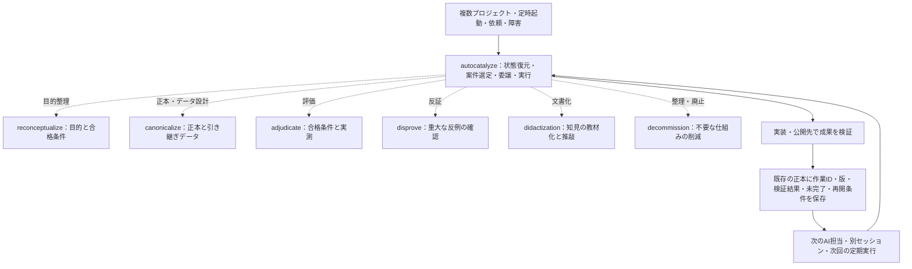

# Kafstyler

**Kafstylerは、複数のAIエージェント・セッション・プロジェクトをまたぐ大規模な作業を、引き継ぎながら継続して完了させるための7 Skillsです。** Claude Code、Codex、Antigravity CLIで使えます。

## なぜKafstylerか

長期間の開発や多数のリポジトリの運用では、担当AIの交代、セッション終了、定期実行、障害が発生します。そのたびに経緯を説明し直したり、完了済みの処理を繰り返したりしないために、**作業ID、対象と版、完了条件、実際の検証結果、未完了の工程、再開条件**を既存の正本に引き継ぎます。

中核の [autocatalyze](skills/autocatalyze/SKILL.md) が状態復元・案件選定・委譲・実行・復旧・次回起動をつなぎ、他の6 Skillsが専門判断を支えます。規約と記録は複数案件の継続に必要な範囲だけ使い、全Skillsの一律実行や重複台帳は作りません。

## 導入

### Claude Code

```sh
claude plugin install kafstyler --marketplace KAFKA2306/agent-resources --scope user
```

[配布元](https://github.com/KAFKA2306/agent-resources/blob/main/.claude-plugin/marketplace.json)

### Codex

```sh
codex plugin marketplace add KAFKA2306/kafstyler
codex plugin add kafstyler@kafstyler
```

### Antigravity CLI

```sh
agy plugin install https://github.com/KAFKA2306/kafstyler
agy plugin list --json
```

## まず一件試す

```text
autocatalyzeを使い、このプロジェクトの検索機能を直して。
実際の画面で検索し、期待した結果が開けることまで確認して。
作業を中断・引き継げるよう、既存のIssueまたは履歴に検証結果と再開条件を残して。
必要なSkillだけ使い、不要な仕組みは増やさないで。
```

仕事に合うスキルを選びます。Claude Codeでは `/kafstyler:decommission`、Codexでは `$decommission`、Antigravity CLIでは `/decommission` のように直接指定できます。

## 7スキル

| スキル | 役割 |
| --- | --- |
| [reconceptualize](skills/reconceptualize/SKILL.md) | 目的と完成条件 |
| [adjudicate](skills/adjudicate/SKILL.md) | 評価と採否 |
| [canonicalize](skills/canonicalize/SKILL.md) | 正本とデータ設計 |
| [didactization](skills/didactization/SKILL.md) | 知見と文章 |
| [disprove](skills/disprove/SKILL.md) | 反証レビュー |
| [decommission](skills/decommission/SKILL.md) | 不要なものの削除 |
| [autocatalyze](skills/autocatalyze/SKILL.md) | 自律実行と継続運用 |

`autocatalyze` が継続作業と引き継ぎの中核を担い、残り6 Skillsは案件に必要なときだけ使います。

## 大規模運用・引き継ぎの全体像



実線は継続運用の流れ、点線は **必要なときだけ選ぶSkills** を表します。図は組み込みの自動スケジューラーや全Skillsの同時実行を意味しません。起動は利用可能な外部のスケジューラー・実行環境を使います。[Mermaid図解の規約](AGENTS.md#mermaid図解)に従います。

## 正本・保守

[共通規約](AGENTS.md) · [ミッション](MISSION.md) · [一次資料](BIBLES.md)

モデル候補は `node .agents/select-models.mjs --baseline` で確認し、公開データから `node .agents/select-models.mjs --write` で更新します。配布変更後は、影響するCLIでスキルが見つかり、目的の操作が完了するか確かめます。フックの承認は不要です。
