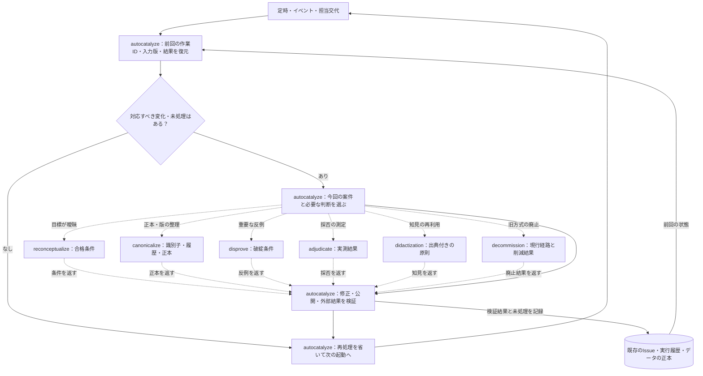

# Kafstyler

**複数のAI担当が作業を引き継ぎ、長期運用を続けるための7 Skills。**

Kafstylerは、Claude Code・Codex・Antigravity CLIで使うAIエージェント向けのSkillsです。仕事を一件ずつ終えるだけでなく、前回の成果を引き継ぎ、新しい問題を発見し、必要な改善を実行し続ける運用を設計します。

[なぜ必要か](#なぜ単発のai作業では足りないのか) · [なぜ7 Skillsか](#なぜこの7-skillsなのか) · [連携する仕組み](#常時稼働エージェントの中核) · [実務例](#7つのskillが連関して成果を出す) · [試す](#まず一件試す) · [導入](#プラグインの使い方)

## なぜ単発のAI作業では足りないのか

例えば、公表統計を毎週取得してWeb画面とCSVを更新するプロジェクトでは、初回の実装が動いた後にも仕事が発生します。公表元が過去の値を訂正し、公開画面だけ古いまま残ることがあります。取得ジョブが失敗しても、前週のCSVが残っているため正常に見えることがあります。新しい方式へ移ったのに旧ジョブが動き続け、二重に取得・通知することもあります。

さらに、AIのセッションが切れたり担当モデルが変わったりすると、どのデータを処理済みか、どの公開結果を確認したかを会話だけから復元できません。多数のリポジトリでは、こうした障害と引き継ぎが同時に発生します。

**必要なのは「指示を一回実行するAI」だけではありません。前回の状態を復元し、今回の変化に対応し、外部の成果を検証し、次回も同じ正本から続ける運用です。** Kafstylerはその判断と作業を7 Skillsに分けます。

## Kafstylerが変えること

| 単発実行で起きる問題 | Kafstylerで受け持つSkillと具体的な処理 |
| --- | --- |
| AIが交代すると、何を終えたか分からない | `canonicalize` が作業ID・入力版・最終確認結果を正本でそろえ、`autocatalyze` が再開する |
| コマンド成功を成果の成功と取り違える | `reconceptualize` が公開結果の合格条件を定め、`adjudicate` が公開先を実測する |
| 想定していない入力で間違った結果を公開する | `disprove` が改定値の取り違え・重複・取得失敗などの反例を探す |
| 修正のたびに調査や運用作業が増える | `didactization` が再利用できる知見を残し、`decommission` が旧方式を安全に廃止する |

## なぜこの7 Skillsなのか

**設計の基本は「実行の責任を一つに集め、異なる判断は分ける」ことです。** `autocatalyze` は定時・イベント・再開から案件を選び、実装と検証と引き継ぎを統括します。他の6 Skillsは必要になった判断だけを引き受け、結果を `autocatalyze` に返します。

### 7 Skillsを分ける理由

| Skill | 独立させた判断 | 混ぜたときに起こる問題 |
| --- | --- | --- |
| [`autocatalyze`](skills/autocatalyze/SKILL.md) | 今回どの案件を実行し、どこから再開し、次に何を観測するか | 複数の担当が同じ仕事を起動し、重複公開や処理漏れを起こす |
| [`reconceptualize`](skills/reconceptualize/SKILL.md) | 利用者にとって何が達成条件か | CSVを作っただけで、公開画面の古い値を見逃す |
| [`canonicalize`](skills/canonicalize/SKILL.md) | データ・作業状態の正本、識別子、更新規則は何か | 担当ごとに別の値や作業履歴を更新する |
| [`disprove`](skills/disprove/SKILL.md) | 現行の設計や仮説が破綻する条件は何か | 正常例しか試さず、二重取り込みや訂正の混同を見逃す |
| [`adjudicate`](skills/adjudicate/SKILL.md) | 固定した条件で測ると、本当に合格・改善したか | 実装した本人の主観や変更後に緩めた基準で採用する |
| [`didactization`](skills/didactization/SKILL.md) | 今回の発見の何が、別案件にも適用できるか | 作業ログは残っても、次の担当が同じ問題を再調査する |
| [`decommission`](skills/decommission/SKILL.md) | どの旧処理・規則・通知を安全に廃止できるか | 案件が増えるほど管理負荷が増え、次の改善を実行しにくくなる |

`reconceptualize` は達成条件を決め、`adjudicate` は測定して採否を決めます。`disprove` は測定項目自体が見落とした反例を探します。`canonicalize` は次回実行のための正確な状態を保ち、`didactization` は別案件にも移せる知見を残します。`decommission` は `autocatalyze` が増やした成果に付随する旧経路を減らし、運用の余力を守ります。

### なぜ一つの巨大な指示や、7つの独立常駐エージェントにしないのか

一つの巨大な指示にまとめると、簡単なバグ修正にも無関係な記事作成・監査・台帳更新が入り、どの判断が必要だったのか分かりにくくなります。反対に7 Skillsそれぞれが定期実行や正本の更新を独立して担うと、同じ案件への二重書き込みと実行状態の不一致が起きやすくなります。

したがって、**`autocatalyze` は時間をまたぐ実行と引き継ぎを一元化し、他の6 Skillsは案件ごとに必要な専門判断だけを返す**構成にします。7 Skillsは毎回すべて実行する工程ではありません。Skillそのものは常駐サービスやジョブ実行基盤ではありません。導入先の認可済みスケジューラー・実行環境が実際の起動と処理を担います。

## 常時稼働エージェントの中核

### `autocatalyze` がどのように6 Skillsを使うか



**点線は必要な場合だけ呼び出す専門Skill、実線は継続する運用です。** 複数の専門Skillを使う回も、一つも使わない回もあります。`autocatalyze` の手順は、更新がないときの再取得を省き、公開結果を読み戻し、失敗時は再開条件を記録することを求めます。ただし、これらの処理が実際に成功するかは導入先の実装・権限・実行結果で確認する必要があります。

## 大規模な開発を支える仕組み

### 7つのSkillが連関して成果を出す

公表統計を毎週取得し、Web画面とCSVを更新するケースでは、次のように**具体的な入力と出力**を引き継ぎます。

| Skillの仕事 | 次のSkillへ渡すもの |
| --- | --- |
| [`autocatalyze`](skills/autocatalyze/SKILL.md) は前回の実行記録と公表元の更新を比べ、訂正対象の系列と期間を選ぶ | 対象系列ID・対象月・入力版を `reconceptualize` と `canonicalize` へ |
| [`reconceptualize`](skills/reconceptualize/SKILL.md) は「WebとCSVが同じ改定値・単位・出典を表示する」を合格条件にする | 代表入力と確認操作を `adjudicate` へ |
| [`canonicalize`](skills/canonicalize/SKILL.md) は系列ID・対象月・公表日で初報と改定値を区別し、WebとCSVの正本をそろえる | 正本の場所・識別子・再処理範囲を `autocatalyze` へ |
| [`disprove`](skills/disprove/SKILL.md) は取得失敗・重複取り込み・古いCSVの再公開を反例として調べる | 破綻する入力と修正条件を `autocatalyze` と `adjudicate` へ |
| [`autocatalyze`](skills/autocatalyze/SKILL.md) は必要な取得・集計・公開コードを修正し、公開結果を読み戻す | 公開URL・CSV・実行ログを `adjudicate` へ |
| [`adjudicate`](skills/adjudicate/SKILL.md) は公表元・Web・CSVの値と出典を照合し、再実行後の行数も調べる | 合否・実測値・再現手順を `autocatalyze` へ。不合格なら修正に戻す |
| [`didactization`](skills/didactization/SKILL.md) は再現した訂正パターンと例外を、他のデータ更新にも使える知見にまとめる | 根拠と適用条件を既存の知識正本へ |
| [`decommission`](skills/decommission/SKILL.md) は後継の結果を確認したうえで、旧ジョブ・重複集計・不要な通知を廃止する | 残す経路・削減した処理・機能維持の結果を `canonicalize` と `autocatalyze` へ |
| [`canonicalize`](skills/canonicalize/SKILL.md) は作業ID・コミット・確認済み結果・未処理・次の起動条件を既存の記録にそろえる | 次回の `autocatalyze` と交代したAI担当が読む再開情報 |

この表は**複数のSkillsが必要だったケース**であり、全案件に9工程を課すものではありません。例えば更新がなければ `autocatalyze` は再取得を省きます。文章に新しい発見がなければ `didactization` に新規記事を作らせません。

## decommissionが常時稼働の実行力を守る

**`decommission` は、継続運用で増え続ける維持管理の負担を減らし、次の改善に使える実行余力を取り戻すSkillです。** 新方式の移行後も旧ジョブが残ると、同じデータの取得、古いCSVの上書き、二重通知が続き得ます。`canonicalize` が現行の正本を定義し、`adjudicate` が新方式の利用結果を測定したあと、`decommission` が旧ジョブ・設定・参照を整理します。`autocatalyze` は次の起動で新方式だけが動くことを確かめます。

価値を測るのは削除ファイル数ではありません。**必要な機能を維持したまま、減らせた起動回数・処理時間・費用・誤通知・保守対象**です。未測定の効果は改善したと断定しません。不要と確認できない現役の依存は削除しません。

### 提供しているものと、まだ実証していないもの

**リポジトリで確認できるもの：** 7つの `skills/*/SKILL.md`、Claude Code・Codex・Antigravity CLI向けプラグイン定義、モデル候補を更新するGitHub Actionsのワークフローです。Skillは作業手順と判断条件を記述しています。

**このリポジトリだけでは確認できないもの：** 複数AIへの実際の作業引き継ぎ、定期起動による一連の自動実装・復旧、公開先での成功率、運用費用の削減率です。モデル選定用の定期ワークフローが存在することと、常時稼働エージェント全体が実動していることは別です。導入先で実行し、ログと公開成果を検証したときにのみ、動作実績として報告します。

## 何をもって設計の有効性を確かめるか

| 実際に試す状況 | 合格とみなす結果 |
| --- | --- |
| `autocatalyze` が同じ入力で途中失敗・再起動する | `canonicalize` の記録から続きが分かり、公開結果が二重にならない |
| `adjudicate` が改定値を含むCSVを検証する | 公表元・公開画面・CSVの値、単位、出典が一致する |
| 前回の担当AIと会話できない状態で再開する | `autocatalyze` が既存記録から対象版・確認済み結果・残作業を復元できる |
| `decommission` が旧ジョブを廃止する | 後継だけが次回起動し、必要な成果を一度だけ出す |
| 公表元に変化がない周期を実行する | `autocatalyze` が不要な再取得・再公開を行わない |

これは評価**方法**であり、成功率や費用削減率を実測した結果ではありません。`adjudicate` で同じ条件の前後比較を行い、`disprove` で見落とした失敗条件がないか調べます。結果に応じてSkill間の境界も見直します。

## まず一件試す

公開リポジトリを題材に、現状確認から一件の改善と次回への引き継ぎを試せます。対象URLは自分のプロジェクトに置き換えられます。

```text
対象: https://github.com/KAFKA2306/semiconductor-earnings-model

Kafstylerのautocatalyzeを使い、既存のIssueと実際の公開成果を調べ、
いま最も価値のある改善を一件選び、実装・検証・反映まで進めてください。
必要なSkillsだけを使い、次回は別のAI担当でも再開できるよう
作業ID、対象版、判断根拠、検証結果、未処理と次の起動条件を既存の記録に残してください。
```

継続運用は既存の定時・イベント起動と組み合わせます。詳しくは [autocatalyze](skills/autocatalyze/SKILL.md#常駐エージェントと定期実行) を参照してください。

## プラグインの使い方

[Claude Code](#claude-code) · [Codex](#codex) · [Antigravity CLI](#antigravity-cli)

### Claude Code

```sh
claude plugin install kafstyler --marketplace KAFKA2306/agent-resources --scope user
```

[配布元](https://github.com/KAFKA2306/agent-resources/blob/main/.claude-plugin/marketplace.json)。対象プロジェクトで `claude` を起動します。

### Codex

```sh
codex plugin marketplace add KAFKA2306/kafstyler
codex plugin add kafstyler@kafstyler
```

対象プロジェクトで `codex` を起動します。

### Antigravity CLI

```sh
agy plugin install https://github.com/KAFKA2306/kafstyler
agy plugin list --json
```

対象プロジェクトで `agy` を起動します。

### 依頼を送って使う

必要なSkillを直接指定する場合は、Claude Codeで `/kafstyler:autocatalyze`、Codexで `$autocatalyze`、Antigravity CLIで `/autocatalyze` を使います。たとえばデータ移行では `canonicalize`、旧方式の整理では `decommission` を選べます。

### プラグインの更新と検証

- Claude Code: `claude plugin update kafstyler@kafka-agent-tools`。新しいセッションまたは `/reload-plugins` で変更を反映します。
- Codex: `codex plugin marketplace upgrade kafstyler` と `codex plugin add kafstyler@kafstyler`。新しいセッションで読み込みを確認します。
- Antigravity CLI: `agy plugin list --json` で導入版とSkillsの検出を確認します。

### 作業中の版で試す

Claude Codeは `claude plugin validate .`、Antigravity CLIは `agy plugin validate --json .` など、各CLIの標準の検証を使います。変更したSkillが読み込まれることと、該当する実際の依頼の結果を確認します。スキル呼び出しのためのフック承認・全Markdown監査は不要です。

## 成果から使い方を選ぶ

分野が変わっても、`autocatalyze` が案件を選び、必要なSkillが結果を返し、その成果を次の観測へ引き継ぎます。「イベント収集を直して」なら、[公開カレンダー](https://github.com/KAFKA2306/cast_event_cal)のURLと「開催回が公開WebとICSに一度ずつ載り、主催者の告知を開ける」という合格条件を渡します。目的と結果は[作業台帳](AGENTS.md#正本と記録)に残ります。

### 開発・運用

停止した処理を最終成功時刻と失敗ログから直し、次の結果を利用者のURLで確認する。画面は初見で情報と出典を探し、迷った操作と合格条件を一件にまとめる。[定期運用](https://github.com/KAFKA2306/agent-resources) · [画面の評価例](https://github.com/KAFKA2306/design/blob/main/docs/frontend-review.md)

### 記事・動画・音声

記事は実際の発見から再利用できる原則を抽出し、数値や実験を一次資料・再実行で確かめ、成立しない条件を示す。発見がないときは既存記事を改善し、新規公開や重複を増やさない。動画は音声・字幕を通しで確認し、公開先でチャンネル・公開状態を確かめる。音声は同じ台詞で比較し、採用WAV・モデル・シード・参照音声を残す。[記事](https://github.com/KAFKA2306/articles/blob/main/articles/kafstyler-agent-quality-loop.md) · [動画](https://github.com/KAFKA2306/yt3) · [音声](https://github.com/KAFKA2306/yt4)

### VRChat・3D・画像制作

ワールドでは初期位置から展示へ歩き、案内を読んで操作する。衣装はUnityで取り込み・装着し、指定ポーズで貫通とウェイト崩れを確認する。画像は素材・シード・サイズをそろえ、画質と処理時間を比べる。[VRMine](https://github.com/KAFKA2306/vrmine) · [衣装](https://github.com/KAFKA2306/image2outfit) · [ComfyUIの制作台帳](https://github.com/KAFKA2306/comfyui-workflows-factory)

### ボードゲーム・ゲーム

スマホで作品と版を選び、プレイ中に裁定と公式説明書の該当ページを開く。MODはSteam版に導入し、プレイ中に効果を確かめる。[ボドゲのミカタ](https://bodoge-no-mikata.vercel.app/) · [Slay the Spire 2のMOD](https://github.com/KAFKA2306/sts2)

### 企業・市場の調査

半導体の価格と出荷は決算期・単位をそろえ、実績・会社予想・シナリオを分けて、公開画面で式と一次開示を開く。統計は初報・改定値を対象月・公表日で区別し、公開CSVを原資料と照合する。[半導体決算モデル](https://github.com/KAFKA2306/semiconductor-earnings-model) · [米雇用統計](https://github.com/KAFKA2306/nonfarmpayroll)

### 科学・製造の調査

同じ材料・加工目的の候補を一次資料から探し、温度・圧力・速度などの条件と歩留まり・欠陥率を表にする。論文は対象・比較条件・測定値と引用箇所を記録し、案件で試せる条件を選ぶ。[製造工程の調査](https://github.com/KAFKA2306/factory) · [arXiv調査](https://github.com/KAFKA2306/daily-arXiv-ai-enhanced)

技術白書を作る場合は、[執筆の一次資料](BIBLES.md#技術白書の執筆)を起点に、`reconceptualize` が導入目的と採否条件を定め、`canonicalize` が論文・実験の版と数値をそろえます。`disprove` が不利な結果や例外を探し、`adjudicate` が同条件で候補を比較します。`didactization` が根拠と限界を読者の判断につなげ、`decommission` が旧稿・重複説明を整理し、`autocatalyze` が公開版を検証して改訂を引き継ぎます。[白書の執筆手順](skills/didactization/SKILL.md#技術白書を構成する)

### Kaggle

データ版・時系列分割・公式指標・ベースラインをそろえ、手元の検証と公式提出の結果を分けて記録する。[商品価格予測コンペ](https://github.com/KAFKA2306/mitsuikaggle)

### 暮らしと学習

家計は明細の再取り込みで件数・合計が変わらず、差額から元の取引を開けるか試す。蔵書は同じ作品の別版を区別し、目的のノートに戻る。旅行は公式時刻・総額・取消条件を比べ、現地時刻で乗り換えを確かめる。[家計](https://github.com/KAFKA2306/kakeibo) · [蔵書](https://github.com/KAFKA2306/books) · [旅行計画](https://github.com/KAFKA2306/travel)

## スキル

Claude Codeは `/kafstyler:<名前>`、Codexは `$<名前>`、Antigravity CLIは `/<名前>` からSkillを選びます。各Skillの目的と判断基準は[7つのSkillが連関して成果を出す](#7つのskillが連関して成果を出す)を参照してください。

端末を閉じた後の定期実行やイベント起動は、[autocatalyzeの実行方法](skills/autocatalyze/SKILL.md#常駐エージェントと定期実行)を使います。実行前に必要な権限と接続、前回の状態を確認します。

## Unity・VRChatで制作する

汎用Unityは `CoplayDev/unity-mcp`、VRChat Worldsは `swax/UnityMCP-VRC`、VRChat Avatarsは `lighfu/unity-agent` を使い、Unity EditorやVRChat SDKで成果を確かめます。[公式の接続手順](BIBLES.md#ユニティとvrchatの制作ツール)

## 外部スキルとテンプレート

### 成果物の根拠調査と推敲

imozuruで根拠を原文までたどり、yomiyasuで説明を整え、反証レビューで利用場面に照らします。Claude CodeかCodexの新しいセッションで両方を選べることを確かめます。[成果物の確認手順](skills/didactization/SKILL.md#本文の推敲と提出前の確認)

```sh
npx skills add MaryCache/imozuru
npx skills add nanaism/yomiyasu
```

### Googleのフロントエンド設計スキル

KAFKA2306のWeb UIを設計するときは[かふかのデザインパターン](BIBLES.md#かふかのデザインパターン)を先に確認します。Claude Codeで `/plugin marketplace add google-gemini/demolab`、`/plugin install demolab@demolab` の順に実行し、`/demolab:gemini-frontend-design` で設計案を検討します。[Google Gemini DemoLabの導入手順](https://github.com/google-gemini/demolab#claude-code)

### ComfyUIのワークフローテンプレート

[採用基準](BIBLES.md#comfyuiのワークフロー選定)に合わせ、`Workflow → Browse Workflow Templates` で候補を開き、必要なモデルと出力を確認します。[ComfyUI公式手順](https://docs.comfy.org/interface/features/template) · [テンプレートの正本](https://github.com/Comfy-Org/workflow_templates)

## ミッション・聖典・作業規約

[ミッション](MISSION.md) · [一次資料の聖典台帳](BIBLES.md) · [共通作業規約](AGENTS.md) · [目次](index.md)

過去の知見を次の仕事へつなぐために、引き継ぐ判断・版・根拠は既存の正本に残します。案件固有の実装と履歴は案件のリポジトリで管理します。
