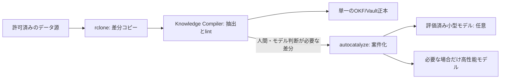
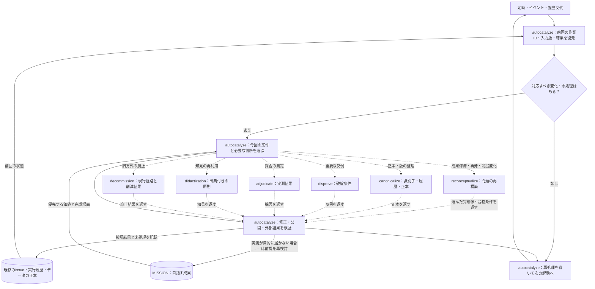
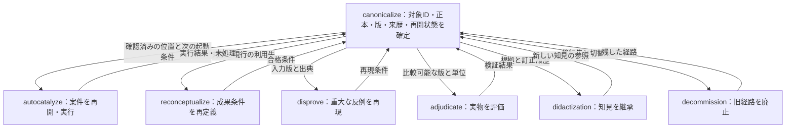

# Kafstyler

**なぜ、AIに仕事を任せるほど運用が複雑になるのか。**

複数のAIが開発や公開を繰り返すと、プロジェクトごとに旧実装、定期処理、検証、判断履歴が積み上がります。AIが交代すると以前の判断や公開結果を調べ直し、既に成功した工程の再実行や、残された旧方式との二重動作が起こります。

**Kafstylerは、一個人の構想を永続的な知能機関へ変える7 Skillsです。** モデル・端末・担当AIを交換しても使命、来歴付き正本、実世界で観測した成果を継承する。Claude Code・Codex・Antigravity CLIで使い、`autocatalyze`が案件選定・実行・検証・次回起動を統括します。`reconceptualize`・`canonicalize`・`disprove`・`adjudicate`・`didactization`・`decommission`は、目的、正本、反証、実測、知見、廃止の判断を分担します。

[設計の理由](#なぜこの7-skillsなのか) · [連携構造](#常時稼働エージェントの中核) · [正本と引き継ぎ](#canonicalizeが大規模運用の共通基盤をつくる) · [大規模運用](#7つのskillが連関して成果を出す) · [導入](#プラグインの使い方)

## Kafstylerが変えること

| 大規模運用の課題 | 解決を担当するSkill |
| --- | --- |
| 担当交代で案件の状態が失われる | `canonicalize`が作業ID・対象版・公開結果を正本にまとめ、`autocatalyze`が再開する |
| 修正が増えても利用者の体験が改善しない | `reconceptualize`が目的や手段を問い直して解く問題を選び、`adjudicate`が実際の成果で採否を決める |
| 重大な入力や障害を見落とす | `disprove`が反例を探し、`autocatalyze`が必要な修正を実行する |
| 同じ失敗を何度も調査する | `didactization`が根拠と再現条件を別案件でも使える知見にする |
| 旧実装・ジョブ・監視が増え続ける | `decommission`が後継の動作を確認して旧経路を廃止し、次の案件に使う余力を戻す |

**旧方式を残さない移行。** `canonicalize` が新しい正本を決め、`autocatalyze` が利用側を切り替え、`decommission` が旧定義・互換経路・重複起動を廃止します。既存データの保持と実動作は `adjudicate`・`disprove` で確認します。[破壊的移行の規約](AGENTS.md#破壊的移行と旧方式の廃止) · [原典](bibles/knowledge-and-obsidian.md#互換を残さない移行)

## MISSION駆動・Issue駆動

**MISSIONが成果を決め、Issueが実行をつなぎ、検証結果が次の使命判断を変える。** `autocatalyze` はプロジェクトの目的・未完了Issue・実物の結果を照合し、最も重要な問題から実行する。`reconceptualize` が未登録の問題も発見し、`canonicalize` がIssue・コミット・確認済みの成果を結ぶ。Issueを閉じた数ではなく、目的に対する実際の改善で次の案件を選び直す。

[MISSION](MISSION.md#mission起点のissue駆動) · [運用規約](AGENTS.md#missionとissueの運用) · [GitHub公式資料](bibles/mission-eval-writing.md#missionとissueによる案件選定)

## 外部ツールで回す日常保守

常駐するのはLLMではなくスケジューラー。データ差分はrclone、抽出・OKF準拠のVault整形はKnowledge Compiler、起動はOS、必要なAI作業の受付はOrcaに任せる。Kafstylerは既存7 Skillsで正本・評価・成果をつなぐ。



WSL等のbash環境では、`OBSIDIAN_VAULT_PATH`に既存Vaultを設定して[`scripts/vault-maintenance.sh`](scripts/vault-maintenance.sh)を`--check`で検査する。`KAFSTYLER_INGEST_SOURCE`を指定した場合は`--apply`でrcloneから取得・抽出し、形式修復・検証する。Git管理Vaultはcleanな`main`でのみ実行し、検証済み差分をローカルコミットする。OSの定期登録・元データの認可・既存ジョブの切替は[実行手順](skills/autocatalyze/SKILL.md#外部ツールによるゼロトークン保守)に従う。実行環境を接続していない場合は自動稼働しない。

[原典](bibles/agents-and-orca.md#外部主導の差分取り込みとvault保守) · [単一正本](skills/canonicalize/SKILL.md#vaultとパスの単一正本) · [モデルの採否](skills/adjudicate/SKILL.md#低コスト常駐を評価する)

## なぜこの7 Skillsなのか

[使命と五原則](MISSION.md#組織エントロピーを反転する五原則) · [3層実行と停止契約](AGENTS.md#計算資源の3層配分と停止契約) · [比較評価](AGENTS.md#kafstyler自身の反証と比較評価)

**設計の基本は「実行の責任を一つに集め、異なる判断は分ける」ことです。** `autocatalyze` は定時・イベント・再開から案件を選び、実装と検証と引き継ぎを統括します。他の6 Skillsは必要になった判断だけを引き受け、結果を `autocatalyze` に返します。

### 7 Skillsを分ける理由

| Skill | 独立させた判断 | 混ぜたときに起こる問題 |
| --- | --- | --- |
| [`autocatalyze`](skills/autocatalyze/SKILL.md) | 今回どの案件を実行し、どこから再開し、次に何を観測するか | 複数の担当が同じ仕事を起動し、重複公開や処理漏れを起こす |
| [`reconceptualize`](skills/reconceptualize/SKILL.md) | 実績から本当に解くべき問題を見つけ、どの完成像を選ぶか | 与えられたIssueや既存手段の達成だけで満足し、本来の問題を放置する |
| [`canonicalize`](skills/canonicalize/SKILL.md) | **複数AIが共有する対象・正本・版・判断・再開状態をどう一貫させるか** | 担当ごとに異なる定義を使い、誤った再実行、比較、旧版の削除を招く |
| [`disprove`](skills/disprove/SKILL.md) | 現行の設計や仮説が破綻する条件は何か | 監視停止・公開先の不整合・二重実行を見逃す |
| [`adjudicate`](skills/adjudicate/SKILL.md) | 固定した条件で測ると、本当に合格・改善したか | 実際の公開結果や費用を比較せず、差分だけで改善を判断する |
| [`didactization`](skills/didactization/SKILL.md) | 今回の発見の何が、別案件にも適用できるか | 他プロジェクトに過去の失敗と解決策が共有されず、調査を繰り返す |
| [`decommission`](skills/decommission/SKILL.md) | どの旧処理・規則・通知を安全に廃止できるか | 旧経路と検証が累積し、次の改善の時間・費用を圧迫する |

`reconceptualize` は依頼や利用結果から目的そのものを見直して完成像を選び、`adjudicate` は測定して採否を決めます。`disprove` は測定項目自体が見落とした反例を探します。`canonicalize` は対象・版・出典・処理位置を共通の正本につなぎ、他の6 Skillsが同じ事実と判断を引き継げるようにします。`didactization` は別案件にも移せる知見を残します。`decommission` は `autocatalyze` が増やした成果に付随する旧経路を減らし、運用の余力を守ります。

### なぜ一つの巨大な指示や、7つの独立常駐エージェントにしないのか

一つの巨大な指示にまとめると、簡単なバグ修正にも無関係な記事作成・監査・台帳更新が入り、どの判断が必要だったのか分かりにくくなります。反対に7 Skillsそれぞれが定期実行や正本の更新を独立して担うと、同じ案件への二重書き込みと実行状態の不一致が起きやすくなります。

したがって、**`autocatalyze` は時間をまたぐ実行と引き継ぎを一元化し、他の6 Skillsは案件ごとに必要な専門判断だけを返す**構成にします。必要なSkillだけを選び、定時・イベントの起動には既存の認可済みスケジューラーと実行環境を使います。

## 常時稼働エージェントの中核

### `autocatalyze` がどのように6 Skillsを使うか



**実線は継続運用、点線は必要なSkillへの委譲です。** `autocatalyze`は確認済みの作業状態を復元し、変化のある案件だけを実行して、検証結果を次の起動へ渡します。

## 大規模な開発を支える仕組み

### 7つのSkillが連関して成果を出す

対象を[イベント収集・公開](https://github.com/KAFKA2306/cast_event_cal)、[知識サイト](https://github.com/KAFKA2306/know)、[半導体決算モデル](https://github.com/KAFKA2306/semiconductor-earnings-model)の3リポジトリに広げます。イベントの欠落・重複、検索結果の参照切れ、決算の単位や期間の誤集計は、異なる実装を持ちながら、**正本の整合・実物の検証・担当交代**という共通の運用課題を持ちます。

| Skill | 複数リポジトリに対する仕事 | 次へ渡す結果 |
| --- | --- | --- |
| [`autocatalyze`](skills/autocatalyze/SKILL.md) | 3件の公開先・失敗ログ・Issue・最終確認版を調べ、優先案件を選ぶ | 対象ID・コミット・最終成功・未処理 |
| [`reconceptualize`](skills/reconceptualize/SKILL.md) | 公開結果と再発する問題を調べ、検索・出典確認・数値追跡のうち最も重要な利用者の障害から完成像を選ぶ | 問題の根拠・採用する完成像・利用者の操作と合格条件 |
| [`canonicalize`](skills/canonicalize/SKILL.md) | イベントID、記事の出典と改訂、決算期・単位をそれぞれの正本に統一する | 識別子・入力版・履歴・再開位置 |
| [`disprove`](skills/disprove/SKILL.md) | イベントの二重掲載、記事の参照切れ、決算期をまたぐ誤集計を調べる | 反例・再現入力・修正条件 |
| [`autocatalyze`](skills/autocatalyze/SKILL.md) | 取得・検索・集計の必要なコードを修正し公開先を読み戻す | 修正コミット・公開URL・実行ログ |
| [`adjudicate`](skills/adjudicate/SKILL.md) | 公開画面・検索結果・決算値を出典と照合し、変更前後を比較する | 合否・実測値・再現手順 |
| [`didactization`](skills/didactization/SKILL.md) | 原因と解決条件を他のリポジトリでも使える知見にする | 出典・適用条件・再現手順 |
| [`decommission`](skills/decommission/SKILL.md) | 後継の動作を確認して旧取得ジョブ・二重台帳・重複監視を廃止する | 維持した機能・廃止箇所・削減した負担 |
| [`canonicalize`](skills/canonicalize/SKILL.md) | 作業ID・確認済みコミット・公開結果・未処理と再開条件をまとめる | 次回の`autocatalyze`と交代するAIが読む状態 |

**`autocatalyze`は案件間の優先順位と再開を担い、6 Skillsは異なるプロジェクトへ移せる専門的な判断を返します。** 一件の成果を検証した後も、新たな障害や次の更新を観測します。

## canonicalizeが大規模運用の共通基盤をつくる

**`canonicalize`は、AIが交代し、プロジェクトが増えても、同じ対象を同じ意味・版・状態で扱えるようにするSkillです。** `autocatalyze`がどれだけ多くの案件を実行しても、成果と判断が別々のファイル・Issue・セッションに分裂すれば、次の担当は正しい続きを選べません。正本の分裂は誤った再実行、データの二重公開、検証のやり直し、旧方式の誤削除につながります。

`canonicalize`は管理対象ごとに**正本、識別子、版、出典、更新経路、状態遷移**を確定し、既存のIssue・実行履歴・データ管理先を参照できる形に結びます。すべてを一つの巨大な台帳へ集約するのではなく、**同じ意味の情報に競合する現行の正本を作らない**ことが中心です。

| 連携するSkill | `canonicalize`から渡すもの | 成果への寄与 |
| --- | --- | --- |
| [`autocatalyze`](skills/autocatalyze/SKILL.md) | 作業ID、対象コミット、処理済み位置、未処理、再開条件 | セッションやAI担当を替えても、確認済みの位置から次の作業を選べる |
| [`reconceptualize`](skills/reconceptualize/SKILL.md) | 対象の識別子、現行の利用先、判断の版 | 異なる担当が同じ対象と成果条件について議論できる |
| [`disprove`](skills/disprove/SKILL.md) | 入力版、出典、訂正履歴、現行の契約 | 同じ条件で破綻例を再現し、原因を切り分けられる |
| [`adjudicate`](skills/adjudicate/SKILL.md) | 比較対象の版、単位、粒度、測定結果の参照先 | 実装前後を取り違えず、同条件で採否を判断できる |
| [`didactization`](skills/didactization/SKILL.md) | 主張と結び付いた原資料、数値、版、訂正履歴 | 過去の知見を更新・引用しても根拠をたどれる |
| [`decommission`](skills/decommission/SKILL.md) | 現行の正本、旧版からの対応、切替条件、参照元 | 必要な情報を移した後で旧経路を安全に廃止できる |

### canonicalizeが統一する実際の対象

[cast_event_cal](https://github.com/KAFKA2306/cast_event_cal)では開催回のID、主催者の告知、公開Webとカレンダーファイルの対応をそろえます。[know](https://github.com/KAFKA2306/know)では記事の出典、作成・改訂時点、旧URLと現行記事の関係をそろえます。[semiconductor-earnings-model](https://github.com/KAFKA2306/semiconductor-earnings-model)では企業、決算期、通貨・単位、一次開示と計算モデルの関係をそろえます。それぞれの正本は各プロジェクトに置き、`autocatalyze`が共通の作業IDと実行履歴から引き継ぎます。



**`autocatalyze`が運用を前へ進め、`canonicalize`がその成果を失わず次の担当へ渡せる状態にします。** この二つを切り離すと、継続実行はできても、何を引き継ぐべきかが曖昧になります。

## decommissionが常時稼働の実行力を守る

**`decommission`は、次の成果を生むための実行余力を回復するSkillです。** 新方式への移行後に旧ジョブ・通知・互換分岐・二重データ・重複検査を残すと、案件数とともに処理費用、実行時間、故障箇所が増え続けます。

`canonicalize`は残す正本を定め、`adjudicate`は後継の公開動作を比較し、`decommission`は旧経路を停止して参照元まで削除します。`autocatalyze`は次回の起動で現行経路を確認し、回復した処理時間・費用・管理負担を次の案件選定に反映します。

**成果は削除件数ではなく、機能を維持したまま減らした実行回数・費用・時間・保守対象です。**

## 何をもって設計の有効性を確かめるか

| 評価対象 | 実際に確認する結果 |
| --- | --- |
| `autocatalyze` の再開 | 担当交代後も、対象リポジトリ・確認済みコミット・残作業を既存履歴から復元できる |
| `canonicalize` の一元管理 | 各公開成果が正しい識別子・版・出典を参照し、再処理で重複しない |
| `disprove` と `adjudicate` の品質評価 | 重大な反例を検出し、利用者の操作と公開結果を同条件で評価できる |
| `didactization` の知見継承 | 他リポジトリで過去の検証方法・解決条件を再利用できる |
| `decommission` の廃止 | 旧ジョブを停止しても成果が維持され、処理回数・費用・管理負担が減る |

## まず一件試す

```text
対象:
- KAFKA2306/cast_event_cal
- KAFKA2306/know
- KAFKA2306/semiconductor-earnings-model

autocatalyzeで各リポジトリの公開先・実行履歴・Issueを確認し、
利用者への影響が最も大きい案件を選ぶ。
必要なSkillで目標・正本・重大な反例・合格条件を確かめ、
実装、公開、利用者の入口での検証まで進める。
後継が確認された旧処理はdecommissionで廃止する。
既存履歴に対象コミット・検証結果・未処理・再開条件を残し、
次回の実行で続きから始める。
```

[autocatalyzeの定時・イベント起動](skills/autocatalyze/SKILL.md#常駐エージェントと定期実行)

## プラグインの使い方

[Claude Code](#claude-code) · [Codex](#codex) · [Antigravity CLI](#antigravity-cli)

### Claude Code

```sh
claude plugin install kafstyler --marketplace KAFKA2306/agent-resources --scope user
```

[配布元](https://github.com/KAFKA2306/agent-resources/blob/main/.claude-plugin/marketplace.json)。対象プロジェクトで `claude` を起動します。

### Codex

```sh
codex plugin marketplace add KAFKA2306/kafstyler
codex plugin add kafstyler@kafstyler
```

対象プロジェクトで `codex` を起動します。

### Antigravity CLI

```sh
agy plugin install https://github.com/KAFKA2306/kafstyler
agy plugin list --json
```

対象プロジェクトで `agy` を起動します。

### Orca

[Orca](https://orca.dev/docs)がある環境では、`autocatalyze`が仕事の性質に応じてOrcaの端末、監督付きワーカー、Automations、Bots、ブラウザー、Remote Server、利用枠の観測を選びます。Kafstylerの7 SkillsはClaude Code・Codex・Antigravityに共通のまま維持し、`canonicalize`が正本と再開位置を管理します。単発の仕事をわざわざ多段のOrchestrationにせず、複数担当や継続実行ではOrcaの管理機能を使います。[機能選択の手順](skills/autocatalyze/SKILL.md#orca機能を選んで使う) · [公式Skills仕様](https://orca.dev/docs/cli/skills)

```sh
orca status --json
orca worktree current --json
orca skills installed --json
# 監督付きの複数担当が必要なときだけ
orca skills get orchestration --full
```

**設定の優先順位はKafstylerが上です。** OrcaのBotが通常作成する新しいworktreeより、[Kafstylerの作業規約](AGENTS.md#orcaなど外部実行環境との優先順位)に従います。`main`一本・1ワークツリーで書き込みを直列化し、別リポジトリの作業や読み取り専用の調査を並列化します。

Orcaは、複数AIの[セッション検索](https://orca.dev/docs/cli/reference#session-search)、[監督付きワーカー](https://orca.dev/docs/cli/orchestration)、[ブラウザー検証](https://orca.dev/docs/cli/overview#browser-automation)、[リモートPCとスマホ](https://orca.dev/docs/ways-to-run)にも活用します。**Plugins・Skills・MCP・Botsを区別して追加**し、[拡張の採用判断](bibles/agents-and-orca.md#orcaの拡張を選ぶ)から必要なものだけ使います。[横断運用の構想](skills/autocatalyze/SKILL.md#orcaの横断運用) · [公式資料](bibles/agents-and-orca.md#orcaを横断運用の実行基盤にする)

初回はOrcaの`Settings → General → Orca CLI`でCLIを登録し、AgentsとSkills画面で使用するエージェントとSkillを確認します。`Settings → Plugins`では標準機能では扱えない成果物がある場合だけ[公式カタログ](bibles/agents-and-orca.md#orcaの拡張を選ぶ)から選びます。Kafstylerの編集は既存`main`のタブで行い、Botの標準コード変更フローが新しいworktreeを作る場合は使いません。

OrcaのAutomationsは定時実行、BotsはGitHub・Slack等からのイベント受付と返答、Remote Serverは常駐ホストとPC・スマホ間の継続操作を担います。**7 SkillsはOrca専用Pluginへ移さず、Codex・Antigravity・Claude Codeと共通に使います。** [常駐・通信の実行手順](skills/autocatalyze/SKILL.md#orcaのautomationsとbotsを使う) · [通信IDと再開の正本](skills/canonicalize/SKILL.md#定期実行と再開の記録) · [判断根拠](bibles/agents-and-orca.md#orcaを常駐通信基盤として使う)

### 依頼を送って使う

Claude Codeでは `/kafstyler:autocatalyze`、Codexでは `$autocatalyze`、Antigravity CLIでは `/autocatalyze` で起動します。正本統合には `canonicalize`、旧経路の廃止には `decommission` を使います。

### プラグインの更新と検証

- Claude Code: `claude plugin update kafstyler@kafka-agent-tools`。新しいセッションまたは `/reload-plugins` で変更を反映します。
- Codex: `codex plugin marketplace upgrade kafstyler` と `codex plugin add kafstyler@kafstyler`。新しいセッションで読み込みを確認します。
- Antigravity CLI: `agy plugin list --json` で導入版とSkillsの検出を確認します。

### 作業中の版で試す

Claude Codeは `claude plugin validate .`、Antigravity CLIは `agy plugin validate --json .` で構造を検査し、各CLIでSkillの読み込みと実際の依頼の動作を確認します。

## 成果から使い方を選ぶ

`autocatalyze`が公開成果と運用履歴を観測し、必要なSkillが分野固有の問題を解決します。成果の版、検証方法、再開条件を共有し、複数の担当AIが次の更新へ引き継ぎます。

### 開発・運用

複数のGitHub Pagesや公開サービスを対象に、公開先での機能障害を検出し、原因となる変更を修正、再公開、回帰確認します。`canonicalize`が各サイトの正本とリリース版を管理し、`adjudicate`が実利用の操作を確かめ、`decommission`が旧配布経路・重複監視を整理します。[定期運用](https://github.com/KAFKA2306/agent-resources) · [画面設計](https://github.com/KAFKA2306/design)

### 記事・動画・音声

研究・一次資料の検証から記事の改訂、動画の字幕・音声確認、公開後の追跡までをつなぎます。`didactization`は複数の制作物に適用できる知見を残し、`adjudicate`は公開成果と品質を確認し、`canonicalize`が原典・音源・モデル・版を追跡できる状態にします。[記事](https://github.com/KAFKA2306/articles) · [動画](https://github.com/KAFKA2306/yt3) · [音声](https://github.com/KAFKA2306/yt4)

### VRChat・3D・画像制作

画像生成、3Dモデル化、Unityへの取り込み、ワールドとアバターへの適用を制作パイプラインとして扱います。`reconceptualize`が利用場面を定義し、`disprove`が破綻しやすい素材・ポーズ・構成を調べ、`adjudicate`が出力品質と実環境の操作を確認します。使われなくなったワークフローは`decommission`で整理します。[VRMine](https://github.com/KAFKA2306/vrmine) · [衣装制作](https://github.com/KAFKA2306/image2outfit) · [ワークフロー](https://github.com/KAFKA2306/comfyui-workflows-factory)

### ボードゲーム・ゲーム

説明書・版・裁定の正本と、ゲームの実動作やMODの互換性を継続して管理します。`canonicalize`が作品と版を区別し、`disprove`が例外と不整合を調べ、`adjudicate`がゲーム中の利用結果を確かめます。[ボドゲのミカタ](https://bodoge-no-mikata.vercel.app/) · [Slay the Spire 2](https://github.com/KAFKA2306/sts2)

### 企業・市場の調査

企業開示と公表統計の取得、訂正履歴、決算期・通貨・単位の統一から、計算モデルと公開画面までを追跡します。`canonicalize`は数値と出典の正本をそろえ、`disprove`は前提と感応度の弱点を探し、`adjudicate`は実績・予測・シナリオの比較条件を固定します。[半導体決算モデル](https://github.com/KAFKA2306/semiconductor-earnings-model) · [米雇用統計](https://github.com/KAFKA2306/nonfarmpayroll)

### 科学・製造の調査

一次論文から材料、加工条件、歩留まり、欠陥率を収集し、再現条件と評価方法を比較します。`reconceptualize`が解く課題を定め、`disprove`が対立仮説を探し、`adjudicate`が測定条件をそろえ、`didactization`が後続の研究で使える知見を残します。[製造技術](https://github.com/KAFKA2306/factory) · [論文調査](https://github.com/KAFKA2306/daily-arXiv-ai-enhanced)

技術白書は[執筆の一次資料](bibles/mission-eval-writing.md#技術白書の執筆)を起点に、`reconceptualize`が採否条件、`canonicalize`が引用と数値の正本、`disprove`が反証、`adjudicate`が比較結果、`didactization`が論証、`decommission`が旧稿の統合を担当し、`autocatalyze`が改訂と公開を引き継ぎます。[執筆の手順](skills/didactization/SKILL.md#技術白書を構成する)

### Kaggle

データ更新、時系列分割、実験記録、ベースライン、公式提出を一つの比較可能な実験系列として扱います。`canonicalize`がデータと特徴量の版、`adjudicate`が独立検証、`disprove`がリークや評価条件の破綻を調べます。[価格予測](https://github.com/KAFKA2306/mitsuikaggle)

### 暮らしと学習

家計、蔵書、旅行計画の異なるデータをそれぞれの正本に保ち、更新、重複、外部情報の改定を継続して管理します。`canonicalize`が識別子と履歴を統一し、`adjudicate`が明細や公式条件との一致を確認し、`decommission`が不要になった同期を整理します。[家計](https://github.com/KAFKA2306/kakeibo) · [蔵書](https://github.com/KAFKA2306/books) · [旅行](https://github.com/KAFKA2306/travel)

## スキル

Claude Codeは `/kafstyler:<名前>`、Codexは `$<名前>`、Antigravity CLIは `/<名前>` からSkillを選びます。各Skillの目的と判断基準は[7つのSkillが連関して成果を出す](#7つのskillが連関して成果を出す)を参照してください。

端末を閉じた後の定期実行やイベント起動は、[autocatalyzeの実行方法](skills/autocatalyze/SKILL.md#常駐エージェントと定期実行)を使います。実行前に必要な権限と接続、前回の状態を確認します。

## Unity・VRChatで制作する

汎用Unityは `CoplayDev/unity-mcp`、VRChat Worldsは `swax/UnityMCP-VRC`、VRChat Avatarsは `lighfu/unity-agent` を使い、Unity EditorやVRChat SDKで成果を確かめます。[公式の接続手順](bibles/dev-infra-and-3d.md#ユニティとvrchatの制作ツール)

## 外部スキルとテンプレート

### 成果物の根拠調査と推敲

imozuruで根拠を原文までたどり、yomiyasuで説明を整え、反証レビューで利用場面に照らします。Claude CodeかCodexの新しいセッションで両方を選べることを確かめます。[成果物の確認手順](skills/didactization/SKILL.md#本文の推敲と提出前の確認)

```sh
npx skills add MaryCache/imozuru
npx skills add nanaism/yomiyasu
```

### Googleのフロントエンド設計スキル

KAFKA2306のWeb UIを設計するときは[かふかのデザインパターン](bibles/design-and-ui.md#かふかのデザインパターン)を先に確認します。Claude Codeで `/plugin marketplace add google-gemini/demolab`、`/plugin install demolab@demolab` の順に実行し、`/demolab:gemini-frontend-design` で設計案を検討します。[Google Gemini DemoLabの導入手順](https://github.com/google-gemini/demolab#claude-code)

### ComfyUIのワークフローテンプレート

[採用基準](bibles/design-and-ui.md#comfyuiのワークフロー選定)に合わせ、`Workflow → Browse Workflow Templates` で候補を開き、必要なモデルと出力を確認します。[ComfyUI公式手順](https://docs.comfy.org/interface/features/template) · [テンプレートの正本](https://github.com/Comfy-Org/workflow_templates)

## ミッション・聖典・作業規約

[ミッション](MISSION.md) · [一次資料の聖典台帳](BIBLES.md) · [共通作業規約](AGENTS.md) · [目次](index.md)

過去の知見を次の仕事へつなぐために、引き継ぐ判断・版・根拠は既存の正本に残します。案件固有の実装と履歴は案件のリポジトリで管理します。
