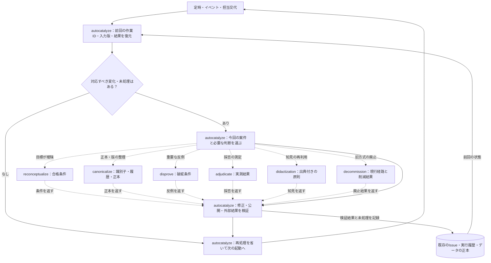

# Kafstyler

**なぜ、AIに仕事を任せるほど運用が複雑になるのか。**

複数のAIが開発や公開を繰り返すと、プロジェクトごとに旧実装、定期処理、検証、判断履歴が積み上がります。AIが交代すると以前の判断や公開結果を調べ直し、既に成功した工程の再実行や、残された旧方式との二重動作が起こります。

**Kafstylerは、複数のリポジトリで仕事を継続するための7 Skillsです。** Claude Code・Codex・Antigravity CLIで使い、`autocatalyze`が案件選定・実行・検証・次回起動を統括します。`reconceptualize`・`canonicalize`・`disprove`・`adjudicate`・`didactization`・`decommission`は、目的、正本、反証、実測、知見、廃止の判断を分担します。

[設計の理由](#なぜこの7-skillsなのか) · [連携構造](#常時稼働エージェントの中核) · [大規模運用](#7つのskillが連関して成果を出す) · [導入](#プラグインの使い方)

## Kafstylerが変えること

| 大規模運用の課題 | 解決を担当するSkill |
| --- | --- |
| 担当交代で案件の状態が失われる | `canonicalize`が作業ID・対象版・公開結果を正本にまとめ、`autocatalyze`が再開する |
| 修正が増えても利用者の体験が改善しない | `reconceptualize`が成功条件を定め、`adjudicate`が実際の成果で採否を決める |
| 重大な入力や障害を見落とす | `disprove`が反例を探し、`autocatalyze`が必要な修正を実行する |
| 同じ失敗を何度も調査する | `didactization`が根拠と再現条件を別案件でも使える知見にする |
| 旧実装・ジョブ・監視が増え続ける | `decommission`が後継の動作を確認して旧経路を廃止し、次の案件に使う余力を戻す |

## なぜこの7 Skillsなのか

**設計の基本は「実行の責任を一つに集め、異なる判断は分ける」ことです。** `autocatalyze` は定時・イベント・再開から案件を選び、実装と検証と引き継ぎを統括します。他の6 Skillsは必要になった判断だけを引き受け、結果を `autocatalyze` に返します。

### 7 Skillsを分ける理由

| Skill | 独立させた判断 | 混ぜたときに起こる問題 |
| --- | --- | --- |
| [`autocatalyze`](skills/autocatalyze/SKILL.md) | 今回どの案件を実行し、どこから再開し、次に何を観測するか | 複数の担当が同じ仕事を起動し、重複公開や処理漏れを起こす |
| [`reconceptualize`](skills/reconceptualize/SKILL.md) | 利用者にとって何が達成条件か | 公開障害を後回しにしてIssue数だけを成果とみなす |
| [`canonicalize`](skills/canonicalize/SKILL.md) | データ・作業状態の正本、識別子、更新規則は何か | リポジトリごとに状態と版が分裂し、異なるAI担当が誤った情報で再開する |
| [`disprove`](skills/disprove/SKILL.md) | 現行の設計や仮説が破綻する条件は何か | 監視停止・公開先の不整合・二重実行を見逃す |
| [`adjudicate`](skills/adjudicate/SKILL.md) | 固定した条件で測ると、本当に合格・改善したか | 実際の公開結果や費用を比較せず、差分だけで改善を判断する |
| [`didactization`](skills/didactization/SKILL.md) | 今回の発見の何が、別案件にも適用できるか | 他プロジェクトに過去の失敗と解決策が共有されず、調査を繰り返す |
| [`decommission`](skills/decommission/SKILL.md) | どの旧処理・規則・通知を安全に廃止できるか | 旧経路と検証が累積し、次の改善の時間・費用を圧迫する |

`reconceptualize` は達成条件を決め、`adjudicate` は測定して採否を決めます。`disprove` は測定項目自体が見落とした反例を探します。`canonicalize` は次回実行のための正確な状態を保ち、`didactization` は別案件にも移せる知見を残します。`decommission` は `autocatalyze` が増やした成果に付随する旧経路を減らし、運用の余力を守ります。

### なぜ一つの巨大な指示や、7つの独立常駐エージェントにしないのか

一つの巨大な指示にまとめると、簡単なバグ修正にも無関係な記事作成・監査・台帳更新が入り、どの判断が必要だったのか分かりにくくなります。反対に7 Skillsそれぞれが定期実行や正本の更新を独立して担うと、同じ案件への二重書き込みと実行状態の不一致が起きやすくなります。

したがって、**`autocatalyze` は時間をまたぐ実行と引き継ぎを一元化し、他の6 Skillsは案件ごとに必要な専門判断だけを返す**構成にします。必要なSkillだけを選び、定時・イベントの起動には既存の認可済みスケジューラーと実行環境を使います。

## 常時稼働エージェントの中核

### `autocatalyze` がどのように6 Skillsを使うか



**実線は継続運用、点線は必要なSkillへの委譲です。** `autocatalyze`は確認済みの作業状態を復元し、変化のある案件だけを実行して、検証結果を次の起動へ渡します。

## 大規模な開発を支える仕組み

### 7つのSkillが連関して成果を出す

対象を[イベント収集・公開](https://github.com/KAFKA2306/cast_event_cal)、[知識サイト](https://github.com/KAFKA2306/know)、[半導体決算モデル](https://github.com/KAFKA2306/semiconductor-earnings-model)の3リポジトリに広げます。イベントの欠落・重複、検索結果の参照切れ、決算の単位や期間の誤集計は、異なる実装を持ちながら、**正本の整合・実物の検証・担当交代**という共通の運用課題を持ちます。

| Skill | 複数リポジトリに対する仕事 | 次へ渡す結果 |
| --- | --- | --- |
| [`autocatalyze`](skills/autocatalyze/SKILL.md) | 3件の公開先・失敗ログ・Issue・最終確認版を調べ、優先案件を選ぶ | 対象ID・コミット・最終成功・未処理 |
| [`reconceptualize`](skills/reconceptualize/SKILL.md) | イベントの検索、記事の出典確認、決算の数値・式の追跡を成功条件にする | 利用者の操作と期待結果 |
| [`canonicalize`](skills/canonicalize/SKILL.md) | イベントID、記事の出典と改訂、決算期・単位をそれぞれの正本に統一する | 識別子・入力版・履歴・再開位置 |
| [`disprove`](skills/disprove/SKILL.md) | イベントの二重掲載、記事の参照切れ、決算期をまたぐ誤集計を調べる | 反例・再現入力・修正条件 |
| [`autocatalyze`](skills/autocatalyze/SKILL.md) | 取得・検索・集計の必要なコードを修正し公開先を読み戻す | 修正コミット・公開URL・実行ログ |
| [`adjudicate`](skills/adjudicate/SKILL.md) | 公開画面・検索結果・決算値を出典と照合し、変更前後を比較する | 合否・実測値・再現手順 |
| [`didactization`](skills/didactization/SKILL.md) | 原因と解決条件を他のリポジトリでも使える知見にする | 出典・適用条件・再現手順 |
| [`decommission`](skills/decommission/SKILL.md) | 後継の動作を確認して旧取得ジョブ・二重台帳・重複監視を廃止する | 維持した機能・廃止箇所・削減した負担 |
| [`canonicalize`](skills/canonicalize/SKILL.md) | 作業ID・確認済みコミット・公開結果・未処理と再開条件をまとめる | 次回の`autocatalyze`と交代するAIが読む状態 |

**`autocatalyze`は案件間の優先順位と再開を担い、6 Skillsは異なるプロジェクトへ移せる専門的な判断を返します。** 一件の成果を検証した後も、新たな障害や次の更新を観測します。

## decommissionが常時稼働の実行力を守る

**`decommission`は、次の成果を生むための実行余力を回復するSkillです。** 新方式への移行後に旧ジョブ・通知・互換分岐・二重データ・重複検査を残すと、案件数とともに処理費用、実行時間、故障箇所が増え続けます。

`canonicalize`は残す正本を定め、`adjudicate`は後継の公開動作を比較し、`decommission`は旧経路を停止して参照元まで削除します。`autocatalyze`は次回の起動で現行経路を確認し、回復した処理時間・費用・管理負担を次の案件選定に反映します。

**成果は削除件数ではなく、機能を維持したまま減らした実行回数・費用・時間・保守対象です。**

## 何をもって設計の有効性を確かめるか

| 評価対象 | 実際に確認する結果 |
| --- | --- |
| `autocatalyze` の再開 | 担当交代後も、対象リポジトリ・確認済みコミット・残作業を既存履歴から復元できる |
| `canonicalize` の一元管理 | 各公開成果が正しい識別子・版・出典を参照し、再処理で重複しない |
| `disprove` と `adjudicate` の品質評価 | 重大な反例を検出し、利用者の操作と公開結果を同条件で評価できる |
| `didactization` の知見継承 | 他リポジトリで過去の検証方法・解決条件を再利用できる |
| `decommission` の廃止 | 旧ジョブを停止しても成果が維持され、処理回数・費用・管理負担が減る |

## まず一件試す

```text
対象:
- KAFKA2306/cast_event_cal
- KAFKA2306/know
- KAFKA2306/semiconductor-earnings-model

autocatalyzeで各リポジトリの公開先・実行履歴・Issueを確認し、
利用者への影響が最も大きい案件を選ぶ。
必要なSkillで目標・正本・重大な反例・合格条件を確かめ、
実装、公開、利用者の入口での検証まで進める。
後継が確認された旧処理はdecommissionで廃止する。
既存履歴に対象コミット・検証結果・未処理・再開条件を残し、
次回の実行で続きから始める。
```

[autocatalyzeの定時・イベント起動](skills/autocatalyze/SKILL.md#常駐エージェントと定期実行)

## プラグインの使い方

[Claude Code](#claude-code) · [Codex](#codex) · [Antigravity CLI](#antigravity-cli)

### Claude Code

```sh
claude plugin install kafstyler --marketplace KAFKA2306/agent-resources --scope user
```

[配布元](https://github.com/KAFKA2306/agent-resources/blob/main/.claude-plugin/marketplace.json)。対象プロジェクトで `claude` を起動します。

### Codex

```sh
codex plugin marketplace add KAFKA2306/kafstyler
codex plugin add kafstyler@kafstyler
```

対象プロジェクトで `codex` を起動します。

### Antigravity CLI

```sh
agy plugin install https://github.com/KAFKA2306/kafstyler
agy plugin list --json
```

対象プロジェクトで `agy` を起動します。

### 依頼を送って使う

Claude Codeでは `/kafstyler:autocatalyze`、Codexでは `$autocatalyze`、Antigravity CLIでは `/autocatalyze` で起動します。正本統合には `canonicalize`、旧経路の廃止には `decommission` を使います。

### プラグインの更新と検証

- Claude Code: `claude plugin update kafstyler@kafka-agent-tools`。新しいセッションまたは `/reload-plugins` で変更を反映します。
- Codex: `codex plugin marketplace upgrade kafstyler` と `codex plugin add kafstyler@kafstyler`。新しいセッションで読み込みを確認します。
- Antigravity CLI: `agy plugin list --json` で導入版とSkillsの検出を確認します。

### 作業中の版で試す

Claude Codeは `claude plugin validate .`、Antigravity CLIは `agy plugin validate --json .` で構造を検査し、各CLIでSkillの読み込みと実際の依頼の動作を確認します。

## 成果から使い方を選ぶ

`autocatalyze`は異なる分野の案件を選び、必要なSkillの判断・検証結果を次の観測へ引き継ぎます。

### 開発・運用

停止した処理を最終成功時刻と失敗ログから直し、次の結果を利用者のURLで確認する。画面は初見で情報と出典を探し、迷った操作と合格条件を一件にまとめる。[定期運用](https://github.com/KAFKA2306/agent-resources) · [画面の評価例](https://github.com/KAFKA2306/design/blob/main/docs/frontend-review.md)

### 記事・動画・音声

記事は実際の発見から再利用できる原則を抽出し、数値や実験を一次資料・再実行で確かめ、成立しない条件を示す。発見がないときは既存記事を改善し、新規公開や重複を増やさない。動画は音声・字幕を通しで確認し、公開先でチャンネル・公開状態を確かめる。音声は同じ台詞で比較し、採用WAV・モデル・シード・参照音声を残す。[記事](https://github.com/KAFKA2306/articles/blob/main/articles/kafstyler-agent-quality-loop.md) · [動画](https://github.com/KAFKA2306/yt3) · [音声](https://github.com/KAFKA2306/yt4)

### VRChat・3D・画像制作

ワールドでは初期位置から展示へ歩き、案内を読んで操作する。衣装はUnityで取り込み・装着し、指定ポーズで貫通とウェイト崩れを確認する。画像は素材・シード・サイズをそろえ、画質と処理時間を比べる。[VRMine](https://github.com/KAFKA2306/vrmine) · [衣装](https://github.com/KAFKA2306/image2outfit) · [ComfyUIの制作台帳](https://github.com/KAFKA2306/comfyui-workflows-factory)

### ボードゲーム・ゲーム

スマホで作品と版を選び、プレイ中に裁定と公式説明書の該当ページを開く。MODはSteam版に導入し、プレイ中に効果を確かめる。[ボドゲのミカタ](https://bodoge-no-mikata.vercel.app/) · [Slay the Spire 2のMOD](https://github.com/KAFKA2306/sts2)

### 企業・市場の調査

半導体の価格と出荷は決算期・単位をそろえ、実績・会社予想・シナリオを分けて、公開画面で式と一次開示を開く。統計は初報・改定値を対象月・公表日で区別し、公開CSVを原資料と照合する。[半導体決算モデル](https://github.com/KAFKA2306/semiconductor-earnings-model) · [米雇用統計](https://github.com/KAFKA2306/nonfarmpayroll)

### 科学・製造の調査

同じ材料・加工目的の候補を一次資料から探し、温度・圧力・速度などの条件と歩留まり・欠陥率を表にする。論文は対象・比較条件・測定値と引用箇所を記録し、案件で試せる条件を選ぶ。[製造工程の調査](https://github.com/KAFKA2306/factory) · [arXiv調査](https://github.com/KAFKA2306/daily-arXiv-ai-enhanced)

技術白書を作る場合は、[執筆の一次資料](BIBLES.md#技術白書の執筆)を起点に、`reconceptualize` が導入目的と採否条件を定め、`canonicalize` が論文・実験の版と数値をそろえます。`disprove` が不利な結果や例外を探し、`adjudicate` が同条件で候補を比較します。`didactization` が根拠と限界を読者の判断につなげ、`decommission` が旧稿・重複説明を整理し、`autocatalyze` が公開版を検証して改訂を引き継ぎます。[白書の執筆手順](skills/didactization/SKILL.md#技術白書を構成する)

### Kaggle

データ版・時系列分割・公式指標・ベースラインをそろえ、手元の検証と公式提出の結果を分けて記録する。[商品価格予測コンペ](https://github.com/KAFKA2306/mitsuikaggle)

### 暮らしと学習

家計は明細の再取り込みで件数・合計が変わらず、差額から元の取引を開けるか試す。蔵書は同じ作品の別版を区別し、目的のノートに戻る。旅行は公式時刻・総額・取消条件を比べ、現地時刻で乗り換えを確かめる。[家計](https://github.com/KAFKA2306/kakeibo) · [蔵書](https://github.com/KAFKA2306/books) · [旅行計画](https://github.com/KAFKA2306/travel)

## スキル

Claude Codeは `/kafstyler:<名前>`、Codexは `$<名前>`、Antigravity CLIは `/<名前>` からSkillを選びます。各Skillの目的と判断基準は[7つのSkillが連関して成果を出す](#7つのskillが連関して成果を出す)を参照してください。

端末を閉じた後の定期実行やイベント起動は、[autocatalyzeの実行方法](skills/autocatalyze/SKILL.md#常駐エージェントと定期実行)を使います。実行前に必要な権限と接続、前回の状態を確認します。

## Unity・VRChatで制作する

汎用Unityは `CoplayDev/unity-mcp`、VRChat Worldsは `swax/UnityMCP-VRC`、VRChat Avatarsは `lighfu/unity-agent` を使い、Unity EditorやVRChat SDKで成果を確かめます。[公式の接続手順](BIBLES.md#ユニティとvrchatの制作ツール)

## 外部スキルとテンプレート

### 成果物の根拠調査と推敲

imozuruで根拠を原文までたどり、yomiyasuで説明を整え、反証レビューで利用場面に照らします。Claude CodeかCodexの新しいセッションで両方を選べることを確かめます。[成果物の確認手順](skills/didactization/SKILL.md#本文の推敲と提出前の確認)

```sh
npx skills add MaryCache/imozuru
npx skills add nanaism/yomiyasu
```

### Googleのフロントエンド設計スキル

KAFKA2306のWeb UIを設計するときは[かふかのデザインパターン](BIBLES.md#かふかのデザインパターン)を先に確認します。Claude Codeで `/plugin marketplace add google-gemini/demolab`、`/plugin install demolab@demolab` の順に実行し、`/demolab:gemini-frontend-design` で設計案を検討します。[Google Gemini DemoLabの導入手順](https://github.com/google-gemini/demolab#claude-code)

### ComfyUIのワークフローテンプレート

[採用基準](BIBLES.md#comfyuiのワークフロー選定)に合わせ、`Workflow → Browse Workflow Templates` で候補を開き、必要なモデルと出力を確認します。[ComfyUI公式手順](https://docs.comfy.org/interface/features/template) · [テンプレートの正本](https://github.com/Comfy-Org/workflow_templates)

## ミッション・聖典・作業規約

[ミッション](MISSION.md) · [一次資料の聖典台帳](BIBLES.md) · [共通作業規約](AGENTS.md) · [目次](index.md)

過去の知見を次の仕事へつなぐために、引き継ぐ判断・版・根拠は既存の正本に残します。案件固有の実装と履歴は案件のリポジトリで管理します。
