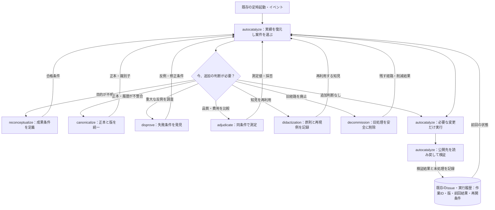
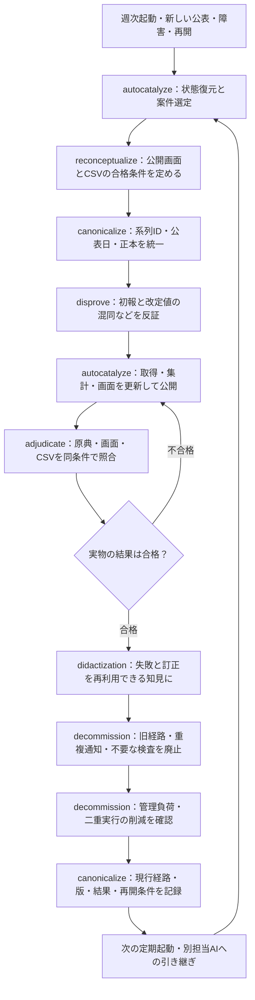

# Kafstyler

**AIエージェントが常時稼働し、成果を積み上げる。**

Kafstylerは、Claude Code・Codex・Antigravity CLIで**複数のリポジトリを定期的に更新し、AI担当やセッションが交代しても運用を止めない**ための7 Skillsです。例えば、公表統計を週次取得してWebサイトとCSVを公開する運用では、各Skillが次の仕事をします。

**`autocatalyze`** は既存の定期実行から起動し、前回の成功記録と公表元の更新を照合して、修正する系列・対象月・リポジトリを選びます。**`reconceptualize`** は「Web画面とCSVが同じ改定値・単位・出典を示す」を合格条件にします。**`canonicalize`** は系列ID・対象月・公表日で初報と訂正値を区別し、WebとCSVが参照する正本を一つにします。**`disprove`** は二重取り込み、旧データの再公開、取得失敗を成功と誤認するケースを探します。

**`autocatalyze`** は必要な取得処理・集計・公開コードを修正し、実際の公開URLを読み戻します。**`adjudicate`** は原資料・Web・CSVの値と件数を突き合わせ、不一致なら修正工程へ戻します。**`didactization`** は今回見つけた訂正パターンと再現手順を、次の案件でも使える知見にまとめます。**`decommission`** は後継の動作を確認してから、旧ジョブ・重複集計・不要な通知を廃止し、次回の実行負担を減らします。

**`canonicalize`** は作業ID、対象コミット、最後に確認した公開結果、未処理、次回起動条件を既存のIssueや実行履歴に残します。**`autocatalyze`** は次の起動でその記録を読み、前のAIとの会話なしで続きを始めます。今週の更新に成功しても、来週の新しい統計、訂正、障害対応へ運用は続きます。

[できること](#kafstylerが変えること) · [設計の理由](#なぜこの7-skillsなのか) · [まず一件試す](#まず一件試す) · [導入する](#プラグインの使い方) · [常時稼働の仕組み](#常時稼働エージェントの中核) · [実例を見る](#成果から使い方を選ぶ)

## Kafstylerが変えること

| 運用中の課題 | Kafstylerの仕組み |
| --- | --- |
| 案件が増えると、担当AIに毎回説明し直す | `canonicalize` が正本と状態をそろえ、`autocatalyze` が前回の記録から再開する |
| 定期実行が成功したように見えて、成果が届かない | `adjudicate` で利用者の入口の結果を確かめ、`autocatalyze` が失敗を次の実行へ引き継ぐ |
| AIやセッションの交代で、途中工程が重複・消失する | 作業ID、対象版、確認済みの結果、未処理、次の起動条件を引き継ぐ |
| 案件が増えるほど旧処理・重複検証・通知が残り、開発より維持管理に時間を使う | `decommission` が旧経路を安全に廃止し、実行回数・費用・障害の原因を減らして次の改善に余力を戻す |

[改善の事例](https://github.com/KAFKA2306/articles/blob/main/articles/kafstyler-agent-quality-loop.md) · [継続的なデータ運用例](https://github.com/KAFKA2306/semiconductor-earnings-model)

## なぜこの7 Skillsなのか

**Kafstylerの設計対象は、一回の回答ではなく、複数プロジェクトを何か月も更新する運用です。** 一つの修正が成功しても、翌週には新しいデータ、故障、仕様変更が届きます。AI担当やモデルが交代したとき、前回の会話だけに状態を残していると、検証済みの処理を再実行したり、古い版を公開したりする危険があります。

そこでKafstylerは、**時間をまたいで仕事を動かす責任を `autocatalyze` に集め、目的・正本・反証・評価・知見・廃止の判断を6 Skillsに分けます。** 7つは順番に必ず通る工程ではありません。判断の種類が違うため、必要なSkillだけを呼び出し、結果を一つの作業に戻せるようにした構成です。

### 7 Skillsを分ける理由

| Skill | そのSkillだけが決めること | 混同した場合の失敗例 |
| --- | --- | --- |
| [`autocatalyze`](skills/autocatalyze/SKILL.md) | **いつ・どの案件を・どこから再開するか。** 実装、公開結果の読み戻し、次回の起動への引き継ぎを統括する | 他のSkillが各自で定期起動すると、同じCSVを二重公開し、どちらが処理済みか分からなくなる |
| [`reconceptualize`](skills/reconceptualize/SKILL.md) | **何が利用者にとって成功か。** 「CSV生成成功」ではなく「公開画面とCSVで訂正値が一致」を定義する | コマンドが正常終了しただけで、古い画面を成功扱いする |
| [`canonicalize`](skills/canonicalize/SKILL.md) | **どの識別子・版・保存先が正本か。** 初報と改定値、作業IDと実行IDを区別する | 担当AIごとに別のCSV・台帳を更新し、次の担当が正しい値を選べない |
| [`disprove`](skills/disprove/SKILL.md) | **どんな反例なら現在の方式が破綻するか。** 重複取得、取得失敗、改定の取り違えを探す | 想定した正常例しか検査せず、重大な失敗条件そのものを見落とす |
| [`adjudicate`](skills/adjudicate/SKILL.md) | **同じ条件で測って採用できるか。** 原資料と公開値、再実行時の件数、費用を比較する | 「失敗しそう」という推測だけで採否を決める。または変更した側が自分で合格条件を緩める |
| [`didactization`](skills/didactization/SKILL.md) | **今回の経験の何を他案件でも再利用できるか。** 訂正パターン、根拠、再現手順、適用条件を残す | ログは残っても次の担当が意味を理解できず、同じ調査と失敗を繰り返す |
| [`decommission`](skills/decommission/SKILL.md) | **何を安全に廃止するか。** 新方式で代替した旧ジョブや重複通知を停止・削除する | 案件が増えるほど旧方式・監査・定期処理が積み上がり、新しい仕事に使う実行枠が減る |

**`reconceptualize` と `adjudicate` は別です。** 前者は「何を達成すべきか」を決め、後者は「実物がその条件を満たしたか」を測ります。**`disprove` と `adjudicate` も別です。** 前者は評価から漏れた破綻条件を探し、後者は固定した条件で候補を比較します。**`canonicalize` と `didactization` も別です。** 前者は次回の処理が読む正しい状態を管理し、後者は別案件にも持ち運べる知識を編集します。**`decommission` は `autocatalyze` と対になる役割**で、実装を増やす一方にならないよう、不要になった経路を安全に減らします。

### なぜ一つの巨大な指示や、7つの独立常駐エージェントにしないのか

一つの巨大な指示へすべて詰め込むと、軽微な修正にまで無関係な評価・記事作成・台帳整備が割り込み、各判断の責任が曖昧になります。反対に7 Skillsそれぞれが起動・状態管理・公開を担当すると、同じ案件への重複書き込みや引き継ぎの不整合が生じやすくなります。

**`autocatalyze` が起動と実行の流れを一元化し、各専門Skillは必要な判断と証拠を返す**ことで、この両方を避けます。担当が交代しても継続できるよう、記録は会話内ではなく既存のIssue・実行履歴・対象プロジェクトの正本に置きます。KafstylerのSkills自体が常駐プロセスやスケジューラーを提供するわけではなく、認可済みの既存の起動手段と接続して使います。

### 必要なSkillだけを選ぶ制御



この図の分岐は **呼び出し候補** であり、毎回すべて実行する順路ではありません。`autocatalyze` は公表元に更新がなければ取得や公開を省きます。`autocatalyze` は改定があれば `canonicalize` の正本を使って再処理し、`adjudicate` で公開値を確かめます。`autocatalyze` は旧ジョブが残ったときだけ `decommission` に廃止を依頼します。各回の結果は次の起動へ渡し、一件の終了を常時稼働全体の終了とはしません。

### この構成で守る条件

- **`autocatalyze` は処理の受付・実行終了・成果の検証を区別する。** 公開先を読めない場合は成功と記録しない。
- **`canonicalize` は再試行と新しい定期起動を区別する。** 同じ入力を再送しても二重反映せず、確認済みの処理位置から再開できるようにする。
- **`adjudicate` と `disprove` は必要な機能を失う変更を検出する。** `decommission` は後継が使えることを確かめてから旧方式を廃止する。
- **`didactization` は新しい発見があるときだけ知見を増やす。** 単発の簡単な修正に全Skillの適用や新しい台帳を要求しない。

この分割は7 Skillsが常に最適という実測結果ではなく、**大規模運用で起きる「実行の中断、正本の分裂、評価漏れ、経験の消失、仕組みの肥大化」を別々に解消するための設計判断**です。継続運用で得た実測がこの境界を否定したら、`adjudicate` で見直し、`decommission` で不要になった構造を減らします。

[根拠：長時間稼働するエージェント](BIBLES.md#長時間稼働するエージェント) · [評価指標のすり替えと独立した検証](BIBLES.md#評価指標のすり替えと独立した検証) · [減算による解決](BIBLES.md#減算による解決)

## まず一件試す

公開リポジトリを題材に、現状確認から一件の改善と次回への引き継ぎを試せます。対象URLは自分のプロジェクトに置き換えられます。

```text
対象: https://github.com/KAFKA2306/semiconductor-earnings-model

Kafstylerのautocatalyzeを使い、既存のIssueと実際の公開成果を調べ、
いま最も価値のある改善を一件選び、実装・検証・反映まで進めてください。
必要なSkillsだけを使い、次回は別のAI担当でも再開できるよう
作業ID、対象版、判断根拠、検証結果、未処理と次の起動条件を既存の記録に残してください。
```

継続運用は既存の定時・イベント起動と組み合わせます。詳しくは [autocatalyze](skills/autocatalyze/SKILL.md#常駐エージェントと定期実行) を参照してください。

## プラグインの使い方

[Claude Code](#claude-code) · [Codex](#codex) · [Antigravity CLI](#antigravity-cli)

### Claude Code

```sh
claude plugin install kafstyler --marketplace KAFKA2306/agent-resources --scope user
```

[配布元](https://github.com/KAFKA2306/agent-resources/blob/main/.claude-plugin/marketplace.json)。対象プロジェクトで `claude` を起動します。

### Codex

```sh
codex plugin marketplace add KAFKA2306/kafstyler
codex plugin add kafstyler@kafstyler
```

対象プロジェクトで `codex` を起動します。

### Antigravity CLI

```sh
agy plugin install https://github.com/KAFKA2306/kafstyler
agy plugin list --json
```

対象プロジェクトで `agy` を起動します。

### 依頼を送って使う

必要なSkillを直接指定する場合は、Claude Codeで `/kafstyler:autocatalyze`、Codexで `$autocatalyze`、Antigravity CLIで `/autocatalyze` を使います。たとえばデータ移行では `canonicalize`、旧方式の整理では `decommission` を選べます。

### プラグインの更新と検証

- Claude Code: `claude plugin update kafstyler@kafka-agent-tools`。新しいセッションまたは `/reload-plugins` で変更を反映します。
- Codex: `codex plugin marketplace upgrade kafstyler` と `codex plugin add kafstyler@kafstyler`。新しいセッションで読み込みを確認します。
- Antigravity CLI: `agy plugin list --json` で導入版とSkillsの検出を確認します。

### 作業中の版で試す

Claude Codeは `claude plugin validate .`、Antigravity CLIは `agy plugin validate --json .` など、各CLIの標準の検証を使います。変更したSkillが読み込まれることと、該当する実際の依頼の結果を確認します。スキル呼び出しのためのフック承認・全Markdown監査は不要です。

## 常時稼働エージェントの中核

[`autocatalyze`](skills/autocatalyze/SKILL.md#常時稼働エージェントの中核) は、**常時稼働エージェントの中核Skill**です。定時・イベント・再開を入口として、進行中の案件だけでなく、次の改善候補や新しい障害を観測し続けます。必要なときに他のSkillsへ委譲し、実装、公開先の検証、復旧、成果の蓄積を統括します。

長期運用では、一件の「完了」は次の観測へ進むための通過点です。仕事がない周期には不要なLLM呼び出しや通知をせず、次の起動を維持します。起動には接続済みのスケジューラーやイベント機構を使い、Kafstyler自体が独立した常駐サービスを提供するわけではありません。

## 大規模な開発を支える仕組み

例として、**公表統計の検索画面とCSVを毎週更新し、過去の数値が訂正されたときも正しく追従する運用**を考えます。定期更新を一度成功させるだけでなく、データの改定、公開先の不一致、担当AIの交代をまたいで成果の品質を維持する仕事です。

### 7つのSkillが連関して成果を出す

| Skillが行うこと | 次へ渡す具体的な結果 |
| --- | --- |
| [`autocatalyze`](skills/autocatalyze/SKILL.md) は週次起動で前回の状態を復元し、統計の新しい公表・訂正を調べて、更新すべき系列と期間を選ぶ。 | 対象系列ID・対象月・入力の版・最後の成功・未処理事項を `reconceptualize` と `canonicalize` へ渡す |
| [`reconceptualize`](skills/reconceptualize/SKILL.md) は「ファイルを生成する」ではなく「公開画面とCSVで同じ訂正値・単位・出典を確認できる」を目的にする。 | 利用者の操作、代表入力、合格条件を `canonicalize` と `adjudicate` へ渡す |
| [`canonicalize`](skills/canonicalize/SKILL.md) は発行元・系列ID・対象期間・公表日で初報と改定値を区別し、画面とCSVが使う正本をそろえる。 | 正本の場所、識別子、訂正履歴、再処理範囲を `disprove` と `autocatalyze` へ渡す |
| [`disprove`](skills/disprove/SKILL.md) は初報と改定値の混同、重複取り込み、取得失敗時の古い数値の誤表示など、結果を壊す反例を探す。 | 再現できる失敗条件と修正対象を `autocatalyze`、判定用の入力を `adjudicate` へ渡す |
| [`autocatalyze`](skills/autocatalyze/SKILL.md) は必要な取得・集計・画面更新を実装して公開し、公開先の版を読み戻す。 | 実際の画面・CSV・実行ログを `adjudicate` へ渡す |
| [`adjudicate`](skills/adjudicate/SKILL.md) は原典・画面・CSVの系列、値、件数、出典を同条件で照合し、再取り込みでも二重登録しないか確かめる。 | 合否・実測値・再現手順を `autocatalyze` に返し、不合格なら修正へ戻す |
| [`didactization`](skills/didactization/SKILL.md) は今回の訂正処理や失敗から、次の系列・別プロジェクトでも使える原則と再現例を残す。 | 出典と成立条件のある知見を既存の正本へ渡す |
| [`decommission`](skills/decommission/SKILL.md) は `canonicalize` の正本と `adjudicate` の比較結果を受けて、二重同期・古い集計・重複通知を安全に廃止する。 | 必要な機能が維持された証拠、減らした起動・管理負荷、唯一の現行経路を `canonicalize` と `autocatalyze` に返す |
| [`canonicalize`](skills/canonicalize/SKILL.md) は最終確認した版、処理済み位置、未処理、次の起動条件を既存記録にそろえる。 | 別の担当AIや次回の `autocatalyze` が会話の再説明なしで使える状態を残す |



この図は7 Skillsの連携が役立つケースを示したものです。毎回7つ全部を呼ぶ仕組みではありません。たとえば新規データに訂正も障害もなければ、`autocatalyze` は差分を確認して不要な再処理を省きます。**一件の成功は次の周期の入力となり、運用と改善は継続します。**

[画面の設計正本](https://github.com/KAFKA2306/design) · [定期実行と再開](skills/autocatalyze/SKILL.md#常駐エージェントと定期実行)

## decommissionが常時稼働の実行力を守る

**[`decommission`](skills/decommission/SKILL.md) は、長期間の自律運用で増え続ける維持管理の負担を取り除き、`autocatalyze` が新しい成果に使える余力を生み出すSkillです。** 単なるファイル削除ではありません。使われなくなった経路、同じ仕事を繰り返す定期処理、重複する正本、効果のない検査や通知を、必要な機能を維持したまま廃止します。

例えば統計データの更新方式を切り替えた後、旧ジョブが残ると同じデータを二度取得し、古いCSVを再公開し、通知まで重複する恐れがあります。`canonicalize` が残す正本を決め、`adjudicate` が新方式の結果を検証し、`decommission` が旧ジョブ・設定・参照を停止・削除します。`autocatalyze` は次回の通常起動で新方式だけが動くことを確かめ、浮いた実行枠を次の案件へ使えます。

`decommission` の成果は削除ファイル数ではなく、**必要な機能を保ちながら減らせた処理回数・実行時間・費用・誤通知・保守対象**で測ります。比較できる実績がない場合は削減効果を推定値として区別します。不要と証明できないものは件数目標のために消しません。

## 成果から使い方を選ぶ

分野が変わっても、`autocatalyze` が案件を選び、必要なSkillが結果を返し、その成果を次の観測へ引き継ぎます。「イベント収集を直して」なら、[公開カレンダー](https://github.com/KAFKA2306/cast_event_cal)のURLと「開催回が公開WebとICSに一度ずつ載り、主催者の告知を開ける」という合格条件を渡します。目的と結果は[作業台帳](AGENTS.md#正本と記録)に残ります。

### 開発・運用

停止した処理を最終成功時刻と失敗ログから直し、次の結果を利用者のURLで確認する。画面は初見で情報と出典を探し、迷った操作と合格条件を一件にまとめる。[定期運用](https://github.com/KAFKA2306/agent-resources) · [画面の評価例](https://github.com/KAFKA2306/design/blob/main/docs/frontend-review.md)

### 記事・動画・音声

記事は実際の発見から再利用できる原則を抽出し、数値や実験を一次資料・再実行で確かめ、成立しない条件を示す。発見がないときは既存記事を改善し、新規公開や重複を増やさない。動画は音声・字幕を通しで確認し、公開先でチャンネル・公開状態を確かめる。音声は同じ台詞で比較し、採用WAV・モデル・シード・参照音声を残す。[記事](https://github.com/KAFKA2306/articles/blob/main/articles/kafstyler-agent-quality-loop.md) · [動画](https://github.com/KAFKA2306/yt3) · [音声](https://github.com/KAFKA2306/yt4)

### VRChat・3D・画像制作

ワールドでは初期位置から展示へ歩き、案内を読んで操作する。衣装はUnityで取り込み・装着し、指定ポーズで貫通とウェイト崩れを確認する。画像は素材・シード・サイズをそろえ、画質と処理時間を比べる。[VRMine](https://github.com/KAFKA2306/vrmine) · [衣装](https://github.com/KAFKA2306/image2outfit) · [ComfyUIの制作台帳](https://github.com/KAFKA2306/comfyui-workflows-factory)

### ボードゲーム・ゲーム

スマホで作品と版を選び、プレイ中に裁定と公式説明書の該当ページを開く。MODはSteam版に導入し、プレイ中に効果を確かめる。[ボドゲのミカタ](https://bodoge-no-mikata.vercel.app/) · [Slay the Spire 2のMOD](https://github.com/KAFKA2306/sts2)

### 企業・市場の調査

半導体の価格と出荷は決算期・単位をそろえ、実績・会社予想・シナリオを分けて、公開画面で式と一次開示を開く。統計は初報・改定値を対象月・公表日で区別し、公開CSVを原資料と照合する。[半導体決算モデル](https://github.com/KAFKA2306/semiconductor-earnings-model) · [米雇用統計](https://github.com/KAFKA2306/nonfarmpayroll)

### 科学・製造の調査

同じ材料・加工目的の候補を一次資料から探し、温度・圧力・速度などの条件と歩留まり・欠陥率を表にする。論文は対象・比較条件・測定値と引用箇所を記録し、案件で試せる条件を選ぶ。[製造工程の調査](https://github.com/KAFKA2306/factory) · [arXiv調査](https://github.com/KAFKA2306/daily-arXiv-ai-enhanced)

### Kaggle

データ版・時系列分割・公式指標・ベースラインをそろえ、手元の検証と公式提出の結果を分けて記録する。[商品価格予測コンペ](https://github.com/KAFKA2306/mitsuikaggle)

### 暮らしと学習

家計は明細の再取り込みで件数・合計が変わらず、差額から元の取引を開けるか試す。蔵書は同じ作品の別版を区別し、目的のノートに戻る。旅行は公式時刻・総額・取消条件を比べ、現地時刻で乗り換えを確かめる。[家計](https://github.com/KAFKA2306/kakeibo) · [蔵書](https://github.com/KAFKA2306/books) · [旅行計画](https://github.com/KAFKA2306/travel)

## スキル

Claude Codeは `/kafstyler:<名前>`、Codexは `$<名前>`、Antigravity CLIは `/<名前>` からSkillを選びます。各Skillの目的と判断基準は[7つのスキルと、残す成果物](#7つのスキルと残す成果物)を参照してください。

端末を閉じた後の定期実行やイベント起動は、[autocatalyzeの実行方法](skills/autocatalyze/SKILL.md#常駐エージェントと定期実行)を使います。実行前に必要な権限と接続、前回の状態を確認します。

## Unity・VRChatで制作する

汎用Unityは `CoplayDev/unity-mcp`、VRChat Worldsは `swax/UnityMCP-VRC`、VRChat Avatarsは `lighfu/unity-agent` を使い、Unity EditorやVRChat SDKで成果を確かめます。[公式の接続手順](BIBLES.md#ユニティとvrchatの制作ツール)

## 外部スキルとテンプレート

### 成果物の根拠調査と推敲

imozuruで根拠を原文までたどり、yomiyasuで説明を整え、反証レビューで利用場面に照らします。Claude CodeかCodexの新しいセッションで両方を選べることを確かめます。[成果物の確認手順](skills/didactization/SKILL.md#本文の推敲と提出前の確認)

```sh
npx skills add MaryCache/imozuru
npx skills add nanaism/yomiyasu
```

### Googleのフロントエンド設計スキル

KAFKA2306のWeb UIを設計するときは[かふかのデザインパターン](BIBLES.md#かふかのデザインパターン)を先に確認します。Claude Codeで `/plugin marketplace add google-gemini/demolab`、`/plugin install demolab@demolab` の順に実行し、`/demolab:gemini-frontend-design` で設計案を検討します。[Google Gemini DemoLabの導入手順](https://github.com/google-gemini/demolab#claude-code)

### ComfyUIのワークフローテンプレート

[採用基準](BIBLES.md#comfyuiのワークフロー選定)に合わせ、`Workflow → Browse Workflow Templates` で候補を開き、必要なモデルと出力を確認します。[ComfyUI公式手順](https://docs.comfy.org/interface/features/template) · [テンプレートの正本](https://github.com/Comfy-Org/workflow_templates)

## ミッション・聖典・作業規約

[ミッション](MISSION.md) · [一次資料の聖典台帳](BIBLES.md) · [共通作業規約](AGENTS.md) · [目次](index.md)

過去の知見を次の仕事へつなぐために、引き継ぐ判断・版・根拠は既存の正本に残します。案件固有の実装と履歴は案件のリポジトリで管理します。
