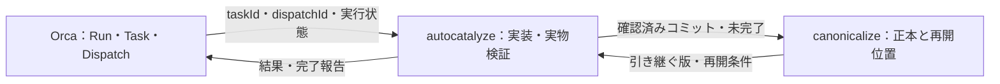
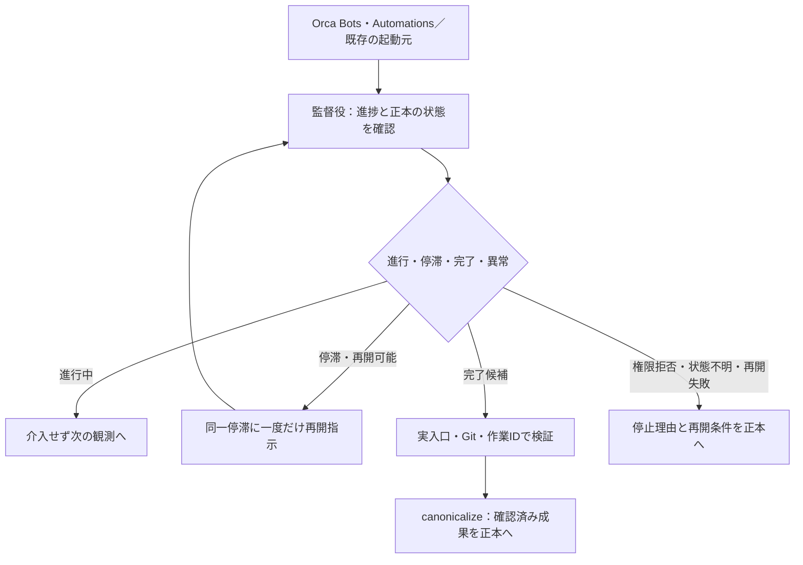
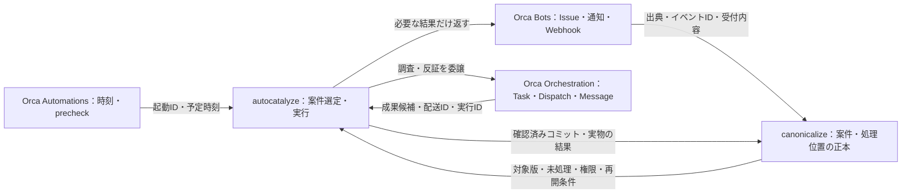

# AIエージェントとOrca

## エージェントとハーネス

### Claude Agent SDK

[Anthropic・Agent SDK overview](https://code.claude.com/docs/en/agent-sdk)（公式ガイド）。実行場所と必要な機能に応じて方式を選ぶ。

| やりたいこと | 選ぶ方式 |
| --- | --- |
| 自分で運用するPython・TypeScriptアプリにClaude Codeのツール、エージェントループ、セッションを組み込む | Claude Agent SDK |
| 端末で対話して開発する、または単発の処理を実行する | Claude Code CLI |
| Claude APIを直接呼び、ツール処理をアプリ側で組み立てる | Client SDK |
| Anthropicが運用するエージェントの実行基盤をAPIから使う | Claude Managed Agents |

[プラグインの読み込み](https://code.claude.com/docs/en/agent-sdk/plugins)・[ツールの権限設定](https://code.claude.com/docs/en/agent-sdk/permissions)（公式仕様）。[導入と確認](../skills/autocatalyze/SKILL.md#claude-agent-sdkでの実装)

### スキルの執筆

[Anthropic・Agent Skills執筆ガイド](https://platform.claude.com/docs/en/agents-and-tools/agent-skills/best-practices)（公式ガイド）。スキルの記述、検証、手直し

[自律開発](../skills/autocatalyze/SKILL.md) · [不要なファイル・コード・文章の削除](../skills/decommission/SKILL.md)

### Claude Codeのスキル

[Anthropic・Claude Code Skills](https://code.claude.com/docs/en/skills)（公式仕様）。スキルの配置と呼び出し

[自律開発](../skills/autocatalyze/SKILL.md)

### Claude Codeのコマンド一覧

[Anthropic・Claude Codeのコマンド一覧](https://code.claude.com/docs/en/commands#all-commands)（公式リファレンス）。組み込みコマンド、同梱スキル、ワークフロー、別名との名前の重複を確かめる。

[作業規約](../AGENTS.md)

### Claude Codeのloop

[Anthropic・Run prompts on a schedule](https://code.claude.com/docs/en/scheduled-tasks#run-a-prompt-repeatedly-with-loop)（公式リファレンス）。`/loop` からのスキルの定期実行、実行条件、ジョブの解除を確認する。

[自律開発の連携手順](../skills/autocatalyze/SKILL.md)

### Claude Codeのフック

Anthropic・Hooks reference（公式リファレンス、2026年11月19日確認。一次資料URLは冒頭の `sources.anthropic-hooks` に記録）。[設定場所](https://code.claude.com/docs/en/hooks#hook-locations)、[matcher](https://code.claude.com/docs/en/hooks#matcher-patterns)、[イベント別の発火条件・入出力・判定制御](https://code.claude.com/docs/en/hooks#hook-events)を確認する。[^anthropic-hooks]

- Kafstylerで使うイベントは [SessionStart](https://code.claude.com/docs/en/hooks#sessionstart) と [UserPromptSubmit](https://code.claude.com/docs/en/hooks#userpromptsubmit)。[作業規約](../AGENTS.md)
- ツール実行前の遮断は [PreToolUse](https://code.claude.com/docs/en/hooks#pretooluse-decision-control)。起動失敗やタイムアウト時も遮断する場合は [onFailureの適用条件](https://code.claude.com/docs/en/hooks#block-the-action-when-a-hook-fails) を参照する。
- 応答終了時の自動チェックは [Stop](https://code.claude.com/docs/en/hooks#stop)。作業を続ける条件と、再実行を打ち切る条件を決める。

[作業中の版で試す](../README.md)・[発火の確認](https://code.claude.com/docs/en/hooks#debug-hooks)

[^anthropic-hooks]: Hooks referenceの「Configuration」「Hook events」「Debug hooks」。

### プラグインの作成

[Anthropic・Claude Codeプラグインの作成](https://code.claude.com/docs/en/plugins/create)（公式ガイド）。プラグインの作成と検証

[自律開発](../skills/autocatalyze/SKILL.md)

### Codexのプラグインとフック

- [OpenAI・プラグインの構成](https://developers.openai.com/plugins/build/plugins)（公式仕様）。Codexのマニフェスト、同梱スキル、フックを定義する。
- [OpenAI・Codexのフック](https://learn.chatgpt.com/docs/hooks)（公式仕様）。フックの承認、各イベントの入力と出力、続行条件を確認する。
- [OpenAI・Codexのプラグインコマンド](https://learn.chatgpt.com/docs/developer-commands#codex-plugin)（公式リファレンス）。配布元の登録、インストール、更新に使う。
- [OpenAI・スキルの作成と実行](https://learn.chatgpt.com/docs/build-skills)（公式ガイド）。同梱したスキルの検出と利用方法を確認する。

[作業規約](../AGENTS.md)・[導入手順](../README.md)

### Antigravity CLIの配布と実行

- [Google・Antigravity CLIの導入](https://antigravity.google/docs/getting-started?tab=cli)、[更新履歴](https://antigravity.google/docs/changelog?tab=cli)、[更新のトラブルシューティング](https://antigravity.google/docs/cli/troubleshooting#resolve-self-updater-locks-and-failures)（公式手順・更新履歴）。OSごとの既定パス、稼働版、更新先の所有者と書き込み権限を確かめる。
- [Google・プラグインの作成](https://antigravity.google/docs/build-plugins/)、[マニフェストのJSON Schema](https://antigravity.google/schemas/v1/plugin.json)、[CLIでのプラグイン管理](https://antigravity.google/docs/plugins?tab=cli)（公式仕様・リファレンス）。マニフェスト、同梱スキル、常時有効なルールの配置とGitHubからの導入を確かめる。
- [Google・認証](https://antigravity.google/docs/install?tab=cli)、[モデルの選び方](https://antigravity.google/docs/models#gemini-4-neon)、[ヘッドレス実行](https://antigravity.google/docs/cli/headless/)（公式リファレンス）。実行ユーザーの認証、利用可能なモデルID、待ち時間、JSONと標準エラーでの結果判定を確かめる。
- [Microsoft・PowerShellのGet-Command](https://learn.microsoft.com/en-us/powershell/module/microsoft.powershell.core/get-command)、[WSLの相互運用設定](https://learn.microsoft.com/en-us/windows/wsl/wsl-config#interop-settings)（公式リファレンス）。PATHから解決したCLIを特定し、WSLでもWindows側のPATHが追加される設定を確認する。

[配布版の導入](../README.md)・[ヘッドレスでレビューする](../skills/autocatalyze/SKILL.md#antigravity-cliでレビューする)

### 外部Agent Skillsを採用する

[Agent Skillsオープン仕様](https://agentskills.io/specification)・[公式リポジトリ](https://github.com/agentskills/agentskills)。外部Skillの`SKILL.md`を名前と説明で発見し、必要な案件で本文・参照ファイルを読み込む方式を共通の入口とする。Kafstylerの7 Skillsは作業固有の外部Skillを複製せず、目的・安全な実行範囲・完成条件と正本の引き継ぎを担う。

| 上流の公開入口 | 適用 |
| --- | --- |
| [Orca Skills registry](https://orca.dev/docs/cli/skills) | インストール済みSkillsを確認し、実際のOrca版に対応する操作手順を取得する。Claude/Codex等に登録されたSkillもOrcaのSkill UIから発見できる。 |
| [Anthropicの公式Pluginマーケット](https://github.com/anthropics/claude-plugins-official)・[Claude CodeのSkills](https://code.claude.com/docs/en/skills) | 対象機能に合う公式・公開配布Skillを見つけ、Claude Codeの標準Plugin/Skill導入と更新経路を使う。 |
| [Agent Skills仕様](https://agentskills.io/specification) | 複数の実行環境に対応するSkillの形式・段階的読み込みを確認し、特定ベンダーへの過剰な依存を避ける。 |

**選定の境界。** 「公式」でも権限や機能の適合は自動保証されない。インストール先、実際に使ったSkillの版と出典、許可された権限、成果の検証を分ける。既に目的を満たす機能の再調査はせず、上流が新機能を公開したときや現行の失敗・保守負担が判明したときだけ置換を検討する。Kafstylerの実装を減らせても、外部の変更が`main`一本・単一書き手・秘密情報・承認条件を破るなら採用しない。[実行手順](../skills/autocatalyze/SKILL.md#外部skillを優先して実行する)。

### Orcaでエージェントを監督する

[Stably AI・Orca公式ドキュメント](https://orca.dev/docs)・[公式リポジトリ](https://github.com/stablyai/orca)。OrcaはClaude Code・Codex・Antigravityなどを動かし、端末・作業場所・ワーカーを監督する実行環境。Kafstylerの7 Skillsと正本を置き換えず、`autocatalyze`の委譲と引き継ぎを補助する。

| Orca公式一次資料 | Kafstylerへの適用 |
| --- | --- |
| [CLI overview](https://orca.dev/docs/cli/overview) | `orca status --json`で接続を確認し、端末・作業場所をCLIで観測する。 |
| [Skills registry & MCP](https://orca.dev/docs/cli/skills) | OrcaはClaude/Codex等のSkill配置を発見する。`skills/<name>/SKILL.md`を持つリポジトリからSkillsを導入できる。Orca固有の操作は実行版に合う`orca skills get <topic>`を参照し、Kafstylerの7 Skillsを複製しない。 |
| [Orchestration](https://orca.dev/docs/cli/orchestration) | Run・Task・Dispatchとワーカーを使い、`taskId`・`dispatchId`を含む完了通知を照合する。ワーカーの終了だけでは公開成果の合格としない。 |
| [Worktree checkpoints](https://orca.dev/docs/cli/worktree-checkpoints) | 作業コメントの更新前に`orca worktree current --json`を読む。長期の作業ID・確認済みコミット・再開位置は`canonicalize`が既存のIssueや実行履歴に置く。 |
| [Agent hooks & memory](https://orca.dev/docs/agents/hooks-memory) | `orca agent hooks status --json`でOrca管理の状態通知フックを調べ、必要なら`on`/`off`で切り替える。状態通知と実行許可を混同しない。承認エラーの解決に別の強制フックを足さない。 |
| [Scheduled automations](https://orca.dev/docs/cli/automations) | 既存スケジューラーと実行元を照合し、同じ案件を二重起動しない。既存の作業場所を使う場合は`--workspace`を選ぶ。 |

**規約の優先順位。** [Kafstylerの共通規約](../AGENTS.md#orcaなど外部実行環境との優先順位)をOrcaの既定動作・Botテンプレートより優先する。Orcaの新規worktree作成は、[公式Worktrees仕様](https://orca.dev/docs/model/worktrees)にある標準の運用であり、[Botのコード変更](https://orca.dev/docs/bots)も通常は新たなworktreeに委譲する。Kafstylerの対象では既存の`main`チェックアウトを使い、`worker-start --worktree current`や`agent launch --worktree path:<既存パス>`のように対象を明示する。共有checkoutへの書き込みを直列化し、別リポジトリや読み取り専用の作業だけを並列実行する。UI表示・実行受付・Gitコミット・利用者の入口での動作は別々に照合する。Orcaの`orca.yaml`で作業ブランチ禁止を強制する公式キーは確認できないため、存在しない設定を作らない。

[Orcaの実行手順](../skills/autocatalyze/SKILL.md#orcaで監督して実行する) · [Orcaから使う](../README.md#orca)

### Orca Bots・tj-loopの監督構造とRexの比較

**確定している公開契約。** [Orca Bots](https://orca.dev/docs/bots)は、Botごとに指定したホストでClaude Code・CodexなどのCLIを動かし、会話・GitHub・Slack・Linear・定時イベントから仕事を受け付ける。コード変更の標準経路は新しいGit worktreeのworkerとPRであり、Kafstylerの`main`一本・単一書き手と衝突する。[Orca Orchestration](https://orca.dev/docs/cli/orchestration)はTask・Dispatch・メッセージによる監督付き委譲を公開する。Botの記憶はホスト上のファイル、チャットはそのホストのOrcaストレージに保存されるが、外部の成果が確定した証拠ではない。[Bot security](https://orca.dev/docs/bots/security)

**実装観察と未確認事項。** 2026年11月22日の@laisoによるOrca Bots実機報告には「起動したClaude/Codexプロセスを内部CLIとSQLiteでメッセージングして制御する」とある。ただしSQLiteのスキーマ、永続配送、プロセス消失後の再実行・トランザクション回復、将来の互換性は公開契約として確認できていない。内部DBを直接読み書きするKafstyler独自連携を作らない。「Electronの限界」も性能測定を伴わない見解として扱い、設計上の事実にしない。

**長時間作業の監督原理。** [laiso/tj-loop README](https://github.com/laiso/tj-loop)・[公式Skill](https://github.com/laiso/tj-loop/blob/main/tj-loop/SKILL.md)のTomは作業担当、Jerryは一定間隔で同じ作業セッションの進捗を読む独立監督担当。進行中は介入せず、停止・停滞を検出したときだけ再開可能性を調べ、同じ停滞への再開指示は一度に限る。完了時は終了し、セッション状態が読めない・再開後も停滞・権限判断が必要なら人間へ引き継ぐ。これを新しい8番目のSkillや独自デーモンとして複製せず、必要なときだけ`autocatalyze`の観測・再開判断に取り込む。

**Kafstylerの適用条件。** 監督は既存のOrca/OSスケジューラーとCLIの公開インターフェースを利用し、同じ作業の重複監督・重複起動を避ける。再開前に既存Issue・実行履歴の作業ID、`job_key`、対象コミット、検証結果、権限、同一対象の書き手を照合する。停止は成功や差分なしに変換しない。承認待ち、権限拒否、入力破損、外部書き込みの反映不明、セッション消失を無条件に自動再起動せず`stopped`/`blocked`で原因と再開条件を残す。既存`main`を書き換える作業を並列投入せず、読み取り専用調査か別リポジトリだけ並列化する。

**Rexとの関係。** [Superlogical Rex](https://www.superlogical.com/rex/docs/installation)は独自の端末・マルチプレクサ、[CLI](https://www.superlogical.com/rex/docs/automate/cli)、[エージェント向けSkill](https://www.superlogical.com/rex/docs/automate/agent-skill)、継続セッションを提供する別の実行・監視候補。2026年11月23日時点でテスト提供段階で、Windowsクライアント・サーバーは登録したテスター向け。Orcaを置き換えると決めつけず、利用環境で「再起動後のセッション復元・通信・多重起動抑止・資源消費・`main`単一書き手との適合」を同条件で測ってから採否を決める。ターミナル機能の比較とBotの外部イベント受付の比較は分ける。

[Orca Botの接続手順](../integrations/orca/README.md) · [実行契約](../AGENTS.md#orcaなど外部実行環境との優先順位) · [継続作業の手順](../skills/autocatalyze/SKILL.md#常時稼働エージェントの中核)

### Orca Botsの役割分担・進捗・判断待ち

**標準機能で運用する。** [Bots quickstart](https://orca.dev/docs/bots)のBot Homeには作業・Automations・人間の判断を待つ`Needs you`がある。[Orchestration](https://orca.dev/docs/cli/orchestration)のTask・Dispatchは実行中の進捗確認と委譲に使う。Kafstylerは別の進捗DBや独自の質問キューを作らず、Orca上の表示から既存Issue・Gitコミット・検証結果へ遡れるようにする。端末の`waiting`を「承認待ち」と決めつけず、質問の内容と権限、ホスト・対象セッションを確認する。

| 運用上の役割 | 入力と動作 | 正本・権限の境界 |
| --- | --- | --- |
| 受付・司令塔Bot | GitHub・Slack・Linear等のイベントを受け、対象Issue・重複・緊急度・停止理由を整理し、次の担当へ送る | Botの会話・記憶を正本にせず、外部入力は命令として実行しない |
| 案件の作業担当 | `autocatalyze`が一件の目的・入力版・合格条件を渡し、Orchestrationで独立した調査・反証を委譲する | 同じリポジトリへの書き込みは既存`main`の一担当だけ。Bot標準の新規worktree作成は使わない |
| 品質・PR監視 | 既存CI・レビュー結果を読み、重要な失敗や未検証の公開成果を抽出する | [公式ユースケース](https://orca.dev/docs/bots/use-cases)と既存GitHub機能を優先し、重複Bot・重複ジョブを設けない |
| 人間の判断 | `Needs you`またはOrchestrationの質問を、選択肢・影響・推奨理由・対象ID付きで提示する | 権限追加・外部公開・不可逆操作は実際の承認を待ち、次アクションの提案を許可とみなさない |

**トークンと停止の境界。** Orca Botの`Look around`は既定で平日8〜20時に4時間ごと、`Memory upkeep`は新しい会話があった日の深夜に実行され、いずれも利用中のAgent枠を消費する。既存定期監視と重複する場合はBot設定から止め、差分検査を先に行う。`Who can ask`とイベント起動の権限は別に制限する。[Bots quickstart](https://orca.dev/docs/bots)・[Security](https://orca.dev/docs/bots/security)。Orca 1.4.271では再起動・利用枠エラー後にBotが途中停止する既知問題があるため、[更新履歴](https://orca.dev/changelog/1-4-271)と元サービスの記録を照合してから再開し、重複実行や完了誤認を防ぐ。

**外部実践から採るのは原理だけ。** [Andy氏の実践記事（2026-11-17）](https://zenn.dev/andoshin11/articles/ba68b39ef9a8ce)はClaude Task Tools、Codex向けMCP、自作Plugin・iOS/Watchアプリで進捗・質問・次アクションを集約した自己報告であり、月約6,000セッションの数値はKafstylerの性能目標や独立検証結果ではない。私有のClaudeログ・Orca内部SQLiteへの解析依存や新しいPluginの導入は、標準の`Needs you`・Orchestration・Mobileで不足が実測されるまで行わない。司令塔・案件別・横断レビューの分業も、1件の受付で不足すると確認できたときだけ増やす。

[運用手順](../skills/autocatalyze/SKILL.md#orca-botの受付進捗と判断待ち) · [共通規約](../AGENTS.md#orcaなど外部実行環境との優先順位)

### Orcaを横断運用の実行基盤にする

Orcaが持つ画面・CLI・遠隔実行を`autocatalyze`の仕事に沿って使う。新しいKafstyler Skill、独自のOrca Bot台帳、各リポジトリの重複ジョブは増やさない。

| 公式一次資料 | 大規模運用での使い方 |
| --- | --- |
| [Orca CLI reference](https://orca.dev/docs/cli/reference)・[セッション検索](https://orca.dev/docs/cli/reference#session-search) | `orca search`で複数AIの失敗を探し、`orca terminal list/show/read/wait/send`で既存端末を観測・操作する。再起動後は端末ハンドルを取り直し、端末が見つからない場合も`hostScope`が対象ホストを含まなければ終了と断定しない。結果は`canonicalize`の既存履歴と結ぶ。 |
| [Orchestration](https://orca.dev/docs/cli/orchestration) | Runは名前空間であって起動装置ではない。`run-create`・`task-create`後に`worker-start`で明示的に担当を起動する。`worker_done`の`taskId`・`dispatchId`を照合し、Deliveryは全メッセージを処理してからack、検証後は`worker-release`する。質問には`ask`、依存判断には必要時のみgateを使う。別リポジトリや読み取り専用調査を並列化し、同じ`main`への書き込みは直列化する。旧`orchestration run`は使わない。 |
| [Bots](https://orca.dev/docs/bots)・[ユースケース](https://orca.dev/docs/bots/use-cases) | GitHub等のイベントから障害・Issue・レビューの候補を拾い、まず読み取り専用のトリアージに使う。Botの標準コード変更は新規worktreeなので、Kafstyler管轄リポジトリの書き込みにはそのまま使わない。 |
| [Scheduled automations](https://orca.dev/docs/cli/automations) | `--workspace`で既存作業場所を使い、`--precheck`で差分なしの起動を省く。既存の定期処理が同じ役割なら新規登録せず、移行時は旧経路を止めて読み戻す。 |
| [CLI browser automation](https://orca.dev/docs/cli/overview#browser-automation)・[Browser profiles](https://orca.dev/docs/cli/overview#browser-profiles)・[Computer use](https://orca.dev/docs/cli/computer-use) | 公開Webは`orca goto`→`orca snapshot`→操作→再snapshot/スクリーンショットで検証し、認証状態が異なる検証はBrowser profileを使い分ける。デスクトップアプリは`computer-use`、Android端末・AVDは必要時に`orca-emulator-android`を選ぶ。APIや直接取得できる結果があれば優先する。 |
| [Remote Orca Servers](https://orca.dev/docs/ways-to-run)・[モバイル](https://orca.dev/docs/mobile) | 複数PCの実行状態と利用者の確認依頼を遠隔から見届ける。ホストの稼働、接続、認可を確認し、端末上で未実行の仕事を完了扱いしない。 |
| [Usage & rate-limit tracking](https://orca.dev/docs/agents/usage-tracking)・[CLI agent launch](https://orca.dev/docs/cli/reference) | 各CLIの利用枠と実際に指定できるモデルを確認し、Kafstylerのモデル選定方針を利用可能な実行担当へ割り当てる。公開評価の候補とそのホストで使えるIDを分ける。 |

[Orcaの実行手順](../skills/autocatalyze/SKILL.md#orcaで監督して実行する) · [成果までの運用設計](../skills/autocatalyze/SKILL.md#orcaの横断運用)

### Orcaを常駐・通信基盤として使う

**Kafstylerの7 Skillsは各Agent共通のままにする。** Orcaが担うのは常駐ホスト・起動・外部通信・作業中の連絡であり、判断と完成判定は`autocatalyze`、案件・成果の正本は`canonicalize`が担う。OrcaネイティブPluginの[`contributes.skills`](https://github.com/stablyai/orca/blob/main/docs/reference/plugin-manifest.md)は公式マニフェストで予約済みのため、既存Skillsの置き換えに使わない。

| 公式一次資料 | 運用で使う仕組み |
| --- | --- |
| [Scheduled automations](https://orca.dev/docs/cli/automations) | CLIから定時・cron・RRULEで起動。既存`main`には`--workspace`で対象を固定し、最初は`--disabled`で登録。`--precheck`は終了コード0なら実行し、非0ならスキップする。スケジュールのホスト・タイムゾーン・最終結果は`list`・`show`・`runs`で読み戻す。 |
| [Automationの再開と実行引数](https://orca.dev/docs/cli/automations#reuse-an-existing-automation-session) | `--reuse-session`は既存Workspaceの生きたセッションを再利用する場合だけ。通常は新しいセッションと既存作業履歴の引き継ぎを使う。`--extra-agent-args`のモデル・effort指定は新規セッション用で、再利用と併用しない。欠席回の再実行猶予は`--missed-run-grace-minutes`で指定できる。 |
| [Bots quickstart](https://orca.dev/docs/bots)・[Bot connectors](https://orca.dev/docs/bots/connectors) | Botは会話・定時実行・GitHub／Slack／Linearのメンションやイベント・Webhookを受け付ける。Botによるコード変更は標準で新しいworktreeとPRを生成するため、Kafstylerの書き込みは既存`main`の単一担当に案件として引き継ぐ。 |
| [Bot security](https://orca.dev/docs/bots/security) | Botの既定会話権限はFull accessになり得る。`Who can ask`はメンションを制限するが、イベントによる自動起動は別。外部入力の受付用Botは権限・Connector・発火対象を絞り、書き込みは独立したKafstylerの認可済み経路で行う。承認依頼は依頼者が承認できる点にも注意する。 |
| [Orchestration](https://orca.dev/docs/cli/orchestration) | Run・Task・Dispatchで別リポジトリの実行や読み取り専用調査を管理。`check`で取得したDeliveryのメッセージを処理・記録してから`--ack`する。`worker_done`は`taskId`と`dispatchId`を照合し、Gitと成果を検証するまで完了にしない。 |
| [Remote Orca Servers](https://orca.dev/docs/remote-servers)・[Mobile](https://orca.dev/docs/mobile) | ホストが作業状態・CLI認証・Agentを保持し、PC・スマホは接続先となる。ホストは起動・通信できる状態を維持する。macOS/Linuxの`orca serve service`は利用可能だがWindowsには未対応。クライアント切断とホスト停止を区別する。 |
| [Orca skills registry & MCP](https://orca.dev/docs/cli/skills) | KafstylerのSkillsを複製しない。`orca skills installed --json`でエージェントごとの検出状況を調べ、必要な公式Skillだけ導入する。Orca操作時は`orca skills get orca-cli --full`、監督付き委譲時は`orca skills get orchestration --full`から実行版と一致する手順を取得する。 |

**通信断と再送の境界。** GitHub・Slack・Linear・Webhookの外部イベントはOrca Cloudを通り、ホスト停止中の依頼保持は最大1日。WebhookのURLは起動権限を持つため秘密として扱い、必要なら署名を追加する。[Bot connectors](https://orca.dev/docs/bots/connectors#webhooks)。Orcaによる配送、Botの会話、Automationの実行、Orchestrationのメッセージ受信を、外部正本への変更の確定と混同しない。接続復旧後は元サービスで更新を再取得し、同じ作業ID・イベントID・書き込み操作IDに照合する。[再開情報の契約](../skills/canonicalize/SKILL.md#定期実行と再開の記録)

[実行手順](../skills/autocatalyze/SKILL.md#orcaのautomationsとbotsを使う) · [共通規約](../AGENTS.md#orcaなど外部実行環境との優先順位)

### Orcaの拡張を選ぶ

Orcaの拡張は**Plugins（画面・コマンド）**、**Skills（AIに操作を教える）**、**MCP（外部サービスと連携）**、**Bots（イベントから実行）**を区別する。まず[設定と標準機能](https://orca.dev/docs/settings)にあるAgent Dashboard・Skillsページ・利用枠・通知を使い、重複するプラグインは入れない。

| 種類・公式入口 | 選定と使い方 |
| --- | --- |
| [Orca公式Pluginディレクトリ](https://orca.dev/plugins)・[公式カタログ](https://github.com/stablyai/orca-plugins) | `Settings → Plugins`（Windows: `Ctrl+Shift+X`）から検索し、発行元、ソース、実行権限、対応版を確認する。見た目だけならテーマやアイコン、成果物の編集ならExcalidrawなどの公式Pluginを優先する。 |
| [Orca公式Skills](https://orca.dev/docs/cli/skills) | `orca-cli`は端末・作業場所・ブラウザー操作、`orchestration`はRun・Task・Dispatch、`computer-use`はデスクトップ操作。既存のインストールを先に確認し、必要なSkillだけ追加する。使う前に`orca skills get <topic> --full`で実行版の仕様を読む。 |
| [Orca MCP設定](https://orca.dev/docs/cli/skills#mcp-servers) | `Settings → Integrations → MCP`で外部ツールを接続する。GitHubなど既存の認可済みツールがあれば二重登録しない。 |
| [Orca Bots](https://orca.dev/docs/bots) | GitHub等のイベントとAI担当を結び付けるが、Kafstylerの`main`一本規約に従い、標準の新規worktree付き書き込みフローはそのまま有効化しない。 |

**公式Pluginカタログを基準に選ぶ。** 2026年11月22日、[公式カタログv2](https://github.com/stablyai/orca-plugins/blob/main/orca-catalog.json)の43件を版・実行権限まで照合した。`data`36件、`declarative`1件、`sandboxed-ui`6件、`trusted-worker`0件。マーケットの全掲載数は日々変わり、この43件とコミュニティ製を混同しない。[公式レビュー規約](https://github.com/stablyai/orca-plugins/blob/main/REVIEW_POLICY.md)は最低限の権限、公開ソース、版固定の検証を要求する。[Orca本体のプラグイン執筆ガイド](https://github.com/stablyai/orca/blob/main/docs/reference/plugin-authoring.md)は実行形式を説明する。掲載・インストール可能なことと安全性の保証を区別する。

公式の実用候補は、[Excalidraw](https://orca.dev/plugins/stablyai/orca-plugins/orca-excalidraw)（構造図編集）、[Spreadsheet](https://orca.dev/plugins/stablyai/orca-plugins/orca-spreadsheet)（表計算編集）、[SQLite Browser](https://orca.dev/plugins/stablyai/orca-plugins/orca-sqlite-browser)（データベースの読み取り）、[Word Document Viewer](https://orca.dev/plugins/stablyai/orca-plugins/orca-docx)（Word文書の確認）、[Image Markup](https://orca.dev/plugins/stablyai/orca-plugins/orca-image-markup)（スクリーンショットへの注記）。このうち実際に扱うファイルがある機能だけ採用する。外部の読み書き、DB接続、GPU監視、Skill追跡などを理由に第三者プラグインを導入する前に、Orca本体のビューア、Resource Manager、Agent Dashboard、セッション履歴、CLIで同じ問いに答えられるか確かめる。

**Skillsは公式の7種類から用途別に選ぶ。** [`orca-cli`、`orchestration`、`computer-use`、`orca-linear`、`orca-emulator`、`orca-emulator-android`、`orca-per-workspace-env`](https://orca.dev/docs/cli/skills)。先に`orca skills installed --json`と`orca skills install --all --dry-run`でインストール範囲を確認する。標準の3種類を使う際も`orca skills get <topic> --full`で実行ホストの版に合わせる。`orchestration`は[試験機能](https://orca.dev/docs/cli/orchestration)であり、CLIを有効化して使う。`Skills → Share skills`は版固定されたSkillを別ホストに配布できるが、非公開URLを知る人は取得でき、リンクを失効させてもインストール済みのコピーは消えない。Kafstylerの通常配布はGitHubの正本を優先し、共有リンクの用途と公開範囲が明確な場合だけ使う。

**Chrome拡張とOrca Pluginは別。** [組み込みブラウザーのChrome拡張](https://orca.dev/docs/browser/overview#chrome-extensions)は試験機能で、ローカルプロファイルにだけ適用する。一部の拡張は正しく動作しない。Orca Pluginと二重導入せず、必要なWeb操作は既存ブラウザーとOrca CLIから先に検証する。

**Botの権限とイベント起動。** [公式Bot security](https://orca.dev/docs/bots/security)の権限はKafstylerの正本管理を代替しない。外部イベントは発見・分類に使い、書き込み担当と分ける。[常駐・通信の原則](#orcaを常駐通信基盤として使う)
**Kafstyler向け拡張候補。**

- [No Worktrees](https://orca.dev/plugins/rolottr/orca-no-worktrees)（コミュニティ製、未レビュー、Full access）：`workspace.create.before`を使いOrcaによる新規worktreeを拒否する。実装の[`main.mjs`](https://github.com/rolottr/orca-no-worktrees/blob/main/main.mjs)と[`orca-plugin.json`](https://github.com/rolottr/orca-no-worktrees/blob/main/orca-plugin.json)を確認済み。前者は`event.kind === 'worktree'`を拒否し、後者はフックの`onError: pass`を指定。フックの`onError: pass`によってフック失敗時は通過し得るため、このプラグインをGit運用の強制境界とは扱わない。既存checkoutを選び、Git状態を実際に読み戻す。別経路の`git worktree add`や同時書き込みも防げない。
- [Skill Tracker](https://orca.dev/plugins/robshox/skill-tracker)：セッションで実際に読み込まれたKafstyler Skillsを確認する候補。ただし`agent.tool.after`フックを使用するため、既存のフック障害との整合と性能を確認するまで導入しない。
- [Regia](https://orca.dev/plugins/cryptosecco/orca-regia-plugin)・[Projects & Sessions](https://orca.dev/plugins/simplycreatecode/projects-sessions-sidebar)：Botの判断待ちと過去のセッションを見渡す候補。標準Agent Dashboard・セッション履歴と比べ、運用上の改善が実測できるときだけ採用する。

**権限と採否。** 上記コミュニティプラグインは公式掲載でもコードレビュー済みとは限らず、Full accessではユーザー権限でファイル・ネットワーク・プロセスにアクセスできる。自動インストールやフルアクセスを既定で有効にしない。採用する場合はソース、権限、変更履歴を確認し、既存`main`での起動・不要な作業場所の不作成・アンインストール後の復旧を実機で確かめる。競合を解決できない場合は、プラグインを増やさずOrcaの既存checkout選択で運用する。

[Kafstylerの優先規約](../AGENTS.md#orcaなど外部実行環境との優先順位) · [Orca運用の手順](../skills/autocatalyze/SKILL.md#orcaで監督して実行する)

### プラグインの構成

[Anthropic・プラグインの構成要素](https://code.claude.com/docs/en/plugins/components)（公式仕様）。コマンドやスキルの構成

[自律開発](../skills/autocatalyze/SKILL.md)

### プラグインのマニフェスト

[Anthropic・プラグインマニフェスト仕様](https://code.claude.com/docs/en/plugins/manifest-reference)（公式仕様）。マニフェストの項目と形式

[自律開発](../skills/autocatalyze/SKILL.md)

### DeepSeek Harnessの使い方

[DeepSeek Harness・公式開発者ドキュメント](https://deepseek-harness.github.io/deepseek-harness/)（公式開発者ドキュメント）。DeepSeek Harnessの利用と拡張

[自律開発](../skills/autocatalyze/SKILL.md)

### DeepSeek Harnessの構成

[DeepSeek Harness・アーキテクチャ](https://github.com/deepseek-ai/deepseek-harness/blob/master/docs/architecture.md)（公式設計文書）。Cordis、プロファイル、バンドルの構成

[自律開発](../skills/autocatalyze/SKILL.md)

### エージェントスキルの仕様

[Agent Skills・仕様](https://agentskills.io/specification)（標準仕様）。SKILL.mdの形式、名前と説明、補助資料の配置

[自律開発](../skills/autocatalyze/SKILL.md)

### MCPのツール仕様

[Model Context Protocol・Tools](https://modelcontextprotocol.io/specification/latest/server/tools)（標準仕様）。MCPツールの発見、入力スキーマ、呼び出しと結果

[自律開発](../skills/autocatalyze/SKILL.md)

### OpenAIのハーネス設計

[OpenAI・Harness engineering](https://openai.com/index/harness-engineering/)（公式技術記事）。作業規約からリポジトリ内の設計・手順と検証方法をたどれるようにする。

[自律開発](../skills/autocatalyze/SKILL.md) · [評価と比較](../skills/adjudicate/SKILL.md)

### 長時間稼働するエージェント

[Anthropic・Effective harnesses for long-running agents](https://www.anthropic.com/research/effective-harnesses-for-long-running-agents)（公式技術記事）。Gitの履歴と進捗メモを残す。次のセッションでは両方を読み、[普段の操作で動作を確かめて](mission-eval-writing.md#claude-codeの検証)から作業を続ける。

[自律開発](../skills/autocatalyze/SKILL.md) · [評価と比較](../skills/adjudicate/SKILL.md)

### OpenAIの現場開発

[OpenAI・現場で成果を届けるエンジニアリング（What FDE means at OpenAI）](https://openai.com/index/forward-deployed-engineering-means/)（開発元の実践記事）。[利用者の完成場面から考える設計](mission-eval-writing.md#登大遊の論理的思考)の実践例。顧客と一緒に、現場の条件で使えるかを確かめ、見つけた課題を製品開発に伝える。

[目標設定](../skills/reconceptualize/SKILL.md) · [自律開発](../skills/autocatalyze/SKILL.md)

## 常駐エージェント

**中核の設計資料。** [Anthropic・Effective harnesses for long-running agents](https://www.anthropic.com/research/effective-harnesses-for-long-running-agents) はセッションを越える復元、[Anthropic・Scaling Managed Agents with stable interfaces](https://www.anthropic.com/research/managed-agents) は状態と環境の分離、[Google SRE・Eliminating Toil](https://sre.google/workbook/eliminating-toil/) は不要な起動の削減に使う。[autocatalyze](../skills/autocatalyze/SKILL.md#常時稼働エージェントの中核) が専門工程を統括する。

2026年11月18日に、常駐、定期・イベント起動、長時間実行、再開、記憶、権限、成果の検証に具体的な設計判断がある公式英語資料を確認した。[Anthropic Engineering](https://www.anthropic.com/engineering)・[Claude Resources](https://claude.com/resources/articles)・[claude.dev](https://claude.dev/)・[OpenAI Engineering](https://openai.com/news/engineering/)・[OpenAI Developers](https://developers.openai.com/blog)の索引と、記事から参照された公式仕様を対象にした。翻訳版、重複URL、本文を確認できなかった資料は集計から外した。

[Google SRE・Monitoring Distributed Systems](https://sre.google/sre-book/monitoring-distributed-systems/) は処理件数やプロセス稼働だけでなく利用時の症状を見て原因へ進む監視に使う。[Chenほか・Knowing When to Stop: The Evidence-Action Gap in Coding Agents](https://arxiv.org/abs/2610.31895)（2026年）は、十分な証拠がある障害では無益な再試行をやめ、障害内容・進捗・必要な外部支援・再開条件を渡す設計の根拠とする。回復可能な障害では早すぎる引き継ぎを避け、独立して進められる案件は続ける。

[自律開発の実行手順](../skills/autocatalyze/SKILL.md#常駐エージェントと定期実行)・[再開の記録](../skills/canonicalize/SKILL.md#定期実行と再開の記録)・[運用での評価](../skills/adjudicate/SKILL.md#定期実行と再開の評価)・[長時間作業の引き継ぎ](#長時間稼働するエージェント)

### 外部主導の差分取り込みとVault保守

**ゼロトークンの常駐保守は、AIを小型化する前にAIを呼ばないことから始める。** 上流が実装・保守する機能を使い、Kafstylerは接続条件、正本、完成の判断だけを定める。

| 一次資料・実装 | Kafstylerへの適用 |
| --- | --- |
| [OKF v0.3仕様](https://github.com/open-knowledge-format/open-knowledge-format/blob/main/SPEC.md)・[公式Validator](https://github.com/open-knowledge-format/open-knowledge-format/blob/main/skills/okf-generate/scripts/validate.py) | 知識の構造とfrontmatter、予約ファイルの検証。意味の正しさとは分ける。 |
| [Google Cloud Knowledge Compiler](https://github.com/GoogleCloudPlatform/knowledge-compiler)・[CLI安定性](https://github.com/GoogleCloudPlatform/knowledge-compiler/blob/main/STABILITY.md) | `vault-extract`のSHA-256キャッシュで既処理の入力を省き、`vault-lint --fix`で決定的な形式修復、`vault-lint --json`で検証する。`vault-correct`は事実訂正用なので無審査の一括処理に使わない。 |
| [rclone copy](https://rclone.org/commands/rclone_copy/) | 登録済みの読取元からキャッシュへ更新分をコピー。`--dry-run`で事前確認し、`sync`による削除を日次取り込みへ混ぜない。 |
| [rclone combine backend](https://rclone.org/combine/) | 複数の読み取り元を別名付きのサブフォルダとして一つの仮想remoteにまとめる。`KAFSTYLER_INGEST_SOURCE`にはそのremoteを渡し、実ファイルやVaultの正本を追加複製しない。抽出後の同名衝突は処理前に検出して停止する。 |
| [XDG Base Directory Specification](https://specifications.freedesktop.org/basedir-spec/latest/) | 一時入力は`XDG_CACHE_HOME`、正本は`OBSIDIAN_VAULT_PATH`。WindowsとWSLは同じ実体へ別の表記で到達する。 |
| [Windows Task Scheduler](https://learn.microsoft.com/en-us/windows/win32/TaskSchd/about-the-task-scheduler)・[Orca Scheduled Automations](https://orca.dev/docs/cli/automations) | OSが非AI保守を起動し、Orcaの`--precheck`は0ならAI起動、非0ならスキップ。旧ジョブを照合して二重起動を防ぐ。 |
| [LiquidAI d1-2B](https://huggingface.co/LiquidAI/d1-2B) | 文書生成ではなく分類・選択肢の判断モデル。APIトークンを使わなくてもGPU資源は必要。固定規則より良いことを実測できる場合だけ導入する。 |
| [Erlang/OTP Supervisor Principles](https://www.erlang.org/doc/system/sup_princ.html)・[AWSの安全な再試行](https://aws.amazon.com/builders-library/making-retries-safe-with-idempotent-APIs/) | 監督の独立、再試行の上限、同一入力の重複反映防止。新しい監督用台帳を作らず既存の実行履歴につなぐ。 |

[vault-maintenance.sh](../scripts/vault-maintenance.sh)は上流CLIを呼ぶ薄い入口で、同期DB・モデル判断を内蔵しない。`vault-extract`は抽出であって知識の採否を決めない。Knowledge Compilerの任意Git同期フックは、Kafstylerの単一書き手・`main`運用と競合しない場合だけ使う。Agent Skillsの`SKILL.md`はAgent Skills仕様を優先し、OKFの概念文書と同一のfrontmatterを強制しない。

[実行手順](../skills/autocatalyze/SKILL.md#外部ツールによるゼロトークン保守) · [正本管理](../skills/canonicalize/SKILL.md#vaultとパスの単一正本) · [旧経路の廃止](../skills/decommission/SKILL.md#外部実装への移管)

### VRChatと小型判断モデルのローカル連携

| 一次資料 | Kafstylerへの適用 |
| --- | --- |
| [VRC Friend Connect公式配布・データ保存先](https://booth.pm/ja/items/5098669) | `%APPDATA%\\VRC Friend Connect\\db\\db_1.1.sqlite` と旧版 `db.sqlite` が公式のSQLite保存先。フレンド情報はローカル保管。設定には認証情報が含まれるので読取・同期対象から除外する。 |
| [SQLite URI filenames](https://www.sqlite.org/uri.html)・[WALの仕様](https://www.sqlite.org/wal.html) | `mode=ro&immutable=1` でアプリ側の書き込みとロックを避ける。未チェックポイントWALがあれば読み取りを中止し、古い状態を最新と判定しない。 |
| [Windows tasklist](https://learn.microsoft.com/windows-server/administration/windows-commands/tasklist) | VRChat・SteamVR・VRC Friend Connectの稼働有無を確認し、稼働中や検知不能ならDBとモデルに触れない。 |
| [Liquid AI d1-2B](https://huggingface.co/LiquidAI/d1-2B)・[公式GGUFとSystem One](https://huggingface.co/LiquidAI/d1-2B-GGUF) | 判断専用の約1.92B。llama.cpp v0.8.0以上の`/v1/systemone`で`choice`・`noul`・`score`を利用可能。常駐やGPU占有を前提とせず、静的ルールで判定不能な場合に限定し、ローカルで独立評価する。 |

[読み取り専用スキーマ検査](../scripts/vrcfriend_offline.py)を先に動かす。アプリのDB内の行データやログ本文は読み込まない。どのテーブルが何を表すか確定した後、必要なデータ項目と保存先、プライバシー条件、実測結果を評価して次の連携を決める。VRChatの利用とフレンドの行動を変える自動操作は行わない。

### Anthropicの技術記事と事例

| 英語一次資料 | 設計で使う判断 |
| --- | --- |
| [Building always-on agents](https://claude.com/resources/articles/building-always-on-agents) | 受信、時刻、記憶、権限、通知を設計する。処理はイベントで起動し、回答待ちは記録して実行枠を空ける。 |
| [Building effective agent automations](https://claude.dev/blog/building-effective-agent-automations/) | 通知結果を確認してから次回の読み取り位置を進める。取得失敗と変更なしを区別する。 |
| [Loop engineering: Getting started with loops](https://claude.com/resources/articles/getting-started-with-loops) | 目標を達成するまでの反復、日時での定期実行、エージェントが次の確認を決める方式を選ぶ。 |
| [Claude Code on the web](https://claude.com/resources/articles/claude-code-on-the-web)・[Claude Code in the cloud](https://claude.dev/blog/claude-code-in-the-cloud/) | クラウド実行に必要なリポジトリ、接続、再開時に使える作業環境を確かめる。 |
| [Agent view in Claude Code](https://claude.com/resources/articles/agent-view-in-claude-code)・[Put Claude to work on your computer](https://claude.com/resources/articles/dispatch-and-computer-use)・[Claude Cowork and chat are now one Claude](https://claude.com/resources/articles/cowork-is-now-claude) | バックグラウンド作業の進捗を確認する入口と、端末やアプリの稼働が必要な処理を見分ける。 |
| [Introducing Claude Duet](https://claude.com/resources/articles/claude-duet)・[Claude Duet Safety, Privacy, and Security](https://claude.com/resources/articles/claude-duet-safety-privacy-and-security) | 利用者が継続作業の状態と委任した範囲を確認し、必要な判断だけを返せるようにする。 |
| [Effective context engineering for AI agents](https://www.anthropic.com/research/effective-context-engineering-for-ai-agents)・[The components of agent memory](https://www.anthropic.com/research/components-of-agent-memory) | 会話の外に進捗と参照先を置く。長く使う記憶は後続の作業で役立つかを評価する。 |
| [Scaling Managed Agents with stable interfaces](https://www.anthropic.com/research/managed-agents) | セッションの履歴と成果を実行環境の外で保持し、環境交換後も復元する。 |
| [Claude Managed Agents](https://claude.com/resources/articles/claude-managed-agents)・[The evolution of agentic surfaces](https://claude.com/resources/articles/building-with-claude-managed-agents) | 管理サービスに任せる実行環境と、自分で提供する指示・ツール・成果の入口を決める。 |
| [Scheduled deployments and vaults](https://claude.com/resources/articles/whats-new-in-claude-managed-agents)・[Self-hosted sandboxes and MCP tunnels](https://claude.com/resources/articles/claude-managed-agents-updates) | 定期実行と資格情報を設定し、閉域環境が必要なら実行環境をどこに置くか決める。 |
| [Operate Claude Managed Agents inside your security perimeter](https://claude.com/resources/articles/self-hosted-claude-managed-agents) | 実行環境に加え、セッション履歴や制御を含むサービス自体を自社で運用する必要があるか判断する。 |
| [Dreaming, outcomes, and multiagent orchestration](https://claude.com/resources/articles/new-in-claude-managed-agents) | 記憶の見直し、成果の採点の自動化、委譲の要否を決める。 |
| [Building effective AI agents](https://www.anthropic.com/research/building-effective-agents)・[Building agents with the Claude Agent SDK](https://claude.com/resources/articles/building-agents-with-the-claude-agent-sdk) | 作業を観測して次の操作を選ぶ最小のループから始め、停止条件を決める。 |
| [Harness design for long-running apps](https://www.anthropic.com/research/harness-design-long-running-apps)・[A harness for every task](https://claude.dev/blog/a-harness-for-every-task-dynamic-workflows-in-claude-code/)・[Agent harness design: 3 patterns](https://claude.com/resources/articles/harnessing-claudes-intelligence) | 成果の条件を揃え、自己判定で失敗を見落とすときに独立した検証を使う。 |
| [Long-running Claude for scientific computing](https://www.anthropic.com/research/long-running-claude)・[Formalizing Fermat's Last Theorem](https://www.anthropic.com/research/formalizing-fermats-last-theorem) | 長期案件を検証できる工程に分け、進捗と外部の判定結果を次の作業へ引き継ぐ。 |
| [Building verification loops in Claude Code with skills](https://claude.com/resources/articles/building-verification-loops-in-claude-code-with-skills)・[Demystifying evals for AI agents](https://www.anthropic.com/research/demystifying-evals-for-ai-agents) | 手作業で行っている[確認](mission-eval-writing.md#claude-codeの検証)をスキルにする。成果は操作後に環境へ反映された結果で判定する。 |
| [Using a chaos loop to harden the Claude Docs launch](https://claude.dev/blog/chaos-loop-claude-docs-launch/) | 負荷をかけた環境で失敗を再現し、観測、変更、再実行を繰り返す。 |
| [How we built our multi-agent research system](https://www.anthropic.com/research/multi-agent-research-system)・[Building a C compiler with parallel Claudes](https://www.anthropic.com/research/building-c-compiler)・[Safely scaling multi-agent teams with Claude Fable 5.2](https://claude.dev/blog/safely-scaling-multi-agent-teams-with-fable-5-2/) | 独立した仕事を並行に調べ、成果の統合と同一対象への書き込みを管理する。 |
| [Measuring AI agent autonomy in practice](https://www.anthropic.com/research/measuring-agent-autonomy) | 稼働時間に加え、途中介入や自発停止が必要だった条件を評価する。 |
| [How we contain Claude across products](https://www.anthropic.com/research/how-we-contain-claude)・[Agent identity](https://claude.com/resources/articles/agent-identity-access-model) | 実行環境と資格情報を分け、エージェントに必要な対象と操作だけを許可する。 |
| [Introducing Claude Tag](https://www.anthropic.com/news/introducing-claude-tag)・[Claude Tag now reads even more of the room](https://claude.com/resources/articles/claude-tag-now-reads-even-more-of-the-room)・[Claude Tag as first responder for CI/CD failures](https://claude.com/resources/articles/ai-ci-cd-on-call) | チームのイベントで調査を起動し、介入が必要なときに根拠とともに伝える。 |
| [Project Vend](https://www.anthropic.com/research/project-vend-1)・[Project Vend: Phase two](https://www.anthropic.com/research/project-vend-2) | 長期に委ねた作業では、取引や成果を外部の正本から照合し、書き込み可能な範囲を決める。 |

### OpenAIの技術記事と事例

| 英語一次資料 | 設計で使う判断 |
| --- | --- |
| [Securing persistent agents like OpenClaw at OpenAI](https://developers.openai.com/blog/securing-persistent-agents-like-openclaw-at-openai)・[Running Codex safely at OpenAI](https://openai.com/index/running-codex-safely/) | 起動と権限を管理する仕組みを実行環境から分け、操作主体と結果を追跡する。 |
| [An open-source spec for Codex orchestration: Symphony](https://openai.com/index/open-source-codex-orchestration-symphony/) | 案件の状態を起点に、同じ案件の重複起動を抑え、再試行前に正本と照合する。 |
| [Introducing dots](https://openai.com/index/introducing-dots/)・[How we build safety, security, and privacy into dots](https://openai.com/index/how-we-build-safety-security-and-privacy-into-dots/) | 継続作業を利用者が確認・修正・停止できるようにし、自発的な情報収集と外部への書き込みの権限を分ける。 |
| [Introducing workspace agents in ChatGPT](https://openai.com/index/introducing-workspace-agents-in-chatgpt/)・[Introducing the Admin plugin for ChatGPT Work and Codex](https://openai.com/index/introducing-admin-plugin/) | 共有の定期作業で、起動条件、担当者、接続権限、停止と引き継ぎの入口を定める。 |
| [Trigger a Workspace Agent from the API](https://developers.openai.com/cookbook/examples/chatgpt/workspace_agents/workspace-agents-api-trigger)・[ChatGPT is now a partner for your most ambitious work](https://openai.com/index/chatgpt-for-your-most-ambitious-work/) | 再送されても同じイベントを識別し、長時間の作業中も利用者が指示と成果を確認できるようにする。 |
| [Introducing Codex](https://openai.com/index/introducing-codex/)・[Introducing the Codex app](https://openai.com/index/introducing-the-codex-app/)・[Codex for (almost) everything](https://openai.com/index/codex-for-almost-everything/) | クラウドへの単発委譲、定期実行、既存スレッドへの再開を使い分ける。 |
| [Introducing the Agents API](https://openai.com/index/introducing-the-agents-api/)・[The next evolution of the Agents SDK](https://openai.com/index/the-next-evolution-of-the-agents-sdk/) | 運用を任せるAPIと自分で制御するSDKを選び、セッションや実行環境を誰が管理するか決める。 |
| [Codex as a platform](https://developers.openai.com/blog/codex-as-a-platform)・[Unlocking the Codex harness](https://openai.com/index/unlocking-the-codex-harness/)・[Unrolling the Codex agent loop](https://openai.com/index/unrolling-the-codex-agent-loop/) | `exec`、SDK、App Serverを目的に合わせて選び、実行単位、イベント、途中の指示、結果の取り出し方を押さえる。 |
| [Codex-maxxing for long-running work](https://openai.com/index/codex-maxxing-long-running-work/) | 作業ごとにスレッドを決め、判断と成果物を残して次の実行で参照する。[関連するリポジトリ設計](#openaiのハーネス設計) |
| [Run long horizon tasks with Codex](https://developers.openai.com/blog/run-long-horizon-tasks-with-codex)・[Using PLANS.md for multi-hour problem solving](https://developers.openai.com/cookbook/articles/codex_exec_plans)・[Using Goals in Codex](https://developers.openai.com/cookbook/examples/codex/using_goals_in_codex) | 目標、進捗、判断、合格条件を残し、実装と検証を繰り返して再開後も同じ目標を追う。 |
| [Shell + Skills + Compaction](https://developers.openai.com/blog/skills-shell-tips)・[From model to agent](https://openai.com/index/equip-responses-api-computer-environment/) | 実行環境、スキル、会話の圧縮を組み合わせ、成果物を後続工程から取り出せるようにする。 |
| [Session Memory](https://developers.openai.com/cookbook/examples/agents_sdk/session_memory)・[Building Reliable Agents with Memory and Compaction](https://developers.openai.com/cookbook/examples/agents_sdk/building_reliable_agents_memory_compaction) | セッション履歴の保持範囲を決め、要約から落ちると困る証拠は参照先を残す。 |
| [Automating repetitive work at OpenAI with Codex](https://developers.openai.com/blog/automating-repetitive-work-at-openai-with-codex)・[Build an Agent Improvement Loop](https://developers.openai.com/cookbook/examples/agents_sdk/agent_improvement_loop)・[Build iterative repair loops with Codex](https://developers.openai.com/cookbook/examples/codex/build_iterative_repair_loops_with_codex) | 実行の証拠から再現ケースを作り、手順を直して次回の実行で効果を測る。 |
| [Testing Agent Skills Systematically with Evals](https://developers.openai.com/blog/eval-skills)・[Harness-aware evaluation of plugins](https://developers.openai.com/cookbook/examples/partners/harness_aware_plugin_evals/harness_aware_plugin_evals) | 実際の起動経路と成果を評価し、プラグインの読込みと作業の完了を別々に確かめる。 |

### 起動と再開の公式仕様

| 対象 | 仕様と確認すること |
| --- | --- |
| Claude Code | `/goal` は一件の合格条件を各ターン後に評価する。セッション再開で未完了の条件は復元され、時間・ターン数・消費の計測はリセットされる。[^claude-code-goal] `/bg` はターミナルを閉じても同じ端末で進み、端末の再起動で処理が止まる。[^claude-code-agent-view] [セッション内の `/loop`](#claude-codeのloop)を実行するには、そのセッションを開いておく。[クラウド定期タスク](https://code.claude.com/docs/en/routines)は定時・API・GitHubイベントで起動する（[発表記事](https://claude.com/resources/articles/introducing-routines-in-claude-code)）。[Desktop定期実行](https://code.claude.com/docs/en/desktop-scheduled-tasks)は端末上のファイルとアプリを使う。 |
| Claude Managed Agents | [概要](https://platform.claude.com/docs/en/managed-agents/overview)と[定期デプロイ](https://platform.claude.com/docs/en/managed-agents/scheduled-deployments)で、新規セッションの起動、保存、停止方法を確かめる。[Memory](https://platform.claude.com/docs/en/managed-agents/memory)でセッションをまたぐ記憶の共有範囲を決める（[活用例](https://claude.com/resources/articles/claude-managed-agents-memory)）。[Outcomes](https://platform.claude.com/docs/en/managed-agents/define-outcomes)で成果の判定を決める。 |
| ChatGPT Work・Codex | [長時間作業](https://learn.chatgpt.com/docs/long-running-work)で、Codexの `/goal` が使える環境と目標の再開・停止を確認する。[Scheduled tasks](https://learn.chatgpt.com/docs/automations)で定時・対応イベントと接続を確かめる。ローカルファイルを使うデスクトップのタスクは端末とアプリの起動が必要。[Codex Cloud](https://learn.chatgpt.com/docs/cloud)と[クラウド環境](https://learn.chatgpt.com/docs/environments/cloud-environments)で一件の委譲に使うリポジトリ、依存関係、再開時のファイルを確かめる。[Dotsのタスクと記憶](https://learn.chatgpt.com/docs/dots/tasks-and-memory)で状態や履歴を確認する。 |
| OpenAI Agents API | [概要](https://developers.openai.com/api/docs/guides/agents-api/overview)・[定期実行](https://developers.openai.com/api/docs/guides/agents-api/sessions/automations)・[セッションの継続](https://developers.openai.com/api/docs/guides/agents-api/sessions)で、新規と既存のセッションを選ぶ。[Session webhooks](https://developers.openai.com/api/docs/guides/agents-api/sessions/webhooks)で通知後に成果を確認し、[エラー時の回復](https://developers.openai.com/api/docs/guides/agents-api/errors)で失敗後の再試行を決める。 |
| OpenAI Responses API | [Background mode](https://developers.openai.com/api/docs/guides/background)で非同期のリクエスト状態を取得する。[Webhooks](https://developers.openai.com/api/docs/guides/webhooks)で重複配信を識別する。 |

[^claude-code-goal]: Keep Claude working toward a goal（公式リファレンス、2026年11月19日確認）。目標の評価、上限と再開時の計測を確認した。
[^claude-code-agent-view]: Manage multiple agents with agent view（公式リファレンス、2026年11月19日確認）。ローカルでの継続と、端末の再起動後に復元される範囲を確認した。
