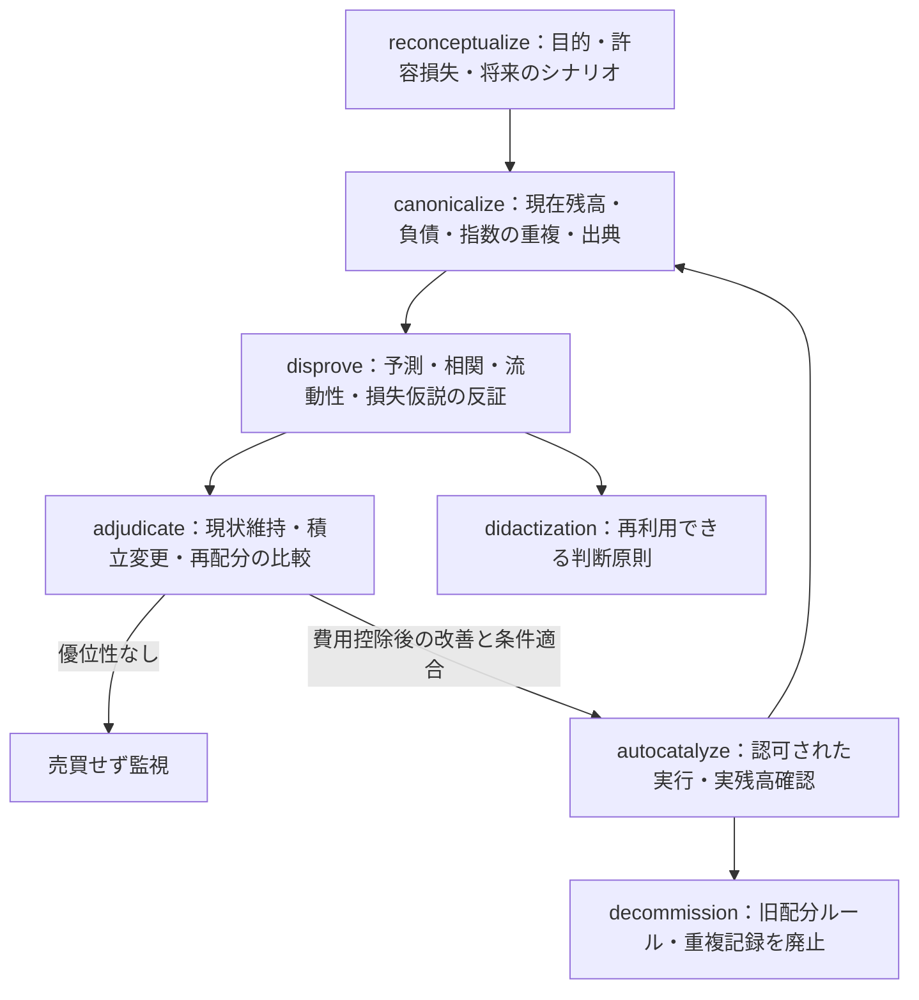

# 金融と市場

## ファンドマネージャーの聖典

**投資戦略の正本は相場予測ではなく、目的・許容損失・全資産の実質リスク・行動規則である。** AI需要の成長、企業収益、株価、信用市場の安定を別の変数として扱う。2027年のAIバブル崩壊を前提に資産を動かすことも、好況が永続する前提で集中することもしない。予測が外れた場合にも資金需要を満たし、長期運用を続けられるかを優先する。

投資対象と制約は利用者の投資方針書で定める。個別企業のPER・成長率・ニュースを指数全体の売買根拠へ直結させない。投資行動の変更は、投資方針書（IPS）で決めた条件、現在の保有残高、投資可能資金、税・費用、代替案との比較によって決める。

### 投資戦略を組み立てる原典

| 役割 | 一次資料 | 適用する判断 |
| --- | --- | --- |
| 目的と制約 | [CFA Institute・Basics of Portfolio Planning and Construction（2026）](https://www.cfainstitute.org/insights/professional-learning/refresher-readings/2026/basics-of-portfolio-planning-and-construction) | 目的、期間、最大許容損失、流動性、税・法的制約、資金需要をIPSにまとめる。 |
| 全体最適 | [CFA Institute・Total Portfolio Approach（2026）](https://rpc.cfainstitute.org/research/reports/2026/total-portfolio-approach) | 商品や資産区分ごとの局所最適ではなく、全資産の収益・リスク・流動性への寄与で判断する。 |
| 配分の根拠 | [CFA Institute・Principles of Asset Allocation（2026）](https://www.cfainstitute.org/insights/professional-learning/refresher-readings/2026/principles-asset-allocation) | 負債・支出予定に対する配分を複数シナリオで比べ、戦略配分と実装の点検頻度を分ける。 |
| 商品を超えたリスク | [MSCI・Total-Portfolio Approach: Framework in Practice（2026-11-12）](https://www.msci.com/research-and-insights/paper/total-portfolio-approach-framework-in-practice) | 銘柄数・商品名ではなく、共通株式要因、金利、信用、為替、流動性、レバレッジで重複を可視化する。 |
| 期待収益の推定 | [AQR・Ilmanen『Expected Returns』（2011）](https://www.aqr.com/insights/research/book/expected-returns-an-investors-guide-to-harvesting-market-rewards) | 過去の高収益を将来の期待値とせず、評価水準・利回り・リスク要因・推定誤差を分ける。 |
| 継続可能な運用 | [Vanguard・Four Principles for Investment Success](https://corporate.vanguard.com/content/corporatesite/us/en/corp/about-our-funds/how-we-invest/principles-for-investing-success.html) | 目的、分散、低コスト、規律を優先する。新規資金と許容乖離に基づく再配分を基本とし、相場の気分で頻繁に売買しない。 |
| 実績の評価 | [CFA Institute・Portfolio Performance Evaluation（2026）](https://www.cfainstitute.org/insights/professional-learning/refresher-readings/2026/portfolio-performance-evaluation) | 実口座の損益、ベンチマーク、配分寄与、売買・税・信託報酬を分け、バックテストを実績と呼ばない。 |

### 信用膨張・AI設備投資を読む原典

| 役割 | 一次資料 | 適用する判断 |
| --- | --- | --- |
| 金融不安定性 | [Hyman Minsky・The Financial Instability Hypothesis（1992）](https://www.levyinstitute.org/pubs/wp74.pdf) | 好況期に金融構造が脆弱化し得る。支払能力、借換え依存、資産売却が連鎖する条件を検証する。 |
| 循環取引 | [BIS Bulletin 137・Circular relationships among AI firms（2026）](https://www.bis.org/publications/bulletin-137-circular-relationships-among-ai-firms) | AI関連企業間の投資・供給・売上の重なりを調べ、資金移転と最終需要を区別する。 |
| 信用の構造 | [BIS Bulletin 140・Building AI on credit（2026）](https://www.bis.org/publications/bulletin-140-building-ai-credit--structures-and-spillovers) | 長期借入、証券化、簿外の約束、信用補完、銀行・債券市場への波及を追う。 |
| 金融安定性 | [ECB・The debt financing of AI and its implications for financial stability（2026-11）](https://www.ecb.europa.eu/press/financial-stability-publications/fsr/focus/2026/html/ecb.fsrbox202611_03~4fd1449eaa.en.html) | 設備投資と営業キャッシュフローの差、契約債務、信用格付け、循環的な収益見込みを確認する。 |

### 正本にするデータと、正本にしない数字

`canonicalize` は証券会社の最新残高、現預金・借入、取得単価、口座区分、NISA枠、生活資金、保有指数の組入れと実質エクスポージャーを、評価日・通貨・取得元付きで統一する。指数の中身は [MSCI Index Methodology](https://www.msci.com/indexes/index-resources/index-methodology) と [S&P U.S. Indices Methodology](https://www.spglobal.com/spdji/en/methodology/article/sp-us-indices-methodology/) を原則として原典で確認する。

同じ企業がS&P500、全世界株、NASDAQ100、Top10集中指数に含まれていても、別の分散先と数えない。株式100%相当＋金100%相当の複合商品は、口数や純資産比率だけでなく、株式と金の**各100%相当の感応度**を別々に計上する。為替、先物の費用、取引条件、相関の変化も考慮する。

過去の保有状況、再構成ポートフォリオ、将来の崩壊確率、PER、政策金利予測は、取得日時と出典を持つ**観測値・推定値・シナリオ**として保存する。過去の比率やバックキャストの高いリターンを将来の目標配分として固定しない。予測市場の価格やSNSの発言を、現実の破綻確率や売買指示へ昇格させない。

### 予測から行動規則へ移す

1. **目的を決める。** 生活防衛資金、支出通貨と予定、運用期間、強制売却なく耐えられる損失を先に確定する。未確定の許容損失を、一般論の「最適配分」で埋めない。
2. **現状を測る。** 全商品の重複、株式・金・債券・信用・為替の感応度、レバレッジ、流動性、税区分を全資産で計算する。資産割合と損失への寄与を別に表示する。
3. **代替案を比較する。** 現状維持、今後の積立先だけを変更、必要な一部再配分の順で、長期期待収益、悲観時の支出通貨建て損失、資金不足、税・費用を同じ条件で比べる。予測への依存が強い「最適解」より、前提が変わっても機能する案を選ぶ。
4. **シナリオを先に決める。** AI投資の成功、AI需要成長下での株価下落、設備投資縮小、信用収縮を区別する。各シナリオで「何を観測し、配分・許容損失・生活資金のどれを再評価するか」を定め、結果が出る前の値動きだけで断定しない。
5. **実行と検証を分ける。** 新規資金による乖離縮小を優先し、売却が必要な場合だけ税・NISA・費用を試算する。事前に定めた許容乖離と定期レビューで見直す。売買後に同じ全資産指標と実残高を再計算する。

### AI信用リスクの監視と判断の境界

営業キャッシュフローと設備投資の差、借入の満期と借換え費用、債券・プライベートクレジットのスプレッド、簿外契約、設備稼働率、顧客の最終需要を監視する。これらは危機の**伝播経路**を調べる指標であり、一つの指標悪化だけで特定時期の崩壊と判断する規則ではない。市場の暴落時にも、生活資金の不足と資産配分の乖離を別々に判断する。

`reconceptualize` は「何が上がるか」から「どうすれば全資産と生活計画が破綻しないか」へ問題を再設定する。`disprove` はAI需要、収益化、金融逼迫、価格への織込みを独立に反証する。`adjudicate` は現状維持を含む候補の改善が税・費用控除後にも残るか比較する。`autocatalyze` は認可された実行と結果の読み戻しを担う。`didactization` は将来も使える原則だけを残し、`decommission` は旧戦略の重複・相反する売買規則を退役させる。

[正本の統一](../skills/canonicalize/SKILL.md) · [反証](../skills/disprove/SKILL.md) · [採否](../skills/adjudicate/SKILL.md) · [自律実行](../skills/autocatalyze/SKILL.md)
