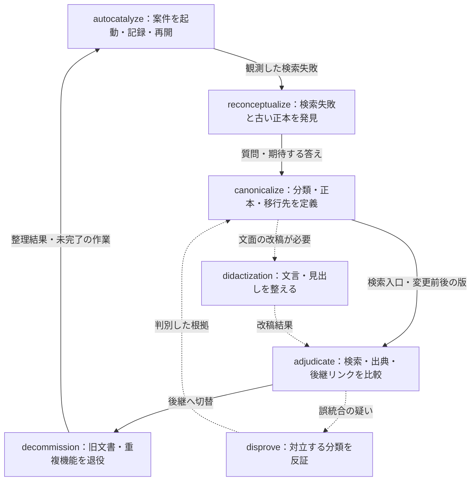

# 知識とObsidian

## ノートの管理

Obsidianでは、このリポジトリのルートを保管庫として開く。文書と見出しは相対Markdownリンクで結ぶ。ファイル名や見出しを変更したら参照元も更新し、GitHubとObsidianで開けるかを確かめる。GitHub用に空白をハイフンにした見出しリンクがObsidianで開けない場合は、対象の文書を開いてアウトラインから見出しを選ぶ。

管理するMarkdownにはYAML frontmatterを置く。README、記事、スキル、規約、メモに共通して、`type` に文書の種別、`description` に用途を示す日本語の説明、`tags` に空でない検索用リストを書く。OKFの目次と変更ログには下の予約ファイル規則を使う。`aliases` は別名で探す文書に使う。同じキーの型は保管庫内でそろえる。設定ファイルの用途とタグは[作業規約](../AGENTS.md)に記録する。

タグは小文字とハイフンを使い、階層は `/` で区切る。YAMLでは `kafstyler/canon` と書く。Obsidianでは `[type:reference] tag:#kafstyler/canon` で種別とタグを組み合わせて検索する。

[保管庫](#obsidianの保管庫)・[内部リンク](#obsidianの内部リンク)・[プロパティ](#obsidianのプロパティ)・[タグ](#obsidianのタグ)・[検索](#obsidianの検索)・[データ設計](../skills/canonicalize/SKILL.md)・[文書監査と移行](#文書監査と移行)

### Open Knowledge Format (OKF) v0.3

[Google Cloud・OKF v0.3の発表](https://cloud.google.com/blog/products/data-analytics/introducing-okf-v0-3)（2026年11月18日公開）。2026年11月19日に[公式リポジトリ](https://github.com/open-knowledge-format/open-knowledge-format)の[仕様](https://github.com/open-knowledge-format/open-knowledge-format/blob/main/SPEC.md)、[プラグインの導入手順](https://github.com/open-knowledge-format/open-knowledge-format#agent-skills)、[生成スキル](https://github.com/open-knowledge-format/open-knowledge-format/blob/main/skills/okf-generate/SKILL.md)と[バリデータ](https://github.com/open-knowledge-format/open-knowledge-format/blob/main/skills/okf-generate/scripts/validate.py)、[読み取りスキル](https://github.com/open-knowledge-format/open-knowledge-format/blob/main/skills/okf-consume/SKILL.md)と[検索スクリプト](https://github.com/open-knowledge-format/open-knowledge-format/blob/main/skills/okf-consume/scripts/scan.py)を確認した。

- OKFで知識として扱う文書には、frontmatterに空でない文字列の `type` を付ける。frontmatterや `type` を持たないMarkdownは読み取り時に対象外になる。Kafstylerの検索に必要な追加項目は[ノートの管理](#ノートの管理)を参照する。既存の項目と型を保ち、独自の項目を新設するときは `x-kafstyler-` で始める。[^okf-v03-spec]
- まとまりとして交換する文書群は、ルートの `index.md` に `okf_version: "0.3"` を置く。サブディレクトリの `index.md` と、各階層の `log.md` にはfrontmatterを置かない。文書やファイルは標準のMarkdownリンクで結ぶ。相対パスは参照元のディレクトリ、先頭が `/` のパスは文書群のルートを基準にする。空白は `%20` と書く。[^okf-v03-spec]

[^okf-v03-spec]: OKF v0.3公式仕様、第3〜6節と第8〜9節。

[文書のメタデータを整える](../skills/canonicalize/SKILL.md)・[公式OKFスキルを使う](../skills/canonicalize/SKILL.md#公式okfスキルを使う)

### 文書監査と移行

文書の分類・検索・統廃合は、読者や後続のAIが**必要な問いに正しい正本と出典から答え、古い版を誤って採用しない**ことを目的とする。最初に実際の検索質問と参照元を選び、既存のMarkdown・frontmatter・索引で解決できるか調べる。ノート数・分類数・プラグイン数を成果とせず、同じ質問で変更前後を比較する。役割の異なる文書を同じ分類へ強制せず、同じ役割の重複は整理する。

| 一次資料 | 文書管理での判断 |
| --- | --- |
| [Diátaxis・Diátaxis as a guide to work](https://diataxis.fr/how-to-use-diataxis/)（設計原典） | 読者が学習・作業・参照・理解のどれを求めているかを確認し、既存文書を少しずつ改善する。分類先の空フォルダを先に量産しない。 |
| [Stanford・Noy / McGuinness「Ontology Development 101」](https://protege.stanford.edu/publications/ontology_development/ontology101-noy-mcguinness.html)（オントロジー設計原著） | 型・階層・関係を増やす前に、知識から答えるべき質問（competency questions）を決める。分類と識別子が実データの問いに答えられるか検証する。 |
| [W3C・SKOS Reference](https://www.w3.org/TR/skos-reference/)（語彙の標準仕様） | 正規名、別名、上位・下位概念を区別する。異なる対象を表記だけで統合せず、同じ対象の表記ゆれを検索可能にする。RDFへの全面移行は目的としない。 |
| [Obsidian・Bases](https://obsidian.md/help/bases)（標準機能の仕様） | Markdownのプロパティの一覧・絞り込み・編集は標準機能から試し、Dataviewや別の表示用台帳と役割を比較する。 |
| [GOV.UK・Transition content to GOV.UK](https://www.gov.uk/guidance/govuk-transition-guidance-for-agencies#audit-your-content)（移行ガイド） | 利用状況・参照元・古さ・重複と旧URLを棚卸しし、移行先と保存先を定める。 |
| [GOV.UK・Retire outdated content](https://guidance.publishing.service.gov.uk/writing-to-gov-uk-standards/plan-manage-content/retire-content/)（公開文書の運用基準） | 旧版を更新・統合・退役するとき、元URLから後継を見つけられるか、検索に旧版が混ざらないかを確かめる。 |
| [Zenn・Zenn CLIで記事・本を管理する方法](https://zenn.dev/zenn/articles/zenn-cli-guide)（公開先の仕様） | Zennへ出す場合だけ、記事種別・ファイル名・公開用メタデータとリポジトリの正本を照合する。 |

各判断・実行手順は [reconceptualize](../skills/reconceptualize/SKILL.md)、[canonicalize](../skills/canonicalize/SKILL.md)、[adjudicate](../skills/adjudicate/SKILL.md)、[decommission](../skills/decommission/SKILL.md)、[autocatalyze](../skills/autocatalyze/SKILL.md) に置く。改稿時は [didactization](../skills/didactization/SKILL.md)、重大な誤統合の検証には [disprove](../skills/disprove/SKILL.md) を使う。

### 互換を残さない移行

新しい正本へ切り替える移行では、廃止する旧契約を明示し、旧形式の読み書き・別名・二重ジョブを無期限に維持しない。必要なデータと出典を移してから、後継へ切り替えて旧経路を削除する。公開URLの退役判断は[文書監査と移行](#文書監査と移行)に統合する。

| 一次資料 | 移行での判断 |
| --- | --- |
| [Semantic Versioning 2.0.0](https://semver.org/spec/v2.0.0.html)（公開APIの版規則） | 公開APIを宣言しSemVerで版管理している場合、非互換の変更をMAJOR更新として伝える。単なる内部文書の変更を機械的にMAJORとしない。 |
| [Git・git-rm](https://git-scm.com/docs/git-rm)（公式操作） | 廃止すると確定した追跡ファイルをリポジトリと作業ツリーから外し、過去の変更はGit履歴で確認する。 |

[破壊的移行の共通規約](../AGENTS.md#破壊的移行と旧方式の廃止) · [正本の移行](../skills/canonicalize/SKILL.md#正本の移行と旧版の整理) · [旧経路の廃止](../skills/decommission/SKILL.md) · [移行の実行](../skills/autocatalyze/SKILL.md#破壊的移行の実行)

## データ・オントロジー・命名

### 産業オントロジー

[Industrial Ontologies Foundry・IOF Ontology Portal](https://spec.industrialontologies.org/portal/)（公式ポータル）。産業分野の共通概念と関係

[データ設計](../skills/canonicalize/SKILL.md)

### Foundryのオントロジー

[Palantir Foundry・Ontology](https://www.palantir.com/docs/foundry/ontology/overview/)（公式ドキュメント）。業務で扱うオブジェクト、関係、操作

[データ設計](../skills/canonicalize/SKILL.md)

### Foundryのデータ来歴

[Palantir Foundry・Data Lineage](https://www.palantir.com/docs/foundry/data-lineage/overview/)（公式ドキュメント）。データの出所と派生先の追跡

[データ設計](../skills/canonicalize/SKILL.md)

### スタースキーマ

[Microsoft Learn・スター・スキーマ](https://learn.microsoft.com/en-us/power-bi/guidance/star-schema)（公式ガイド）。ファクトとディメンションの設計

[データ設計](../skills/canonicalize/SKILL.md)

### ファクトの粒度

[Kimball Group・ファクトの粒度](https://www.kimballgroup.com/data-warehouse-business-intelligence-resources/kimball-techniques/dimensional-modeling-techniques/grain/)（設計原典）。ファクトの1行が何を表すかの定義

[データ設計](../skills/canonicalize/SKILL.md)

### 来歴の標準

[W3C・PROV-O 来歴の標準](https://www.w3.org/TR/prov-o/)（標準仕様）。根拠となる実体、活動、主体の関係

[データ設計](../skills/canonicalize/SKILL.md)

### データカタログの標準

[W3C・DCAT 3 データカタログの標準](https://www.w3.org/TR/vocab-dcat-3/)（標準仕様）。データセットと配布物の記述

[データ設計](../skills/canonicalize/SKILL.md)

### dbtの概要

[dbt Developer Hub・dbtの概要](https://docs.getdbt.com/docs/introduction)（公式ドキュメント）。変換モデルの構成

[データ設計](../skills/canonicalize/SKILL.md)

### dbtのソース

[dbt・ソースと来歴](https://docs.getdbt.com/docs/build/sources)と[`ref()`](https://docs.getdbt.com/reference/dbt-jinja-functions/ref)（公式ドキュメント）。入力データを宣言し、モデル間の依存を記述する。

[データ設計](../skills/canonicalize/SKILL.md)

### 命名規則

[Microsoft・General Naming Conventions](https://learn.microsoft.com/en-us/dotnet/standard/design-guidelines/general-naming-conventions)（公式ガイド）。.NETの指針から、意味が伝わる語を選び、よく知られた略語だけを使う原則を採用する。

[データ設計](../skills/canonicalize/SKILL.md) · [自律開発](../skills/autocatalyze/SKILL.md)

## Obsidian

### Obsidianのプロパティ

[Obsidian・Properties](https://obsidian.md/help/properties)（公式ドキュメント）。ファイル先頭のYAML、プロパティの名前と型

[データ設計](../skills/canonicalize/SKILL.md)

### Obsidianのタグ

[Obsidian・Tags](https://obsidian.md/help/tags)（公式ドキュメント）。タグのリスト、階層、検索

[データ設計](../skills/canonicalize/SKILL.md)

### Obsidianの保管庫

[Obsidian・保管庫の作成](https://obsidian.md/help/vault)（公式文書）。新しい保管庫を作るか、既存のフォルダを保管庫として開く手順。

[データ設計](../skills/canonicalize/SKILL.md)

### Obsidianの内部リンク

[Obsidian・内部リンク](https://obsidian.md/help/links)（公式文書）。リンク先にファイルや見出しを指定するときの書式。

[データ設計](../skills/canonicalize/SKILL.md)

### Obsidianの検索

[Obsidian・Search](https://obsidian.md/help/Plugins/Search#Search%20properties)（公式文書）。プロパティの値とタグで検索し、想定した文書が結果に出ることを確かめる。

[台帳とObsidian Vaultで文書を整理する](../skills/canonicalize/SKILL.md#台帳とobsidian-vaultで文書を整理する)

### Obsidianコミュニティプラグインの選定

[Obsidian公式のコミュニティプラグイン台帳](https://github.com/obsidianmd/obsidian-releases/blob/master/community-plugins.json)でプラグインIDと開発元を特定し、[登録・配布の仕様](https://github.com/obsidianmd/obsidian-releases#community-plugins)と[対応版の判定](https://docs.obsidian.md/Reference/Versions)に沿ってGitHub Releasesの配布物を選ぶ。[Obsidianのプラグインセキュリティ](https://obsidian.md/help/plugin-security)によれば、コミュニティプラグインはObsidianの権限を継承し、ファイルやネットワークへアクセスできる。公式ディレクトリへの登録は、個々の導入環境での動作・安全の保証ではない。

候補は利用目的ごとに公式台帳から探す。標準機能で足りる場合は追加しない。リリース名、安定版・試験版、配布manifest、プラグインID、対応する本体の版を区別する。

導入・更新では、公式台帳から開発元のGitHub Releaseへたどり、該当タグの `main.js`・`manifest.json`・提供されている `styles.css` を同じ版から `.obsidian/plugins/<plugin-id>/` に揃える。GitHubの配布アセットにSHA-256があればダウンロード物と照合し、値がなければ取得元・タグ・ローカルハッシュを記録して照合未完了と区別する。ダウンロード完了は動作確認完了ではない。

Kafstylerの正本はMarkdown、YAML frontmatter、Git履歴とする。DataviewやHomepageの表示、CalendarやPeriodic Notesの生成入口、TemplaterやLinterの自動変更は正本を補助する機能であり、特定のプラグイン一式をKafstylerの必須依存関係にはしない。必要な候補は[canonicalizeのVault移行手順](../skills/canonicalize/SKILL.md#台帳とobsidian-vaultで文書を整理する)で採否を決め、再現できない表示や重複する機能は[decommission](../skills/decommission/SKILL.md)で整理する。
